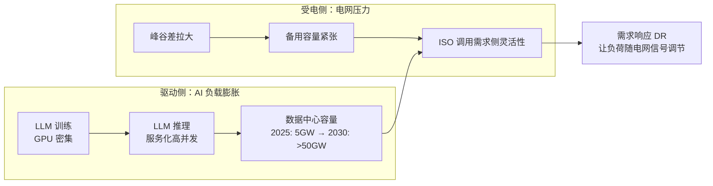
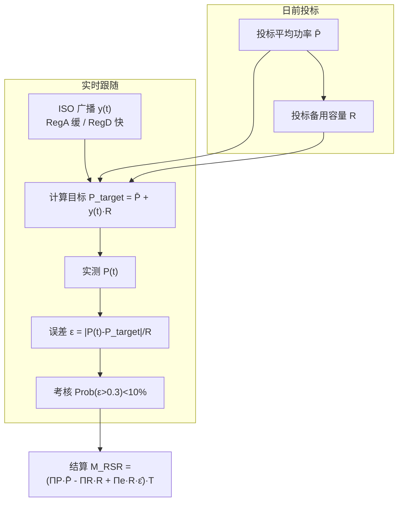
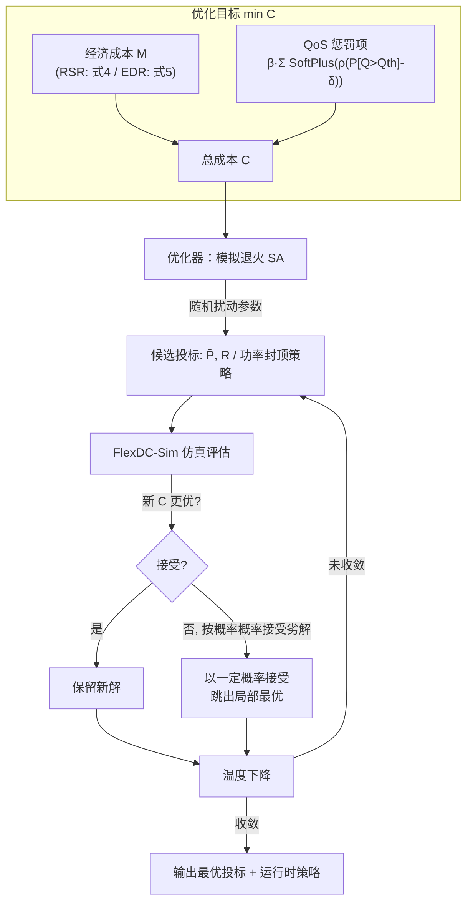
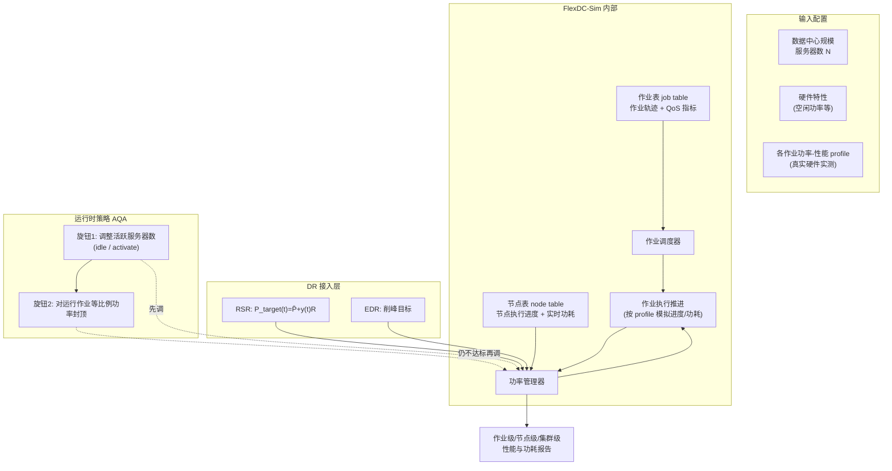
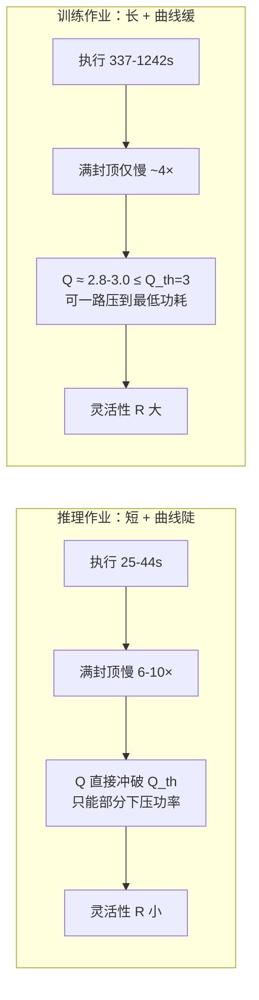
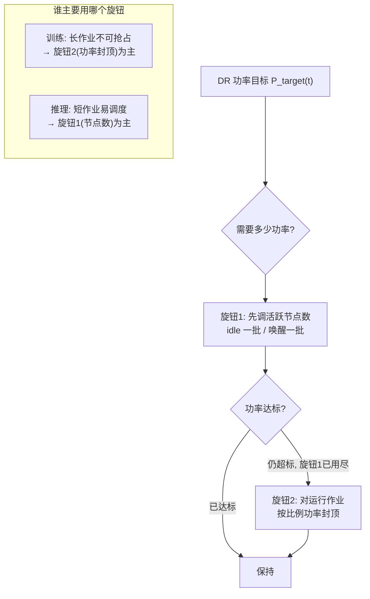
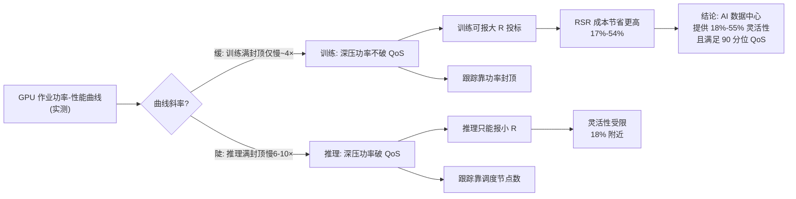

# AI 数据中心参与电网需求响应的功率灵活性研究 —— 中文学习报告

> 本报告基于论文 *Investigating Power Consumption Flexibility of AI Data Centers for Demand Response Participation*（Acun et al., E-Energy '26, Boston University）自下而上精读而成。报告不追求"摘要式概括"，而是把问题背景、两类 DR 市场的数学定义、成本/QoS 联合建模、FlexDC-Sim 模拟器、工作负载刻画与实验结论逐层拆开，落到可指导工程实践的细度。

## 报告元信息

| 项目 | 内容 |
|------|------|
| **论文标题** | Investigating Power Consumption Flexibility of AI Data Centers for Demand Response Participation（探究 AI 数据中心参与需求响应的功率消耗灵活性） |
| **作者团队** | Fatih Acun、Can Hankendi、Ethan Levine、Hudson Reynolds、Joshua Bardwick、Ayse K. Coskun |
| **所属机构** | Boston University（波士顿大学）Electrical and Computer Engineering 系，PEAC Lab |
| **发表会议** | The 17th ACM International Conference on Future and Sustainable Energy Systems（E-Energy '26），2026 年 6 月 22–25 日，加拿大 Banff |
| **文献类型** | 会议短文（5 pages），DOI: 10.1145/3744255.3798112，CC BY 4.0 开放许可 |
| **开源产出** | FlexDC-Sim 轻量数据中心 DR 模拟器：https://github.com/peaclab/flexdc-sim |
| **资助来源** | 美国国家科学基金会（NSF）DESC 计划，Award No. 2450111 |
| **研究范式** | 真实硬件功率–性能 profile（Chameleon Cloud，4×NVIDIA P100）+ 可扩展数据中心 DR 仿真优化框架 |
| **一句话主旨** | 在满足 AI 作业 QoS 的前提下，AI 数据中心能向电网提供占其平均功率 18%–55% 的调频灵活性，紧急场景下可削峰最高约 20%。 |

## 核心指标速览

| 指标 | 数值 |
|------|------|
| **RSR 调频灵活性区间（相对平均功率 P̄）** | **18% – 55%**（即备用容量 R 的投标区间） |
| **EDR 紧急削峰能力（相对基线 P_base）** | **最高约 20%** 的功率削减 |
| **EDR 能源成本节省（相对 NoDR）** | **6% – 34%** |
| **RSR 能源成本节省（相对 NoDR）** | **17% – 54%**（训练负载持续高于推理） |
| **RSR 跟踪误差约束** | Prob[ε(t) > 0.3] < 10%（90% 时间误差须低于 0.3） |
| **仿真规模** | 1,000 台服务器；节点配 4× NVIDIA P100 GPU |
| **刻画的 AI 作业** | 4 类推理（ResNet-50 / GPT-2 / Llama-7B / BLOOM-560M）+ 4 类训练，共 8 条功率–性能曲线 |
| **美国 AI 数据中心功率展望** | 2025 年达约 5 GW，2030 年预计超过 50 GW |
| **QoS 保证口径** | 每类作业 90 分位 QoS 阈值在所有投标方案下均被满足 |

---

## 1. 研究背景与问题动机

### 1.1 为什么 AI 数据中心成了电网的"大负荷"

论文开篇把问题放在一个快速膨胀的功率坐标里：数据中心是支撑越来越大 AI 工作负载（尤其是超大语言模型 LLM 的训练与推理）的关键基础设施。由于 LLM 训练与推理都极度能耗密集、且大量使用 GPU，数据中心的功率需求持续急剧上升。

> *"Recent estimates suggest U.S. AI-related data center capacity is reaching 5 GW by 2025 and exceeding 50 GW by 2030."*
>
> 近期估计显示，美国与 AI 相关的数据中心容量将在 2025 年达到约 5 GW，并在 2030 年超过 50 GW。

5 GW → 50 GW 是一个十年十倍量级的扩张。这种规模不仅是"用电多"，更关键的是其**负荷规模与功率波动模式对电网提出了异乎寻常的要求**，直接威胁电网稳定性。



### 1.2 什么是需求响应（Demand Response, DR）

为维持电网安全可靠运行，独立系统运营商（Independent System Operator, ISO）通过**需求响应（DR）**项目，号召电力用户根据不同事件和客户类型调整自己的用电。DR 的方向不是单向的"节电"：

- **削负荷**：在用电高峰时段降低功率消耗；
- **增负荷**：当发电过剩、需要吸收多余电力时，反而提高用电。

论文列举了三类典型 DR 项目：动态定价（dynamic pricing）、调频备用（Regulation Service Reserves, RSR）、紧急需求响应（Emergency Demand Response, EDR）。

### 1.3 数据中心为什么是 DR 的"优质资源"

数据中心是 DR 的强候选对象，原因有二：它们**消耗功率巨大**，并且能够通过两类手段**快速调整需求**：

1. **硬件功率封顶（hardware power capping）**：直接限制 GPU/服务器功耗上限；
2. **功率感知调度（power-aware scheduling）**：迁移/排队作业以达成功率目标。

此前研究已经用"作业迁移 + 本地发电"来调节数据中心用电，也有 QoS 感知的 DR 方法在跟随 DR 功率目标的同时约束作业性能。但论文一针见血地指出研究空白：

> *"Although data center DR is gaining attention, most studies focus on CPU-based resources; integrating GPU-based AI workloads into DR programs remains underexplored."*
>
> 尽管数据中心 DR 正受到关注，但大多数研究聚焦于基于 CPU 的资源；把基于 GPU 的 AI 工作负载纳入 DR 项目仍未被充分探索。

### 1.4 本文要回答的三个问题与贡献

本文把"真实硬件测出来的功率–性能曲线"与"可扩展的数据中心 DR 仿真框架"结合，核心贡献有三条：

| 贡献点 | 具体内容 | 对应回答的问题 |
|--------|----------|----------------|
| **EDR/RSR 灵活性演示** | 在满足 AI 工作负载 QoS 要求的前提下，证明 AI 数据中心有能力参与 EDR 与 RSR 两类真实 DR 项目 | "AI 数据中心到底能不能 flex？" |
| **区分推理 vs 训练** | 系统考察 DR 功率约束对 AI 推理作业与训练作业的不同影响 | "两类负载谁更能 flex？代价是什么？" |
| **GPU 功率–性能刻画** | 表征流行 AI 工作负载在 GPU 系统上的功率–性能行为（实测 profile） | "flex 的物理边界在哪？" |

**关键洞察**：
- 洞察 1：研究空白不在"数据中心能否 DR"，而在"GPU/AI 负载能否 DR"——CPU 时代的结论不能直接外推到 GPU，因为训练作业长、不可抢占、与短作业推理的调度弹性完全不同。
- 洞察 2：论文的方法论定位是"把经济激励（ISO 付钱）与运行约束（QoS 不退化）统一进一个优化目标"，而不是单纯做功率控制实验。
- 洞察 3：5 页短文的价值集中在"定量边界"——18%–55%、最高 20%、6%–54% 这些数字是全文的硬核产出。

---

## 2. 背景：两类真实 DR 项目的数学定义

要理解数据中心如何"投标"和"被考核"，必须先把 RSR 与 EDR 两个市场的规则翻译成公式。这是后文成本模型与优化投标的基础。

### 2.1 调频备用 RSR（Regulation Service Reserves）

RSR 用于让 ISO 在**高时间分辨率**下维持电网有功平衡。它通过向参与的需求侧资源广播"调频信号（regulation signal）"来协调供需。以 PJM 为例，调频信号分两种：

| 信号类型 | 节奏 | 适合的负荷 |
|----------|------|------------|
| **RegA（传统型 traditional）** | 变化较平缓、较慢，每 2 秒更新一次 | 爬坡敏捷性有限的负荷，可较稳地跟随平滑信号 |
| **RegD（动态型 dynamic）** | 变化快、动态性强，每 2 秒更新一次 | 能快速、精确调节功率的负荷，才能跟上 RegD |

参与 RSR 前，参与者需要在日前/小时前市场向 ISO 提交两个投标量：平均功率 $\bar{P}$ 与**备用容量 $R$**。$R$ 承诺的是"我能在平均功率 $\bar{P}$ 上下多大范围内调制自己的功率"。实时运行时，参与者必须跟随一个功率目标：

$$P_{target}(t) = \bar{P} + y(t)\, R, \quad y(t)\in[-1,1] \tag{1}$$

其中 $y(t)$ 是归一化调频信号。跟踪精度用**归一化跟踪误差**衡量：

$$\epsilon(t) = \frac{|P(t) - P_{target}(t)|}{R} \tag{2}$$

论文把跟踪约束写成**概率形式**（而非每一刻都必须命中）：

$$\text{Prob}\big[\epsilon(t) > 0.3\big] < 10\% \tag{3}$$

含义：归一化跟踪误差 $\epsilon$ 至少 90% 的时间必须保持在 0.3 以下。经济结算上，参与者因提供备用容量 $R$ 而获得激励，同时因平均跟踪误差 $\bar{\epsilon}$ 被惩罚：

$$M_{RSR} = \big(\Pi_P \bar{P} - \Pi_R R + \Pi_\epsilon R \bar{\epsilon}\big) \times T \tag{4}$$

其中 $T$ 是 RSR 持续时长，$\Pi_P, \Pi_R, \Pi_\epsilon$ 是价格系数。注意符号：$-\Pi_R R$ 表示"你报的备用容量越大，被付给你的钱越多（成本项越负）"；$+\Pi_\epsilon R \bar{\epsilon}$ 表示"跟得越差，罚得越多"。



### 2.2 紧急需求响应 EDR（Emergency Demand Response）

EDR 在需求接近或超过可用供电/输电容量时启用，目的是保电网可靠。参与者要相对一个**基线 $P_{base}$** 削减功率，并按削减量获得补偿。对数据中心而言，$P_{base}$ 被定义为"无任何功率约束下正常运行时的平均功率"。事件期间的经济成本为：

$$M_{EDR} = \big(\Pi_P \bar{P} - \Pi_I (P_{base} - \bar{P})\big) \times T \tag{5}$$

其中 $\bar{P}$ 是 EDR 事件期间数据中心的平均功率，$\Pi_I$ 是削减补偿价格系数。$(P_{base} - \bar{P})$ 就是被削减掉的功率——削减越多，补偿越多（成本项越负）。

### 2.3 RSR 与 EDR 的本质差异对比

| 维度 | RSR 调频备用 | EDR 紧急响应 |
|------|--------------|--------------|
| **触发时机** | 常态高频，持续平衡电网（每 2 秒一个信号点） | 紧急事件，短时保供（峰荷/容量紧张时） |
| **功率动作方向** | **双向**：随 $y(t)\in[-1,1]$ 在 $\bar{P}$ 上下波动 | **单向**：只要求从基线 $P_{base}$ 往下削 |
| **核心投标量** | 两个：$\bar{P}$ 与备用容量 $R$ | 一个：事件期间平均功率 $\bar{P}$（直接对应可削减量） |
| **考核方式** | 跟踪精度（概率误差门槛）+ 结算惩罚 | 削减量大小（按削减量补偿） |
| **对数据中心的能力要求** | **快速、可双向调节、爬坡敏捷**（尤其 RegD） | **短时可深度降功率**，不要求频繁上下波动 |
| **灵活性含义** | $R$ 越大越值钱，但要跟得上信号 | $(P_{base}-\bar{P})$ 越大补偿越多 |

**关键洞察**：
- 洞察 1：RSR 本质是"卖调频服务"——数据中心变成一个跟随高频信号的"虚拟储能/可调负荷"，考核的是**跟踪精度**；EDR 是"卖紧急容量"——一次性答应"出事时我能少用多少电"，考核的是**削减深度**。
- 洞察 2：RSR 里 $R$ 的投标是把"双向调节能力"货币化的关键变量，后文结果显示训练负载正是靠报出大 $R$ 赚到更多钱。
- 洞察 3：把跟踪误差写成概率约束（90% 时间 < 0.3）而非逐点硬约束，是工程上的现实选择——电网信号本身有噪声，逐点命中既不可能也无必要。

---

## 3. 建模：把"经济账"与"QoS 账"放进同一个优化

### 3.1 广义成本目标函数

论文扩展了 AQA（Adaptive Policy with QoS Assurance，Zhang et al. 2022）的成本模型。AQA 原本只面向 RSR；本文把它拓宽到同时覆盖 EDR 与 RSR。广义成本函数定义为：

$$C = M + \beta \sum_{j} \text{SoftPlus}\!\Big(\rho\big(\Pr[Q_j > Q_j^{th}] - \delta_j\big)\Big) \tag{6}$$

约束为：

$$\Pr[Q_j > Q_j^{th}] \le \delta_j, \quad \forall j\in[1,2,...,J] \tag{7}$$

逐项拆解：

| 符号 | 含义 | 工程解释 |
|------|------|----------|
| $M$ | EDR 或 RSR 项目的经济成本（式 4 或式 5） | 要尽量小（即多拿补偿、少花电费） |
| $Q_j$ | 第 $j$ 类作业的 QoS 退化程度 | 用相对执行时间慢度刻画，见式 (8) |
| $Q_j^{th}$ | 第 $j$ 类作业的 QoS 阈值 | 业务上能接受的最大退化 |
| $\Pr[Q_j>Q_j^{th}]$ | QoS 越限的概率 | 长时间尺度上"慢得不可接受"的概率 |
| $\delta_j$ | 越限概率的允许上限 | 类似 SLA 违约概率预算 |
| $\text{SoftPlus}(x)=\ln(1+e^x)$ | 软激活函数 | 平滑放大 QoS 约束被违反的程度，使优化器对违约敏感但可导 |
| $\beta$ | QoS 惩罚权重 | 经济利益与性能损失之间的权衡系数 |
| $\rho$ | 缩放系数 | 调节 SoftPlus 对违约量的敏感度 |

### 3.2 QoS 度量：相对慢度（而非绝对延迟）

论文把 $Q_j$ 定义为一个**相对指标**：

$$Q_j = \frac{T_j^{so} - T_j^{min}}{T_j^{min}} \tag{8}$$

其中 $T_j^{min}$ 是无排队、无功率封顶时第 $j$ 类作业的最短执行时间；$T_j^{so}$ 是 sojourn time（驻留时间）= 排队时间 + 执行时间之和。

这个定义非常关键：**QoS 退化是相对"理想最快速度"的倍率**，而不是绝对毫秒数。它的好处是能公平比较训练作业（本来就跑几千秒）和推理作业（几十秒）——大家都用"被拖慢了百分之多少"来衡量，而不是用绝对时间。

> *"Although training workloads may appear to have stricter QoS constraints in Table 2, they effectively have more relaxed deadlines under our relative execution-time-based QoS definition."*
>
> 尽管训练负载在表 2 中看似有更严格的 QoS 阈值，但在本文基于相对执行时间的 QoS 定义下，它们实际上拥有更宽松的截止期。

### 3.3 优化器选择：从梯度下降到模拟退火（SA）

AQA 原本提供梯度下降优化，但论文指出它有两个硬伤：梯度计算依赖**仅限 RSR 场景的解析估计**，且包含一堆对工作负载特性（功耗、QoS 阈值）敏感的经验参数。为摆脱这种敏感性并扩大适用面，本文改用**模拟退火（Simulated Annealing, SA）**：

| 对比项 | AQA 原方法：梯度下降 | 本文：模拟退火 SA |
|--------|----------------------|--------------------|
| **是否需要梯度** | 需要，且依赖 RSR 专属解析式 | 不需要梯度信息 |
| **适用场景** | 仅 RSR | 同时覆盖 RSR 与 EDR |
| **参数敏感性** | 含大量经验参数，随负载特性漂移 | 通过随机扰动探索参数空间，鲁棒性更强 |
| **搜索机制** | 沿梯度方向下降 | 随机扰动 + 温度驱动的冷却调度 |
| **收敛性** | 易陷局部最优 | 冷却调度设计得当时，理论上保证收敛到全局最优 |

SA 的核心思想：高温阶段**探索（exploration）**大范围随机试错，随"温度"下降逐渐转为**开发（exploitation）**，在当前最优点附近精修。



### 3.4 FlexDC-Sim：一个轻量、开源的数据中心 DR 模拟器

论文设计并开源了 FlexDC-Sim，用于建模和评估 DR 参与期间数据中心的运行时控制。它端到端地建模数据中心运行：作业调度、作业执行进度、功率管理，并把 DR 项目需求转换成**显式的、随时间变化的功率目标**。



设计要点：

- **两个核心数据结构**：作业表（记录作业轨迹与 QoS 指标）+ 节点表（记录节点上的作业执行进度与全程功耗）。这使得报告能下钻到作业、节点、集群三个层级。
- **功率–性能 profile 驱动**：模拟器不依赖理论公式，而是用真实硬件测出来的曲线来"重演"功率受限下的执行行为，从而准确复现执行进度。
- **通用性**：只要提供功率–性能 profile，同一框架既支持 CPU 集群，也支持 GPU 系统；用户可自定义数据中心规模、硬件特性、任意作业的 profile。
- **运行时策略可插拔**：本研究采用 AQA 的策略——先估算应保持活跃/应闲置的服务器数量，再对运行作业施加功率封顶，使集群功率对齐 DR 目标。功率封顶方法是"把所有运行中作业按各自功率区间**等比例**下压"。

---

## 4. 工作负载刻画：GPU 上的功率–性能实测

### 4.1 实测设置

为获得真实的功率–性能特性，论文做了一项**离线 profiling 研究**：每个应用在一系列功率封顶值下执行，平台是 Chameleon Cloud（裸金属访问），节点配备 **4 块 NVIDIA P100 GPU**。裸金属权限允许通过 `nvidia-smi power-limit` 接口直接对 GPU 封顶（该接口默认需要 admin 权限）。

- **推理作业**：用批处理式（batch-style）作业，在可控执行窗口内获得稳定、可重复的功耗与性能测量。
- **训练作业**：动辄跑数小时，因此只截取**足够代表性的短片段**来刻画其功率–性能行为，避免 profiling 本身代价过高。

### 4.2 功率–性能 profile 表（论文 Table 1 精读）

| 类别 | 作业类型 | $T_{min}$(s) | $T_{max}$(s) | $p_{min}$(W) | $p_{max}$(W) | 满封顶慢度比 $T_{max}/T_{min}$ |
|------|----------|-------------|-------------|-------------|-------------|-------------------------------|
| **推理** | ResNet-50 | 25 | 190 | 199 | 618 | **7.6×** |
| **推理** | GPT-2 | 28 | 180 | 198 | 732 | **6.4×** |
| **推理** | Llama-7B | 36 | 360 | 202 | 702 | **10.0×** |
| **推理** | BLOOM-560M | 44 | 386 | 202 | 698 | **8.8×** |
| **训练** | ResNet-50 | 337 | 1321 | 199 | 755 | **3.9×** |
| **训练** | GPT-2 | 1185 | 4592 | 201 | 763 | **3.9×** |
| **训练** | Llama-7B | 1242 | 4921 | 200 | 742 | **4.0×** |
| **训练** | BLOOM-560M | 1104 | 4202 | 202 | 726 | **3.8×** |

> 表中 $T_{min}/T_{max}$ 分别是在最大功率 $p_{max}$ / 最小功率 $p_{min}$ 下的执行时间。最后一列"满封顶慢度比"为学习报告据 $T_{max}/T_{min}$ 推算。

这张表藏着全文最深刻的定量对比，需要逐行解读：

| 观察维度 | 推理作业 | 训练作业 |
|----------|----------|----------|
| **执行时长量级** | 几十秒（25–44 s 最快） | 上千秒（337–1242 s 最快），训练是推理的 **30–35 倍** |
| **满功率到空功率的慢度** | 被拖慢 **6.4–10 倍** | 被拖慢仅 **3.8–4.0 倍** |
| **功率区间** | 节点功耗约 198–732 W | 节点功耗约 199–763 W，两者功率区间几乎一致 |
| **物理含义** | 短作业一旦深封顶，时间惩罚的"倍率"很大 | 长作业即使深封顶，相对慢度倍率反而温和 |

**关键洞察（定量推导，理解全文结论的钥匙）**：
- 洞察 1：代入式 (8)，把功率压到 $p_{min}$ 时的 Q 值为 $Q = (T_{max}-T_{min})/T_{min} = T_{max}/T_{min}-1$。
- 洞察 2：**训练作业恰好"贴着 QoS 阈值但不越界"**。以 $W_{train}\text{-}LU$ 轨迹为例，所有训练作业 $Q_{th}=3$，而满封顶时 $Q \approx 2.8$–$3.0$，全部 ≤ 3。也就是说——**训练作业可以一路压到最低功耗，仍满足 QoS**，这就是它们能报大备用容量 $R$ 的物理根据。
- 洞察 3：**推理作业满封顶必然越界**。以 $W_{inf}\text{-}LU$ 为例，ResNet-50 满封顶 $Q=6.6 > Q_{th}=5$；Llama-7B 满封顶 $Q=9 > Q_{th}=4$。它们**不能压到最低功耗**，可用的功率下调区间被 QoS 阈值"拦腰截断"，所以灵活性天然更小。
- 洞察 4：这解释了论文那句看似矛盾的话——"训练看似 QoS 阈值更严，实则更宽松"。严格的是阈值数字（3 vs 5），但训练作业的功率–性能曲线斜率恰好平缓（慢度比仅 4×），给 QoS 留足了余量；推理曲线斜率陡（慢度比 6–10×），余量反而被吃光。



### 4.3 五条工作负载轨迹（论文 Table 2 精读）

论文构造了 5 条作业轨迹，覆盖不同利用率、不同 QoS 阈值、混合 GPU 数：

| 轨迹 | 利用率 | GPU 数 | ResNet $Q_{th}$ | GPT-2 $Q_{th}$ | Llama $Q_{th}$ | BLOOM $Q_{th}$ | 含义 |
|------|--------|--------|-----------------|----------------|----------------|----------------|------|
| $W_{inf}\text{-}LU$ | 60% | 4 | 5 | 4.5 | 4 | 3.5 | 推理、低利用率 |
| $W_{inf}\text{-}HU$ | 80% | 4 | 5 | 5 | 5 | 5 | 推理、高利用率 |
| $W_{train}\text{-}LU$ | 60% | 4 | 3 | 3 | 3 | 3 | 训练、低利用率 |
| $W_{train}\text{-}HU$ | 80% | 4 | 4 | 4 | 4 | 4 | 训练、高利用率 |
| $W_{train}\text{-}multi$ | 70% | 4/8* | 3 | 4 | 4 | 3 | 训练、混合 GPU 规模 |

\* ResNet/Llama 作业用 4 块 GPU；GPT-2 与 BLOOM 用 8 块 GPU。

**利用率（utilization）定义**：正在跑作业的节点占全部节点的比例。作业到达服从**泊松过程**。为达到目标利用率 $\eta$，每类作业 $j$ 的到达率设为：

$$\lambda_j = \frac{\eta N}{T_j^{min}\, s_j\, J} \tag{9}$$

其中 $N$ 是服务器总数，$J$ 是作业类型总数，$s_j$ 是作业规模（该类作业单次提交占用的节点数）。生成器据此算出每类作业到达率并产出轨迹。

---

## 5. 实验结果：灵活性、经济性与跟踪行为

实验规模为 **1,000 台服务器**，对表 2 的每条轨迹分别优化。RSR 同时评估 RegA（传统）与 RegD（动态）两种信号，优化器投标平均功率 $\bar{P}$ 与备用容量 $R$。

### 5.1 功率投标（Power Bids）

| 投标量 | 规律 | 论文证据 |
|--------|------|----------|
| **平均功率 $\bar{P}$（RSR）** | 主要由**数据中心利用率**驱动：利用率越高，$\bar{P}$ 越高；**几乎不敏感于**负载是推理还是训练；RegA 与 RegD 的选择对 $\bar{P}$ 影响也微乎其微 | 图 2：各轨迹 $\bar{P}$ 投标随利用率抬升，推理/训练曲线接近 |
| **备用容量 $R$（RSR）** | **训练作业提供的灵活性显著大于推理作业**；归因于训练作业更长、更"可塑（malleable）"的执行结构 | 图 3：训练轨迹 $R$ 投标远高于推理轨迹 |
| **平均功率 $\bar{P}$（EDR）** | 高利用率数据中心必须承诺更高的 $\bar{P}$；$\bar{P}$ 直接反映相对基线 $P_{base}$ 可实现的削减量 | 图 4：$P_{base}$ 与 $\bar{P}$ 对比 |

> *"For the R bids, we observe that train workloads offer substantially greater flexibility than inference workloads. We relate this to their longer and more malleable execution structure of training jobs."*
>
> 对于备用容量 R 的投标，我们观察到训练工作负载提供的灵活性显著大于推理工作负载。我们将其归因于训练作业更长、更具可塑性的执行结构。

全文最强的实证结论是：**在所有 EDR 与 RSR 实验中，按每类作业 90 分位定义的 QoS 要求，在所提交的投标方案下均被满足**。也就是说，18%–55% 的灵活性不是以牺牲 SLA 换来的。

```mermaid
flowchart TD
    subgraph BIDS["投标决策树"]
        Q{"负载类型?"} -->|"推理(短作业)"| R1["R 投标小<br/>深封顶会破 QoS"]
        Q -->|"训练(长作业)"| R2["R 投标大<br/>可塑、深封顶仍保 QoS"]
        U{"利用率高低?"} -->|"高利用率"| P1["P̄ 投标高<br/> baseline 本身就高"]
        U -->|"低利用率"| P2["P̄ 投标低"]
        R1 --> E["综合投标<br/>1000 台服务器优化"]
        R2 --> E
        P1 --> E
        P2 --> E
        E --> CHK{"90 分位 QoS 达标?"}
        CHK -->|"是"| OK["投标有效: 18%-55% RSR 灵活性<br/>EDR 最高削 ~20%"]
```

### 5.2 能源成本节省（Energy Cost Savings）

以"NoDR（不参与 DR）"为基线，统计每条轨迹的节省百分比：

| DR 项目 | 成本节省区间 | 驱动因素 |
|---------|--------------|----------|
| **EDR** | **6% – 34%** | 直接对应从 $P_{base}$ 往下削减的幅度（图 4 的削减量越大，节省越多） |
| **RSR** | **17% – 54%** | 显著高于 EDR；两种 RSR 信号下，**训练负载因 $R$ 投标大而持续获得更高成本节省** |

> *"In the RSR program, savings are substantially higher, spanning 17% to 54%. Across both RSR signal types, training workloads consistently achieve greater cost reductions, driven by their large R bids."*
>
> 在 RSR 项目中，节省要高得多，区间为 17%–54%。在两种 RSR 信号下，训练工作负载都因其大额 R 投标而持续实现更高的成本削减。

**关键洞察**：
- 洞察 1：RSR 比 EDR 更赚钱（17%–54% vs 6%–34%），因为 RSR 是"卖持续调频服务"，补偿按时间 $T$ 累计、且与 $R$ 成正比；EDR 是"偶尔卖一次紧急容量"，频次低。
- 洞察 2："flexibility"与"钱"之间是直接映射——$R$ 投标越大，RSR 收入越高。训练负载的工程价值（可深压功率）被市场定价为更高的经济回报。

### 5.3 功率跟踪：两个控制旋钮的分工

功率跟踪靠两个**按顺序施加**的控制旋钮：

1. **旋钮 1**：调整活跃服务器数量（闲置/唤醒节点）；
2. **旋钮 2**：对正在运行的作业施加功率封顶。

结果显示，两个旋钮的**有效性与使用频率强烈依赖工作负载特性**：

| 负载类型 | 调度周转 | 能否抢占 | 主用旋钮 | 跟踪行为（图 6，传统信号 1 小时） |
|----------|----------|----------|----------|-----------------------------------|
| **训练数据中心** | 训练作业长，无法频繁调度周转 | **不支持抢占（preemption）** | **旋钮 2：功率封顶** | 前 500 秒活跃节点数基本稳定，功率下降完全来自功率封顶 |
| **推理数据中心** | 短作业，可频繁做调度决策 | 作业短、自然结束快 | **旋钮 1：调整活跃服务器数** | 通过唤醒/闲置服务器来跟随功率目标，而非深封顶 |



> *"In the training data center, the long-running nature of training jobs prevents frequent scheduling turnover. Since preemption is not supported, power capping becomes the primary mechanism to reduce power. In contrast, the inference data center executes short jobs, enabling frequent scheduling decisions, and adjusting the number of active servers becomes the main control knob."*
>
> 在训练数据中心，训练作业的长时运行特性使其无法频繁调度周转；由于不支持抢占，功率封顶成为降功率的主要机制。相反，推理数据中心执行短作业、可频繁调度，调整活跃服务器数量便成为跟随功率目标的主要控制旋钮。

---

## 6. 综合讨论：把结果串成一条因果链



| 命题 | 论文证据 | 可信度 |
|------|----------|--------|
| AI 数据中心可在保 QoS 下参与真实 DR | 两类项目、5 条轨迹、90 分位 QoS 全部达标 | 高（仿真 + 真实 profile） |
| 训练负载比推理负载更"灵活" | $R$ 投标训练 >> 推理；成本节省训练持续更高 | 高，且有定量曲线解释 |
| $\bar{P}$ 主要由利用率决定，与负载类型无关 | 图 2 推理/训练曲线接近 | 高 |
| RSR 比 EDR 经济回报更高 | 17%–54% vs 6%–34% | 高 |
| 控制旋钮分工由作业时长/可抢占性决定 | 图 6 训练节点数平稳、推理靠节点数 | 高 |

---

## 7. 工程启示与个人思考

### 7.1 对数据中心运营者（AI Infra 视角）

| 启示 | 具体可行动作 |
|------|--------------|
| **按负载构成决定 DR 报价策略** | 训练占比高的集群应积极报大 $R$ 参与 RSR（调频），把"长作业可慢"的特性变现；推理为主的集群更适合参与 EDR 或报较小 $R$，避免深封顶击穿延迟 SLA。 |
| **QoS 要用相对慢度、而非绝对延迟来设计 SLA** | 式 (8) 的相对慢度定义让训练/推理可统一考核。运营方应把 SLA 从"P99 延迟 < X ms"扩展出一条"相对理想完成时间的慢度预算"，为功率弹性预留合同空间。 |
| **两套控制旋钮要有分工默认** | 长作业/不可抢占集群默认先动"功率封顶"，短作业/弹性调度集群默认先动"节点闲置/唤醒"；颠倒顺序会导致该快时快不起来。 |
| **建立离线 profile 库是前提** | FlexDC-Sim 证明：只要有真实硬件的功率–性能曲线，就能仿真。AI Infra 团队应为每类常驻训练/推理任务常态化采集 $p$–$t$ 曲线，作为 DR 投标的数字孪生底座。 |
| **硬件能力是门槛** | GPU 直接功率封顶依赖 `nvidia-smi power-limit` 与 admin/裸金属权限。在多租户云环境里，这种细粒度封顶权限本身就是一种稀缺资源，需要在架构上预留。 |

### 7.2 对电网/市场设计侧

- RSR 的概率跟踪考核（90% 时间 $\epsilon<0.3$）给了数据中心这种"有噪声、但总量可观"的资源入场空间；RegD 对爬坡速度要求高，GPU 集群能否真正吃满 RegD（而非只跟 RegA），论文只做了边际差异分析，仍是开放问题。
- EDR 最高约 20% 的削峰，在 50 GW 级 AI 负荷上意味着 10 GW 量级的紧急可调容量——这正是电网最缺的顶峰资源。

### 7.3 方法论上的可迁移点

1. **"实测 profile + 离散事件仿真 + 无梯度优化"是一套可复用范式**：当目标函数没有干净解析式、约束又混杂经济项与概率 QoS 项时，模拟退火比梯度下降更省心、更鲁棒。
2. **把经济结算公式写进目标函数**，而不是事后算账——这让"报多少 $R$"成为优化器自然吐出的决策变量，而非人工拍脑袋。
3. **开源 FlexDC-Sim** 是论文最大的工程遗产之一：后续工作可以直接在它上面换自己的 profile 与调度策略，不必重造仿真轮子。

---

## 8. 论文局限性与可延伸方向

| 局限 | 说明 | 可延伸方向 |
|------|------|------------|
| **硬件代际偏旧** | profiling 用的是 4×NVIDIA P100（2017 代），与当下 A100/H100/B200 的功耗墙、芯片级 power capping 粒度差异巨大 | 用现代 GPU 重测 $p$–$t$ 曲线；考察芯片级（单卡）与机架级（整机柜）封顶的不同灵活性 |
| **只到 1,000 台服务器仿真** | 真实超大规模 AI 集群是数万到数十万卡，聚合效应与网络/存储功耗未建模 | 扩到万卡级，纳入网络、冷却、UPS 损耗（PUE）对灵活性的稀释 |
| **推理用批处理作业** | 论文自己承认推理用 batch-style 以获得可重复测量；真实在线推理是交互式、有 SLA 尾延迟约束的请求流 | 把交互式推理（token 级首 token 延迟、吞吐/延迟权衡）纳入 DR 模型 |
| **不支持作业抢占** | 训练数据中心无法中途暂停/迁移作业，限制了旋钮 1 的使用 | 引入可抢占训练（checkpoint/恢复）后，训练集群能否也靠调度获得灵活性？这是高价值开放问题 |
| **RegD 结论偏弱** | 论文只说 RegA/RegD 对 $\bar{P}$ 影响"边际"，但 RegD 要求每 2 秒快速双向调节，GPU 功率封顶的响应延迟是否跟得上，未做敏感性分析 | 专门做 2 秒级爬坡能力测试，回答"AI 数据中心到底能不能吃 RegD" |
| **模型/作业规模有限** | 推理最大只到 Llama-7B，训练也是中小模型；千亿 MoE 训练的显存/通信约束会改变功率–性能形态 | 扩展到 MoE、大规模分布式训练（数据/张量并行）下的灵活性 |
| **无真实市场价格** | 价格系数 $\Pi_P,\Pi_R,\Pi_\epsilon$ 取经验值，未接 PJM 真实出清价格 | 用真实市场价格重做经济测算，给出美元级收益 |

---

## 9. 一页纸总结

> *"AI workloads can provide significant demand-side flexibility, between 18% and 55% of their average power consumption, while still meeting their QoS requirements during DR participation."*
>
> 在参与 DR 期间，AI 工作负载能够提供占其平均功率 18%–55% 的显著需求侧灵活性，同时仍满足其 QoS 要求。

- **问题**：AI 数据中心（GPU）十年十倍扩功率（5 GW→50 GW），给电网带来稳定性压力；而此前 DR 研究几乎只看 CPU 集群。
- **方法**：实测 8 类 AI 作业（4 推理 + 4 训练）在 P100 上的功率–性能曲线 → 开源 FlexDC-Sim 轻量仿真器 → 用模拟退火联合优化经济成本（RSR/EDR）与概率 QoS 约束。
- **两个 DR 市场**：RSR 是双向调频（报 $\bar{P}$ 与 $R$，考核跟踪误差），EDR 是单向削峰（报相对 $P_{base}$ 的削减量）。
- **核心结论**：AI 数据中心可提供 **18%–55%** 的 RSR 灵活性、EDR 削峰最高约 **20%**；对应成本节省 RSR **17%–54%**、EDR **6%–34%**，且全部满足 90 分位 QoS。
- **最深刻的洞察**：训练负载更灵活，不是因为它 QoS 松，而是因为它的功率–性能曲线**斜率平缓**——满功率封顶也只慢约 4 倍，恰好压在 QoS 阈值内；推理曲线陡（慢 6–10 倍），深封顶必然破 SLA，所以只能报小灵活性。
- **控制哲学**：长作业不可抢占 → 靠功率封顶跟踪；短作业易调度 → 靠节点闲置/唤醒跟踪。

---

## 参考文献（节选自原文，共 19 条）

1. International Energy Agency. 2023. *Demand Response*.
2. California Public Utilities Commission. 2024. *Emergency Load Reduction Program*.
3. Chen et al. 2019. *EnergyQARE: QoS-Aware Data Center Participation in Smart Grid Regulation Service Reserve Provision*. ACM TOMPECS.
4. EPRI. 2025. *Scaling Intelligence: The Exponential Growth of AI's Power Needs*.
5. Granville, Krivanek, Rasson. 1994. *Simulated annealing: a proof of convergence*. IEEE TPAMI.
6. He et al. 2016. *Deep Residual Learning for Image Recognition*. CVPR.
7. Keahey et al. 2020. *Lessons Learned from the Chameleon Testbed*. USENIX ATC.
8. Kirkpatrick, Gelatt, Vecchi. 1983. *Optimization by Simulated Annealing*. Science.
9. Liu et al. 2013. *Data center demand response: avoiding the coincident peak via workload shifting and local generation*. SIGMETRICS.
10. McLaughlin. 2025. *Big Tech's data center boom poses new risk to US grid operators*. Reuters.
11. NYISO. 2023. *Emergency Demand Response Program (EDRP) Manual*.
12. NVIDIA. 2024. *NVIDIA System Management Interface (nvidia-smi)*.
13. PJM Interconnection. 2022. *PJM Manual 12: Balancing Operations*.
14. PJM Interconnection. 2025. *Ancillary Services*.
15. Radford et al. 2019. *Language Models are Unsupervised Multitask Learners* (GPT-2). OpenAI Blog.
16. Le Scao et al. 2022. *BLOOM: A 176B-Parameter Open-Access Multilingual Language Model*. arXiv:2211.05100.
17. Touvron et al. 2023. *LLaMA: Open and Efficient Foundation Language Models*. arXiv:2302.13971.
18. US DOE FEMP. 2025. *Demand Response and Time-Variable Pricing Programs*.
19. Zhang, Wilson, Paschalidis, Coskun. 2022. *HPC Data Center Participation in Demand Response: An Adaptive Policy With QoS Assurance*. IEEE Trans. Sustainable Computing.
