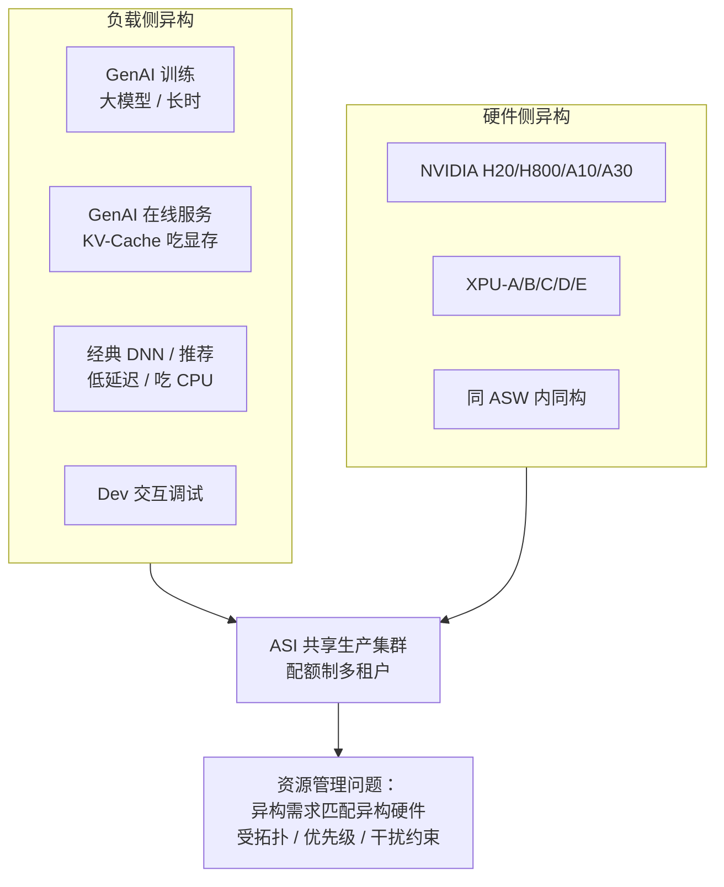
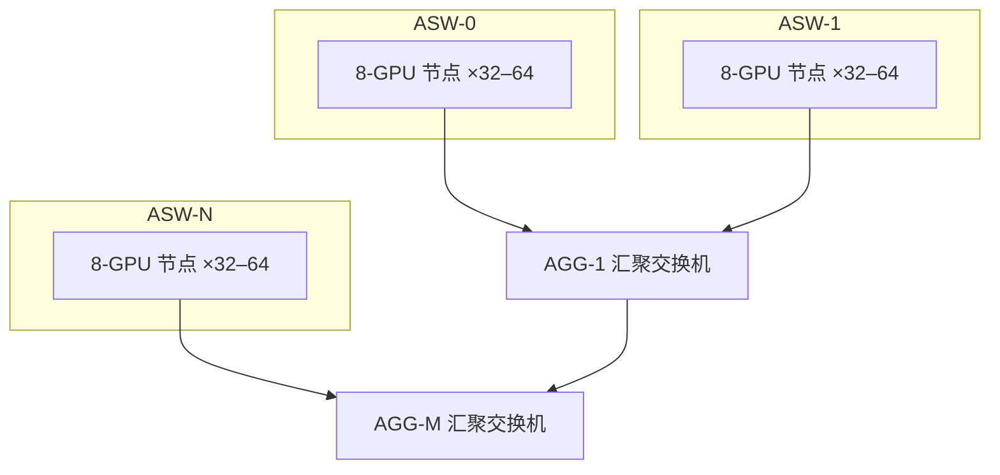
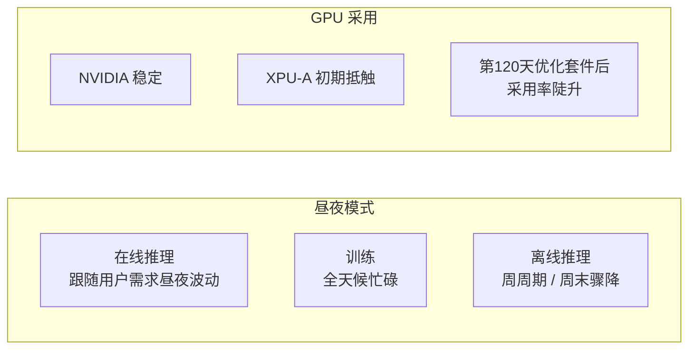
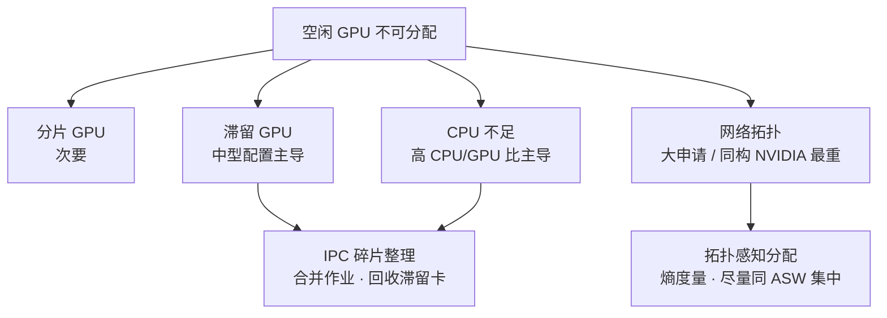
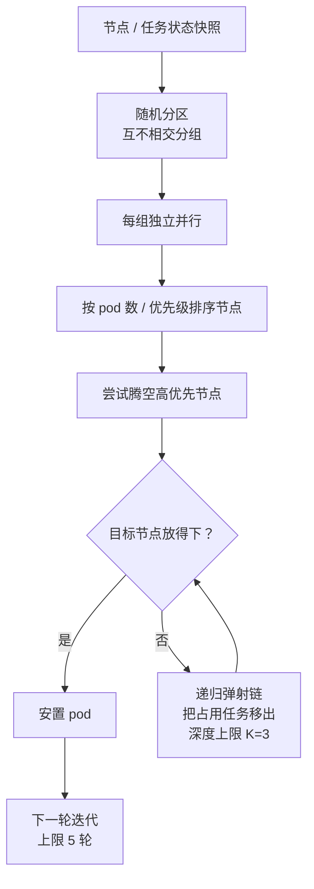
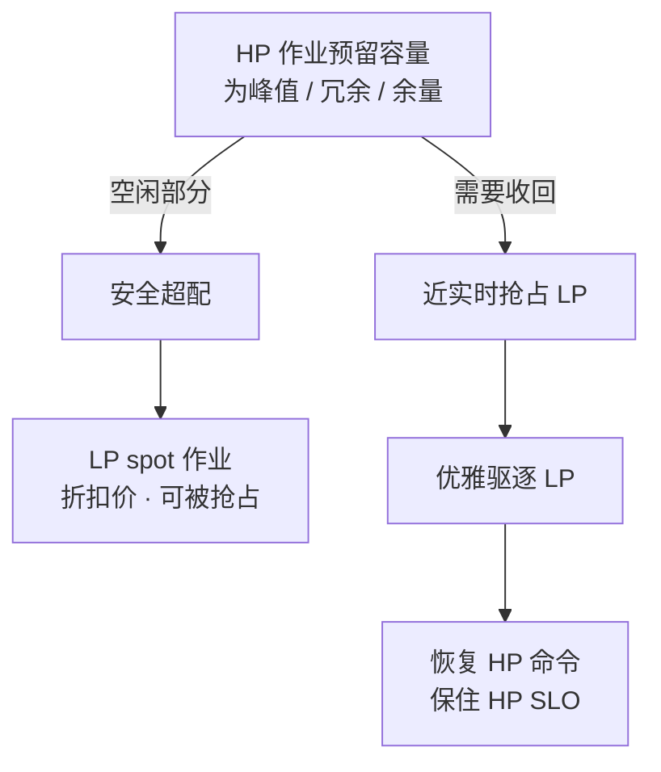
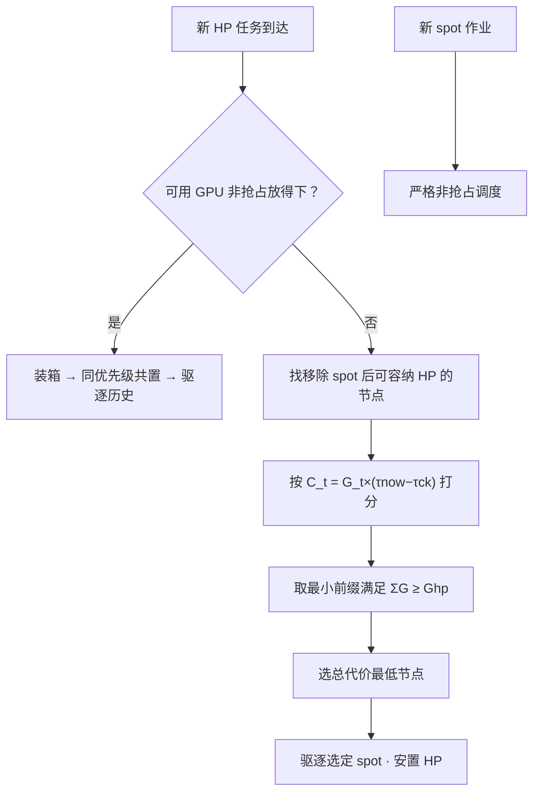
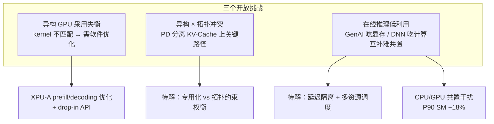

# 超大规模异构：阿里巴巴 ASI 生产集群表征与 SpotGPU 调度 —— 中文学习报告

> 本报告基于论文 *Heterogeneity at Hyperscale: Characterization and Scheduling of Large Production AI Clusters at Alibaba (Operational Systems)*（Li et al., USENIX OSDI 2026，SpotGPU / ASI）自下而上精读而成。报告不做"摘要式概括"，而是把集群与 trace 概况、负载表征、GPU 碎片与 IPC 整理、低利用率与 SpotGPU 抢占调度、开放挑战逐层拆开，落到可指导工程实践的细度，并在最后结合本项目"两机六卡"资源边界讨论可迁移性与候选问题。

## 报告元信息

| 项目 | 内容 |
|------|------|
| **论文标题** | Heterogeneity at Hyperscale: Characterization and Scheduling of Large Production AI Clusters at Alibaba (Operational Systems)（超大规模异构：阿里巴巴大型生产 AI 集群的表征与调度） |
| **作者团队** | Suyi Li、Lingyun Yang、Haoxuan Yu、Sheng Yao、Tianyuan Wu、Xiaoxiao Jiang、Hanfeng Lu、Kangjin Wang、Chenhao Wang、Shenglin Xu、Lun Wang、Qingyang Duan、Shenghao Liang、Xiu Lin、Meng Zhang、Wenchao Wu、Yinghao Yu、Guodong Yang、Liping Zhang、Wei Wang |
| **所属机构** | HKUST（香港科技大学）· Alibaba Group（阿里巴巴集团）· Fudan University（复旦大学） |
| **发表会议** | 第 20 届 USENIX 操作系统设计与实现研讨会（OSDI 2026），2026 年 7 月 13–15 日，美国西雅图；Operational Systems Paper；印刷 pp.2187–2203 |
| **文献类型** | 生产平台表征 + 已部署机制经验报告，附 trace replay 与机制对照；18 页；USENIX 开放获取 |
| **开源产出** | 脱敏 ASI trace 公开发布：https://github.com/alibaba/clusterdata/tree/master/cluster-trace-gpu-v2026 ；推理引擎 RTP-LLM：https://github.com/alibaba/rtp-llm |
| **研究范式** | 六个月生产 trace 表征（155,410 GPU、81 部门）+ 两个月 trace replay（IPC）+ 部署实测（Standby 驱逐时延、SpotGPU 分配率与完成时间） |
| **一句话主旨** | 高 GPU 需求不等于高有效利用率；ASI 用 IPC 碎片整理回收滞留容量，用 SpotGPU（Standby + 感知抢占代价的调度器）在保住 HP 可用性的前提下收割 LP 空闲容量，把分配率从 68% 提升到 93%。 |
| **对应分析包** | AN-20261105-044-v01（LS08，partial）；证据定位 LS08-E1～E7 |
| **阅读重点（清单问题）** | "紧急/不紧急"在生产中怎样定义？重点看 §3.1、§4.2 |

## 核心指标速览

| 指标 | 数值 |
|------|------|
| **trace 规模** | 155,410 张 GPU · 37,707 节点 · 14M 作业 · 81 部门 · 6 个月 |
| **GPU 分配率（仅 HP → HP+LP）** | **68% → 93%** |
| **IPC 未完全占用节点减少（两个月 replay）** | **20.2%** |
| **LP 任务完成时间（对照复合消融基线）** | **−24%**，HP 性能不受影响 |
| **LP 优雅退出时延** | 均值 **13 秒** · P95 **48 秒** · 60 秒窗口内；SIGKILL 影响 <5% |
| **Standby 峰值空闲容量** | 午夜约 **10,000 GPU·小时**；平均 **90%** Standby GPU·小时被收割 |
| **在线推理 SM 利用率中位数** | 仅 **6%**；显存利用率中位数 30% |
| **CPU 共置对 GPU 训练干扰** | CPU 主导节点 SM 利用率中位数 **−10%**、P90 **−18%** |
| **同 ASW 相对跨 ASW allreduce 带宽** | **+27%** |
| **XPU-A 优化后收益** | vLLM 延迟改善 **33% / 43%**（RPS=1 / 2）；HP 需求 **2.5×**；prefill 1.58× 加速 |
| **锁定不可迁移任务占比** | **40%** |
| **作业执行时间中位数** | **5 小时**（PAI 23 分钟、Acme 2 分钟）；调度延迟中位数 1 秒 |
| **PD 分离负载日均 GPU** | trace 期内 **1,041 → 3,841**（3.7×）；峰值每天多达 12,000 张 |

---

## 1. 研究背景与问题动机

### 1.1 生产 AI 集群不再服务单一负载

生产 AI 集群已经不再为单一类机器学习负载而建。大型生成式 AI 模型推动 GPU 需求快速增长，尤其是 LLM 与图像/视频生成；与此同时，经典 DNN 与推荐模型仍是延迟关键业务服务的核心。这些负载在模型规模、执行时长、优先级、资源形态，以及对通信与干扰的敏感性上各不相同。

> *"These workloads differ in model size, execution time, priority, resource shape, and sensitivity to communication and interference. As a result, modern production clusters must manage large GPU fleets as high-value shared infrastructure for heterogeneous workloads that are first-class citizens in production."*
>
> 这些负载在模型规模、执行时长、优先级、资源形态以及对通信与干扰的敏感性上各不相同。因此，现代生产集群必须把大型 GPU 机群作为高价值共享基础设施来管理，服务于在生产中同等重要的异构负载。

由此引出论文的核心命题：现代生产集群必须同时管理**负载异构**与**硬件异构**——经典 DNN 服务、GenAI 训练、GenAI 服务共存于跨多代际、多厂商的 GPU 机群之上。

### 1.2 核心教训：高需求 ≠ 高有效利用率

论文从 ASI 得到的中心教训是：**高需求本身并不意味着高有效利用率**。ASI 集群是一笔巨额财务投入，哪怕 1% 的利用率变化都有显著运营影响。然而空闲 GPU 仍可能不可用，原因有四：

- 空闲资源被分散到不合适的节点（滞留碎片）；
- 缺少匹配的 CPU 容量（CPU 瓶颈）；
- 违反网络局部性要求（拓扑约束）；
- 被留作对时变生产需求的防御性余量（预留闲置）。

因此主要资源管理问题不只是"把空闲 GPU 填满"，而是在拓扑、优先级与干扰约束下，把异构负载需求匹配到异构硬件。论文沿"从测量到实践"的路径展开：先刻画资源为何不可用（碎片），再描述已部署、能回收部分丢失容量的机制，最后指出仍需新系统支持的剩余挑战。

### 1.3 两条回收路径与三个开放挑战

论文把已落地的容量回收机制分为两类：

1. **诊断并缓解 GPU 碎片**：以 IPC（迭代式分区合并）做碎片整理，回收滞留 GPU、缓解 CPU 瓶颈；以熵度量做拓扑感知分配。
2. **缓解资源低利用率**：以 SpotGPU 框架收割 HP 预留但闲置的容量，分配给 LP spot 作业，同时保住 HP 可用性。

在此之外，论文明确列出三个尚未解决的开放挑战：多厂商 GPU 采用失衡、异构 GPU 间带宽瓶颈、共置负载之间的干扰。

---

## 2. ASI 集群与 Trace 概况（§2）

### 2.1 集群组织与胖树拓扑

ASI 是一个共享多租户 GPU 集群，为数十个内部部门提供基础设施服务，业务覆盖电商、广告、本地生活、物流、金融科技与内容平台。这些部门向 ASI 租用计算资源开发和部署 ML 服务，无需各自运维独立 GPU 集群。为保证分配公平，ASI 按配额分配资源：租户申请不得超过其被分配配额。自 2022 年成立以来，ASI 一直支撑这些部门的关键业务运行。

网络采用**胖树（fat-tree）**结构：8-GPU 节点接入接入交换机（ASW），各 ASW 再经汇聚交换机（AGG）互联。每个 ASW 聚合 32–64 个节点，单个 ASW 域约覆盖 256–512 张 GPU，且同一 ASW 下 GPU 同构。

**拓扑对放置的硬约束**：网络并非完全无阻塞。放在单一 ASW 内的作业可满带宽通信；跨 ASW 散布的作业要多经过交换机层级，损失有效带宽。基准显示，把所有 GPU 共置于单一 ASW 下，相比跨 ASW 放置把 allreduce 带宽提高 **27%**。这直接塑造放置决策：通信敏感作业请求 ASW 内本地分配，反过来约束调度器装箱集群的自由度。

### 2.2 负载范围：两类核心负载并存

ASI 必须同时服务两类负载：快速增长的 GenAI 模型与成熟的经典 DNN。

| 负载类别 | 典型模型 | 资源特征 | 在 trace 中的地位 |
|----------|----------|----------|-------------------|
| **GenAI 模型** | LLM、扩散式图像/视频生成（Qwen、DeepSeek、WanX、TBStars、FLUX 等） | 可申请极大资源量；重并行、重跨节点通信；KV-Cache 吃显存 | 最大单个 GenAI 作业同时使用超 2,000 张高端 GPU，消耗超 800,000 GPU·小时 |
| **经典 DNN / 推荐** | CTR 预估、推荐、OCR、BERT 等 | 高吞吐、低延迟；相对吃 CPU 与成熟稳定 | 约占在线推理 GPU·小时的 **70%** |

**范围边界**：trace 覆盖该共享集群中的大规模训练与推理，但**不含超大规模基础模型预训练**——后者通常运行在配备最前沿硬件的专用集群上。

### 2.3 Trace 字段与对比此前公开 trace

ASI 记录研究生产资源管理问题所需的元数据：作业类型、优先级、模型信息、硬件类型、利用率指标与网络拓扑——这些在此前公开 trace 中并未同时暴露。表 1 对比 ASI 与 Acme、PAI、Helios 三份此前公开 GPU 集群 trace。

| 字段 | ASI | Acme [16] | PAI [51] | Helios [15] |
|------|-----|-----------|----------|-------------|
| **年份** | 2025 | 2023 | 2020 | 2020 |
| **时长** | 6 个月 | 6 个月 | 2 个月 | 6 个月 |
| **作业数** | **14M** | 1.09M | 1.26M | 3.36M |
| **作业优先级** | 高 / 低 | — | — | — |
| **作业类型** | 训练、Dev、在线推理、离线推理 | 训练、Dev、评估 | — | — |
| **模型类型** | LLM、DM、DNN、Rec | LLM | DNN | DNN |
| **GPU 型号** | H20、H800、A10、A30、XPU-A/B/C/D/E | A100、A800、L20 | T4、P100、V100 | 1080Ti、V100 |
| **GPU 数** | **155,410** | 4,704 | 6,742 | 6,416 |
| **GPU 节点数** | **37,707** | 588 | 1,814 | 802 |

**关键洞察**：ASI 在作业规模与集群规模上比此前研究最多高出两个数量级，同时覆盖远为异构的 GPU 机群；且它是此前 trace 中**唯一带作业优先级元数据**的一份，这使得论文可以直接研究 HP/LP 分级调度策略。

### 2.4 作业、任务、实例三层结构

与此前研究类似，用户以**作业（job）**作为主要工作单元提交。每个作业由一个或多个承担不同计算角色的**任务（task）**组成；每个任务运行一个或多个**实例（instance）**，每个实例封装在一个 Kubernetes pod（一个或多个被协同调度的容器）中。ASI 用定制版 Kubernetes 管理这些 pod，允许用户指定细粒度资源申请与上限。

> *"Each job consists of one or more tasks that perform distinct computational roles, and each task runs as one or more instances, each encapsulated in a Kubernetes pod (one or more co-scheduled containers)."*
>
> 每个作业由一个或多个承担不同计算角色的任务组成；每个任务运行一个或多个实例，每个实例封装在一个 Kubernetes pod（一个或多个被协同调度的容器）中。

---

## 3. 负载表征（§3）

### 3.1 四类作业与 HP/LP 优先级定义（回应清单问题）

**清单问题**："紧急/不紧急"在生产中怎样定义？

论文的答案是：**优先级不是按"训练/推理"这种作业类型直接划分的，而是由用户声明 + 服务保证合约共同定义**。出于脱敏目的，trace 把作业粗分为高优先级（HP）与低优先级（LP）spot 作业：

- **HP 资源**：价格更高，但提供**不被抢占的有保障可用性**；
- **LP 作业**：更便宜，但**可能被 HP 作业抢占**，运行在弹性容量上。

| 作业类型 | 定义与执行特征 | 主导优先级（trace 实测） | 优先级成因 |
|----------|----------------|--------------------------|------------|
| **Dev 开发** | 交互式临时会话，用于经编码界面做模型原型验证与调试；执行时长最长 | **几乎全 HP**（99.6%） | 开发者需要稳定环境，必须避免被突然终止，以便中间状态能被 checkpoint |
| **Training 训练** | 执行迭代优化算法更新模型参数；时长从零训练数千小时到微调短周期不等 | **以 HP 为主**（94.1% HP） | 需要长期稳定分配以支撑迭代优化 |
| **Online-inference 在线推理** | 支撑面向用户或延迟关键的模型服务 | **以 HP 为主**（99.6% HP） | 延迟关键服务需要高可用性 |
| **Offline-inference 离线推理** | 批量模型推理，如模型评估、数据生成；对延迟不敏感 | **典型 LP**（98.6% LP） | 延迟不敏感，适合低优先级运行以最大化经济效益 |

**关键澄清（避免误读）**：不能把"训练 = 可随意暂停"当作默认分类。训练整体以 HP 为主；离线推理才是典型 LP。LP 的可抢占性依赖**用户自愿标记**与 LP 价格/SLO 合约支撑，不能推断所有训练任务都可抢占。

作业类型分布上，在线推理占比最大，超过负载的 50%；其余为离线推理 21.6%、训练 19.5%、Dev 3.4%、其他 1.0%。

### 3.2 模型类型与硬件专用化

在 ASI 运行的模型粗分为五类：**GenAI**（生成式 AI，含文本/图像/视频生成）、**Rec**（推荐，如 CTR 预估）、**CV**（计算机视觉，如 OCR）、**Embedding** 模型、**Dev**（开发中模型）。流行家族包括 Qwen、TBStars、WanX、DeepSeek、BERT。

| 视角 | 观察 | 含义 |
|------|------|------|
| **按作业类型看模型** | GenAI 主导训练（71%）与离线推理（98%）；在线推理主要是 Rec 模型（63%） | 大规模训练/评估/数据生成需求集中在 GenAI；面向用户服务集中在推荐 |
| **按 GPU 型号看模型** | A10、L20 等较老/中端 GPU 主要跑经典 DNN（推荐、CV）；H800 等新高端加速器几乎完全专用于 GenAI | 用户有意识地把硬件能力匹配到负载需求以控制成本，形成明显专用化 |
| **GPU 型号锁定** | 超 **99%** 作业显式锁定所需 GPU 型号（早期研究 PAI 仅 6%） | 型号约束极强，调度自由度受硬件偏好限制 |
| **同构偏好** | 绝大多数作业申请同构 GPU；使用异构 GPU 的不足 1% | 尽管学界主张异构匹配阶段画像，生产侧仍因部署复杂度与网络退化而偏好同构 |

优先级还与加速器计算能力相关：较早代际/中端加速器（A10 83% HP、L20 85% HP）以 HP 生产关键负载为主；LP 作业偏好 H800 等较新更强硬件，因为其中多数跑 GenAI，且离线推理对延迟不敏感、低优先级运行划算。

### 3.3 时间模式：昼夜、周周期与 GPU 采用曲线

**昼夜周期**：GPU 需求遵循强烈昼夜周期。训练与在线推理白天申请的 GPU 都远多于深夜。但 SM 利用率呈现更细致的图景：在线推理利用率保持昼夜变化（跟踪即时用户需求）；训练利用率则不然（长时迭代让 GPU 全天候忙碌）；离线推理呈现**周周期**，周末 SM 利用率急剧下降。

**GPU 采用曲线**：NVIDIA GPU 已部署多年、需求相对稳定。为缓解供应链约束、构建更可持续基础设施，ASI 近期引入其他厂商 XPU。用户最初不愿采用 XPU-A，因其开箱性能未达预期；约第 120 天起，随专用优化套件发布，XPU-A 采用率急剧上升（§5.1 展开）。

**任务运行时长**：Dev 任务运行最久（长生命周期交互会话）；剔除 Dev 后，在线推理与训练时长相近，都长于离线推理。按模型类型，Rec 与 CV 运行最久（以在线推理为主），GenAI （主导离线推理）时长短于 CV/Rec。总体作业执行时间中位数 **5 小时**，远长于 PAI 的 23 分钟与 Acme 的 2 分钟——归因于 ASI 混合了长时在线服务与大规模训练。调度延迟则很低：中位数仅 1 秒，HP 任务 P90 也只有 101 秒，相对其 24 小时的 P90 执行时间可忽略。

### 3.4 空间模式：申请量、分配率、共享、CPU/GPU 比、利用率

**GPU/CPU 申请量**：ASI 每个作业申请的 GPU 数明显高于更早 trace。GPU 申请中位数与均值从 PAI 的 1 与 2.6，增长到 ASI 的 2 与 11.0，以及 ASI(GenAI) 的 4 与 11.0；部分驱动来自 PAI 出现之前的 GenAI 模型。Acme（面向 LLM 训练）中位数与均值为 1 与 5.0，低值源于短时评估作业在作业数上占主导却消耗很少资源。CPU 申请呈现类似的 PAI→ASI 趋势。

**GPU 分配率（allocation ratio）**：定义为作业占用的总 GPU 容量比例，反映资源被占用的有效程度并直接影响收入。LP 作业提升所有 GPU 型号的分配率，对高端 GPU 尤其明显：集群平均从仅 HP 的 **68%** 升到 HP+LP 合计的 **93%**。

> *"As Fig. 9 shows, LP jobs raise the allocation ratio for all GPU types, and especially for high-end GPUs: the cluster average rises from 68% with HP jobs alone to 93% with HP and LP combined."*
>
> 如图 9 所示，LP 作业提升所有 GPU 型号的分配率，对高端 GPU 尤其明显：集群平均分配率从仅 HP 的 68% 升到 HP+LP 合计的 93%。

**GPU 共享罕见**：GPU 共享让申请分片 GPU（小于 1.0）的多作业复用同一设备，此前系统视其为关键效率杠杆；但在 ASI 已很少使用（§4.2 解释原因）。申请分片 GPU 的任务占比与它们申请的 GPU 总量占比，相比 PAI 都可忽略。

**CPU/GPU 比**：尽管 ML 负载在 GPU 上训练推理，大量数据处理（取数、采样等）运行在 CPU 上，CPU 可能成为瓶颈。多数任务比值适中，但有些极端——ASI GPU 服务器横跨很宽配置：8-GPU H20 服务器可能有 192 CPU 核，1-GPU A10 服务器可能有 128 核。为保证申请可行，ASI 按目标服务器型号限制每个申请的 CPU/GPU 比上限。

**任务级利用率**：Dev 任务所有指标利用率最低（临时性质）；训练任务最高（计算密集）。在线推理与离线推理主存使用相近，但 CPU 与 SM 利用率差异显著（交互式请求 vs 批处理）；在线推理显存使用也更少（主要跑标准 DNN，离线推理以 GenAI 为主）。

**节点级网络**：不同作业类型任务可共享节点，按承载任务组合分组（六种最常见组合）。仅运行训练任务的节点网络利用率最高，因为多数 ASI 训练使用依赖并行、跨节点通信密集的 GenAI 模型。

### 3.5 三个在线 LLM 服务案例研究

| 案例 | 观察 | 机制含义 |
|------|------|----------|
| **PD 分离式服务** | PD（prefill-decode）分离采用激增，日均 GPU 数 trace 期内增长 3.7 倍（1,041 → 3,841）；但用户申请同构 GPU，而非按 prefill/decode 画像配异构卡 | 用户 citing 部署复杂度与跨异构型号网络退化；异构匹配的代价在生产侧被高估 |
| **偏好较小 LLM** | 一个月 Qwen 家族在线推理中，0–30B、30–100B、100B+ 三档分别消耗 60.9%、35.0%、4.1% GPU·小时 | 用户偏好小模型：成本更低，微调后在目标域表现足够好 |
| **代表性 LLM 与 DNN 对比** | CTR/BERT/Qwen 申请 CPU 核中位数 24/8/4；Qwen SM 利用率中位数 26%，是 CTR 的 2.7 倍、BERT 的 9.6 倍 | 推荐模型更吃 CPU；LLM 相对 SM 利用率更高，但仍远未饱和 |

---

## 4. GPU 碎片：成因与 IPC 整理（§4.1）

### 4.1 碎片的四类成因

GPU 碎片把空闲 GPU 资源拆成无法整体分配以满足申请的碎块，缩减集群有效容量。此前工作识别三类成因，ASI trace 在此之外观察到第四类（网络拓扑）。

| 成因 | 定义 | 典型场景 | 在 ASI 的地位 |
|------|------|----------|---------------|
| **1) 分片 GPU 碎片** | 分片分配在单卡留下不可用残余容量，阻碍需要整卡的作业 | ResNet-152 仅 6000 万参数，0.25 GPU 申请共置单卡 | **次要**：GPU 共享罕见，贡献甚微（与图 10 左互证） |
| **2) 滞留 GPU 碎片** | 多 GPU 节点上作业未占满，剩余卡被滞留，无法满足整节点申请 | 2-GPU 任务上 8-GPU 节点，剩 6 张滞留 | **主导之一**：中型配置（4G32C～8G64C）下占主导 |
| **3) CPU 不足** | 节点能满足 GPU 申请却满足不了配套 CPU 申请，节点 CPU 耗尽导致 GPU 碎片 | 极端 CPU/GPU 比申请 | **主导之一**：高 CPU/GPU 比申请（1G8C、8G128C）下占主导 |
| **4) 网络拓扑**（新观察） | 严格拓扑要求使散落在不同交换机下的 GPU 对同一作业不合格，缩减有效资源池 | LLM 要求所有 GPU 同处一个 ASW | 对大批量同构 NVIDIA GPU 影响最严重，容量趋近零 |

图 13 按不同资源申请配置测量不可分配空闲 GPU 的构成；图 14 测量拓扑约束对 128 / 256 GPU 大申请可满足数量的影响。基线（跨 ASW）与强制 ASW 配置（ASW 内）对比显示，强制 ASW 约束显著减少可满足作业数；申请大批量同构 NVIDIA GPU 时下降尤为严重。反之，对较冷门 XPU-A 影响较温和；允许异构分配时集群为大规模申请保留更高容量——因此推广冷门 GPU 与异构 GPU 可缓解拓扑瓶颈。

### 4.2 在线生产集群做迁移整理的三大挑战

碎片整理通过迁移运行中作业、装箱到更少服务器实现。在在线生产集群执行这些迁移面临三个挑战，分别映射到 IPC 的一项设计选择：

| 挑战 | 具体约束 | IPC 对应设计 |
|------|----------|--------------|
| **决策必须快** | 新作业随时提交，动态改变资源可用性与分配；迁移与调度决策须数分钟内完成，集群规模大 | **分治**：随机分区为互不相交分组，各组作为独立子问题并行求解 |
| **须满足集群级实际约束** | 遵守既有亲和性/反亲和性规则；**40%** 任务被标记 locked（业务关键、不可移动） | **弹射链调度**：迁移中遵守亲和性、反亲和性与锁定任务约束 |
| **对用户透明** | 不能约束作业所用底层 ML 框架；不能引入任何服务停机 | **先建后拆**：先在目标节点拉起新实例，再终止旧实例，消除停机 |

### 4.3 IPC 算法：分治 + 弹射链 + 迭代

IPC（iterative partitioned consolidation）对当前节点与任务状态拍照，生成一组任务迁移决策，目标是**腾空尽可能多的节点**。

**1) 分治（Divide-and-conquer）**：把集群节点随机划分为互不相交分组，每组是独立子问题，在其中尽量腾空节点；子问题可并行执行，加速集群规模决策。

**2) 弹射链调度（Ejection chain scheduling）**：每组内按优先级与启发式（如承载 pod 数）给节点打分，优先选择更高优先级（更少 pod）、更易腾空的节点。递归构建弹射链：若目标节点容纳不下某任务，就递归地把任务移出该目标节点，直到所有 pod 安置完毕或达到递归深度上限 K；实践中 **K=3**。

**3) 迭代（Iteration）**：把分治与弹射链调度迭代运行若干轮，每轮尝试腾空节点；经验上第三轮后边际收益变小，最大轮次上限设为 **5**。

**先建后拆**：为保持迁移透明，IPC 先在目标节点拉起新实例，再终止旧实例，消除服务停机。

### 4.4 IPC 有效性与为何不用最优解

| 维度 | 数据 / 结论 |
|------|-------------|
| **在线决策速度** | 已在调度器稳定运行多年，2 分钟内给出迁移决策 |
| **整理效果** | 两个月 trace replay 中，未完全占用节点数减少 **20.2%** |
| **取代对象** | 取代早先依赖的 Kubernetes 驱逐（后者把被驱逐作业在集群内随机重分配） |
| **为何用启发式而非最优** | 在线场景最优碎片整理不切实际：优化求解代价高，最优方案可能要求大规模 pod 迁移，生产无法承受 |
| **ILP 规模证据** | 25 节点集群产生 4,000 二元变量、800 约束，Gurobi 在 16-CPU 节点约 5 分钟求最优；100 节点集群需两天；而实践中每个 IPC 分区有 500 节点 |

**证据边界**：20.2% 来自**两个月 trace replay**，不能冒充该幅度的现场生产因果测量。

### 4.5 拓扑感知分配：GPU 熵

为解决拓扑诱导碎片，ASI 部署一套分配策略，把大规模申请的 GPU 尽量合并到更少 ASW 内。这里介绍的是已部署的**单作业策略**；其最优多作业推广仍是开放挑战（§5），因此论文不报告其聚合收益数字。

**熵度量**：设某作业申请 GPU 分布在 n 个 ASW 下，$g_i$ 为各 ASW 内 GPU 数，$G$ 为总数（$G=\sum g_i$）。作业 GPU 熵定义为：

$$H = -\sum_{i=1}^{n} p_i \log p_i, \quad p_i = \frac{g_i}{G}$$

熵越高表示分布越均匀，熵越低表示集中在少数 ASW 内。分配策略力求把作业 GPU 合并到尽可能少的 ASW，因此**偏好更低熵**。

**贪心算法（算法 2）**：每轮遍历所有 ASW，计算若把该 ASW 尽可能多的 GPU 分给作业时的拓扑分布，选择产生最小熵的 ASW，分配其空闲 GPU，进入下一轮。该贪心对单作业最优；跨多作业时调度顺序很关键、问题变为组合问题。实践中按规模降序排列作业、先调度最大者；跨 ASW 迁移复用 IPC，并把网络拓扑作为实际约束加入。

---

## 5. 资源低利用率：SpotGPU 抢占调度（§4.2）

### 5.1 预留闲置：第二份丢失容量

表征揭示集群存在显著时间与空间低利用率。与用户讨论后追溯到主要原因：用户**超配** GPU 容量以吸收昼夜流量峰值、维持故障切换冗余、为峰值事件预留余量。这种防御性预留使相当一部分资源长期闲置，拉低集群整体效率。午夜前后空闲 standby 容量峰值可达 **10,000 GPU·小时**。

### 5.2 为什么 GPU 共享在 ASI 走不通（基线方案的失败）

回收低利用率资源的一条自然路径是 GPU 共享：多作业共置单卡、时分复用填满空闲周期。尽管 ASI 支持，采用率仍很低，原因有二：

| 失败原因 | 机制说明 |
|----------|----------|
| **隔离弱、相互干扰** | GPU 隔离弱于 CPU，共置作业相互干扰；即便 MPS（多进程服务）、MIG（多实例 GPU）等虚拟化机制也只提供粗粒度、不灵活切分 |
| **GenAI 显存需求过大** | 新兴 GenAI 模型为参数与中间状态（如 KV-Cache）消耗大量显存，使单卡跨作业共享不可行 |

结果：ASI 分片 GPU 申请几乎只来自经典 CV 与推荐模型（开启 MPS 预留 GPU 服务小模型）。GPU 共享只能在**单设备内**回收空闲容量；要回收跨作业、规模大得多的"已预留但闲置"容量池，必须转到**作业粒度**操作——这正是 SpotGPU 的定位。

### 5.3 SpotGPU 双目标与超配模型

SpotGPU 设计目标有二：

1. 回收已预留但闲置的 GPU 容量，重新投入生产使用，提升集群级利用率；
2. 把回收容量连同其他空闲资源，以折扣 spot 价格提供给弹性负载用户。

具体做法：SpotGPU **安全超配** HP 作业的预留容量，把由此产生的空闲容量分配给 LP spot 作业。授予 LP 的资源无保障，定价更低；当 HP 作业收回预留资源时，SpotGPU **近实时**抢占正在运行的 LP 作业。

### 5.4 Standby 机制：容器保温、主进程替换为 sleep

为在不打扰 HP 作业的前提下回收预留容量，SpotGPU 提供 **Standby** 机制，并以费用返点激励参与。用户通过 API 在选定时间窗内把 HP 任务标记为 Standby（例如更新 Kubernetes pod 标签），表明愿意临时把分配资源让给 LP spot 作业。Standby GPU·小时遵循明显昼夜模式，午夜飙升至多达 10,000 小时。

**保温而非拆除容器**：Standby 任务必须快速重启，因此 SpotGPU 不拆除其容器，而是：

- 剥离任务请求流量；
- 用 sleep 命令替换容器主服务进程；
- 保持容器保温（warm），释放 CPU 与 GPU；
- 重启时跳过代价高昂的重新调度与拉镜像步骤。

**恢复流程**：HP 任务必须恢复时，先触发共置 spot 作业的优雅驱逐，再通知 HP 任务恢复，保住 HP SLO。

### 5.5 驱逐时延分解（§4.2 实测）

驱逐分四步：

| 步骤 | 动作 | 性质 |
|------|------|------|
| (i) | 节点代理观察到 HP pod 到达本节点 | 平台侧，快速确定 |
| (ii) | 向共置 spot pod 发送 SIGTERM | 平台侧，快速确定 |
| (iii) | 容器内优雅关闭运行用户自定义逻辑，受 **60 秒**终止时限约束 | **时延主要来源** |
| (iv) | 容器退出、GPU 被回收 | 平台侧，快速确定 |

实测：平均驱逐时间 **13 秒**（P95 **48 秒**），完全在 60 秒窗口内；窗口内未退出的容器经 SIGKILL 强制终止，影响不到 **5%** 的驱逐。恢复 HP 时，SpotGPU 把原命令换回 sleep 之前状态；平均 **90%** Standby GPU·小时被成功收割。

> *"In our deployment, the average eviction time is 13 seconds (P95 of 48 seconds), well within the 60-second window; containers that do not exit within this window are forcibly terminated via SIGKILL, affecting fewer than 5% of evictions."*
>
> 在我们的部署中，平均驱逐时间 13 秒（P95 为 48 秒），完全在 60 秒窗口内；窗口内未退出的容器经 SIGKILL 强制终止，影响不到 5% 的驱逐。

**证据边界（重要）**：13 秒/48 秒是**资源驱逐阶段时延**，不是 HP 服务恢复到首个有效请求的端到端时延；论文未在所读段落给出该时延样本量或置信区间。checkpoint 之后的 GPU-time 只估计丢弃工作，不能自动表示清理、状态写出、通信初始化及首个有效结果的总时间——这三者是不同的量。

### 5.6 抢占式调度：先非抢占，必要时再抢占

对新提交作业，ASI 采用抢占式调度策略：为稳定**优先非抢占分配**；但在必须从 LP spot 作业收回资源时，计入由此产生的抢占代价。GPU 任务执行中通常会 checkpoint，被抢占任务可从最近 checkpoint 恢复而非重启。ASI 允许用户指定 checkpoint 间隔；任务抢占代价定义为**被浪费的计算量**，即自最近成功 checkpoint 以来完成的工作。

调度决策被建模为混合整数线性规划（MILP，附录 A）；由于 MILP 对在线调度难解，改用高效启发式。算法先尝试把 HP 任务非抢占式分配到可用 GPU；失败才切换到抢占模式，驱逐选定 LP spot 任务回收资源。新 spot 作业则**严格按非抢占方式调度**。

**1) 非抢占调度三准则**（依次应用，后一条解决前一条留下的并列）：

| 准则 | 排序方向 | 目的 |
|------|----------|------|
| **任务装箱** | 优先空闲 GPU 容量最少的节点 | 把任务装箱到更少节点，限制碎片 |
| **同优先级共置** | HP 放 HP 节点，spot 放 spot 专用节点 | 隔离并优先保障 HP，便于必要时抢占 spot 高效调度 |
| **驱逐历史** | 新 spot 放历史驱逐次数最低节点；新 HP 放历史驱逐次数最高节点 | 把未来抢占集中到本就波动的节点，稳定节点留给长时 spot，减少同一 spot 被反复驱逐 |

**2) 抢占调度：最小化浪费计算**。新 HP 任务无法非抢占放置时，调度器抢占 spot 任务。由于抢占打断 spot 进度，选择牺牲者使浪费计算最小：识别出移除 spot 任务后可容纳 HP 的节点，按抢占代价打分，选代价最低节点。

设 HP 任务在时刻 $\tau_{now}$ 到达、需 $G_{hp}$ 张 GPU；运行中 spot 任务 $t$ 用 $G_t$ 张 GPU、最近 checkpoint 在 $\tau_{ck}$，抢占代价为按资源用量加权的丢失工作：

$$C_t = G_t \cdot (\tau_{now} - \tau_{ck})$$

节点打分：按抢占代价升序排列其 spot 任务，取最小前缀 $\{t_1,\dots,t_k\}$ 使合计资源满足 HP 需求（$\sum G_{tj} \ge G_{hp}$），节点总代价为 $\sum C_{tj}$。所有节点打分后，HP 放到代价最低节点，驱逐该处选定 spot。对异构 GPU，$G_{hp}$ 与 $G_t$ 变为资源向量，各元素给出所需各型号数量。

### 5.7 SpotGPU 收益与对照口径

| 指标 | 数值 | 对照与边界 |
|------|------|------------|
| **平均 GPU 分配率** | **68% → 93%** | 图 9；更大比例资源投入生产使用 |
| **Standby 释放** | 用户通过 Standby 主动释放预留容量，缩短闲置周期 | 图 16；90% Standby 小时被收割 |
| **LP 任务完成时间** | **−24%**，HP 性能不受影响 | 对照基线：关闭非抢占调度中的共置与驱逐历史感知，并用随机选牺牲者取代抢占调度；该对照同时改变多个策略，不能全归因于一个 cost 公式 |
| **收益来源** | 计入抢占代价，避免丢弃 spot 接近完成的工作 | — |

**口径提醒**：分配率 93% 不是 SM 利用率，也不是有效进度或节能比例；−24% 完成时间的对照是复合消融，不能单归因于抢占代价公式。

---

## 6. 开放挑战（§5）

### 6.1 异构 GPU 采用失衡与 XPU-A 优化

**采用差距**：既要满足高端 GPU 需求、又要避免单厂商依赖，促使硬件多元化。ASI 近期集成另一厂商 XPU-A 作为主要备选，看中其大显存与有竞争力算力。但采用严重倾斜：HP 作业申请 NVIDIA GPU 与其他 XPU 远多于 XPU-A。弥合差距意义不止负载均衡——多数 XPU-A 能满足 NVIDIA GPU 常无法满足的严格拓扑要求，更广采用还能缓解 §4.1 拓扑碎片。

**失衡源于性能而非容量**：纸面上 XPU-A 在 FP16 算力上超越最接近对手 H20，提供更大显存与更高带宽（表 2）。但实践中在 GenAI 模型上不及预期：服务 DeepSeek-R1 时 XPU-A 落后 H20。剖析并与 XPU 团队讨论追溯到单一根因：**标准 kernel 实现与 XPU-A 硬件特性不匹配**。

| 规格项 | H20 | XPU-A |
|--------|-----|-------|
| 每节点 GPU 数 | 8 | 8 |
| 单卡显存 | 96 GiB | **192 GiB** |
| HBM 带宽 | 4.0 TB/s | **5.2 TB/s** |
| 卡间带宽 | 900 GB/s | 896 GB/s |
| FP16 张量核算力 | 148 TFLOPS | **203 TFLOPS** |

**两项代表性优化**（vLLM 与 RTP-LLM 上对 Qwen 家族做基准与优化）：

| 阶段 | 问题 | 优化 | 效果 |
|------|------|------|------|
| **Prefill** | 官方库 Flash Attention kernel 在因果掩码下工作分配不佳；三角计算使每 token 负载随位置线性增长；现有 kernel 沿序列长度维度把线程块映射网格、固定轮询分派到 CE，尾部 CE 成瓶颈、其余提前空闲 | 改为沿**注意力头维度**并行化 CE 分配，均衡各 CE 负载 | 64 头、4k token 序列 prefill 计算 **1.58×** 加速 |
| **Decoding** | PA 是访存受限；SplitKV 把 KV-Cache 分块在各 CU 并行；用 Triton 移植时编译器反转线程块布局，每线程子组冗余重算完整矩阵而非分工，浪费大部分算力 | 向 Triton 注入自定义编译 pass 强制正确并行；修复回馈 Triton 生态 | 配合整体优化关闭性能差距 |

**有效性**：优化集成进 RTP-LLM 后，HP 对 XPU-A 需求增长 **2.5×**；不同规模 Qwen LLM 上优化后 XPU-A 追平 H20、远优于未优化基线。vLLM 同一套基准下，相比未优化 XPU-A 在 RPS=1 / 2 时分别改善请求延迟 **33% / 43%**，超越 H20 **2% / 21%**；RPS=2 更大优势来自 XPU-A 更大显存（更大 KV-Cache、更低排队延迟）。

**编程接口**：为便于采用，优化以即插即用 API 暴露；PyTorch 中只需改动一行 import 启用优化，前端 API 保持与现有代码兼容，API 层透明处理其余适配。

**LLM 之外**：多模态模型（如 Qwen Next）与生成式图像/视频模型仍有大量挑战，其独特架构与注意力机制需要单独硬件专用调优。

### 6.2 异构与拓扑的冲突

§4.1 展示了拓扑约束如何限制 GPU 分配；这些约束也与硬件异构冲突。ASI 同一 ASW 下 GPU 同构，强制 ASW 级局部性会阻止单作业混用异构 GPU——而异构此时正成为 GenAI 优化关键。

PD 分离范式广泛用于 LLM 服务，在 ASI 每天占用多达 **12,000 张 GPU**：prefill 计算受限、偏好高性能 GPU；解码访存受限、需要高带宽。这种异构匹配更具成本效益，但把分离节点间 KV-Cache 传输放到关键路径——KV-Cache 未到则解码无法开始——使网络性能成为瓶颈。成本效益取决于在硬件专用化与拓扑约束间取得平衡；这一张力超越 LLM 服务，存在于任何构建于异构 GPU 之上的系统。

### 6.3 在线推理低利用率与共置互补性

在线推理在 ASI 占主导，运行效率却很低：聚合所有此类作业，SM 利用率中位数仅 **6%**，显存利用率中位数仅 **30%**。低整体利用率掩盖两种互补模式：

| 模式 | 显存 | SM | 特征 |
|------|------|----|------|
| **GenAI 推理** | 94% | 5% | 访存受限，耗尽显存而计算闲置 |
| **经典 DNN 推理** | 20% | 6% | 两类资源都轻量 |

两者互补：DNN 作业显存需求小，可运行在访存受限 GenAI 留下的空闲计算上，在不抢占显存前提下提高 SM 利用率。但实践中实现这种共置并不容易：GPU 共享在延迟敏感在线推理下力不从心且缺乏大规模支持；MIG 等硬件切分对动态负载过于静态；GPU 分时复用因隔离薄弱违反严格延迟 SLO。

### 6.4 CPU/GPU 共置干扰

与 Acme 类似，ASI 节点 CPU 利用率很低（中位数 31%）。ASI 通过把纯 CPU 作业与 GPU 负载共置缓解，使 **80%** 节点成为 CPU 作业主导节点（CPU 作业核使用量超过 GPU 作业）。但这种共置干扰 GPU 训练：相对 GPU 作业主导节点，CPU 作业主导节点 SM 利用率中位数与 P90 分别下降 **10%** 与 **18%**，说明朴素共置并不最优。

此前利用 GPU 节点空闲 CPU 的方法面向特定模型架构（如 LoRA 适配器），并需要高端 CPU，应用受限。弥合差距需要同时统筹 GPU 与配套资源（如 CPU）的多资源调度器，以及遏制干扰的新隔离技术。

---

## 7. 局限与相关工作（§6）

### 7.1 作者自述局限

| 局限 | 说明 |
|------|------|
| **不含基础模型预训练** | trace 不覆盖大规模基础模型预训练，后者通常运行在配备最先进 GPU 的专用集群 |
| **不细分作业子类** | 不区分各作业类型内细分类别；例如训练可能同时含监督微调与 LoRA 微调，trace 未分开 |
| **聚焦 GPU 负载** | 尽管采集了 CPU、内存、网络、GPU 利用率，篇幅所限主要聚焦 GPU，纯 CPU 作业留待未来分析 |

### 7.2 相关工作定位

负载表征长期为集群管理提供依据，但现有公开 trace 只捕捉现代生产 AI 集群场景的一部分。ServeGen 提供 LLM 服务细粒度请求级数据；ByteRobust 与 Megascale 研究上万张 NVIDIA GPU 上基础模型训练稳定性。相比之下，ASI 在单一集群内结合了异构负载、优先级、GPU 型号与拓扑约束。更早的 DNN 负载研究仍是有用参考，但依赖较老 GPU 代际，对当今集群管理问题代表性较弱。

### 7.3 分析者补充的证据边界

- **回放 ≠ 现场因果**：IPC 的 20.2% 来自两个月 trace replay，不能写成生产直接实测幅度。
- **调度对照是复合消融**：LP 完成时间 −24% 的基线同时关闭共置、驱逐历史感知并改为随机 victim，不能单归因于抢占 cost 公式。
- **代理指标边界**：checkpoint 之后 GPU-time 只估计丢弃工作，不等于清理、状态写出、通信初始化、首个有效结果的总恢复时间。
- **可让出容量的前提**：用户自愿 Standby 与 LP 价格/SLO 合约支撑可让出容量；不能推断所有训练任务可抢占，也不能把内部容量变化解释为外部电网限额。
- **未独立核验**：HP"未受影响"的完整尾延迟曲线、负载匹配与 SLO 统计未独立审计；生产 trace 有单平台代表性限制；未审计附录 MILP、调度实现与原始 trace，未独立复现。
- **伦理/数据**：正文使用聚合生产数据；未访问个人或租户原始记录，未审核更细匿名化/发布程序。

---

## 8. 工程启示（结合本项目两机六卡边界）

> 本节是分析者判断，不是论文已验证结论。本项目资源边界为两台服务器、各三张 RTX 3090，所有迁移性判断都需在该规模上重新核验，不冒充原规模完整复现。

### 8.1 可直接借鉴的概念分层

| SpotGPU 机制 | 可迁移要点 | 六卡小规模下的适配方向 |
|--------------|-----------|------------------------|
| **HP/LP 优先级由合约定义** | 优先级不等于作业类型；可抢占性依赖用户声明与服务保证 | 小规模实验可先定义"关键作业/可推迟作业"两类，并写明各自 SLO 与可否被暂停/替换 |
| **抢占代价 = 丢弃工作** | $C_t=G_t(\tau_{now}-\tau_{ck})$，按 checkpoint 年龄 × 资源量选牺牲者，避免丢弃接近完成的工作 | 六卡实验设计可记录各作业 checkpoint 进度，抢占时优先牺牲 checkpoint 后计算量小的作业；但需区分丢弃工作与恢复时延 |
| **非抢占三准则排序** | 装箱 → 同优先级共置 → 驱逐历史，逐级打破并列 | 小规模调度可复用"先装箱减碎片、再同优先级共置、按历史稳定性分配"的排序思路 |
| **Standby 保温** | 保留容器、主进程替换 sleep，重启跳过重新调度与拉镜像 | 六卡上若做弹性暂停/恢复，可记录容器/模型加载代价，把"暂停—恢复"的两段时延分开测量 |
| **四类碎片分解** | 分片/滞留/CPU 不足/拓扑；先分清是哪类瓶颈再选动作 | 六卡虽无行/ASW 级拓扑，但仍可区分：卡内碎片、节点内滞留、CPU 瓶颈；拓扑约束退化为机内 NVLink/PCIe 亲和 |
| **熵度量集中放置** | 用熵量化 GPU 在交换机间分布，偏好低熵集中 | 小规模可类比：把同作业卡尽量集中在同一机/同一 NVLink 域，减少跨机通信 |

### 8.2 规模差异下不能照搬的部分

- **千台级分配率与 replay 收益**：68%→93%、IPC −20.2%、LP −24% 都来自 155,410 GPU 生产规模与 trace replay；六卡上只能观察机制是否存在，不能据此宣称同等收益。
- **多租户配额与用户自愿 Standby**：SpotGPU 的可让出容量依赖用户 API 标记、费用返点与 LP 合约；单机实验没有这类合约主体。
- **跨 ASW 网络效应**：+27% allreduce 来自胖树多层交换机；两机之间的网络拓扑完全不同，该数字不可外推。
- **40% locked 任务**：生产中有不可移动的业务关键任务；实验作业通常都可重排，缺少这一约束维度。
- **异构厂商 kernel 优化**：XPU-A 的 CE/CU、Triton pass 优化是特定硬件工作，与 RTX 3090 无关。

### 8.3 对选题的线索提示

TAPAS 沿"放置—路由—配置"传导供电约束；SpotGPU 则在另一轴上处理**混合紧急度**：HP 有保障、LP 可抢占，抢占按 checkpoint 代价选牺牲者。对照本项目关心的"时变功率预算下不同紧急度作业的调度与恢复"，可重点核验：SpotGPU 的抢占代价只度量**丢弃工作（GPU-time）**，并未把资源释放延迟、服务恢复到首个有效结果的时间纳入同一 cost；这三类量是否需要统一建模，是可区分的机制缺口线索，需在 Mode C 与最近邻对比中继续核验，不能仅凭关键词差异声称创新。

---

## 9. 候选问题与 Mode C 待核验清单

| 编号 | 候选问题（AI 分析判断，非新颖性结论） | 支撑证据 | 状态 |
|------|----------------------------------------|----------|------|
| LS08-P1 | 在混合优先级系统中，哪些资源已分配但可暂时出借？抢占代价应按丢弃工作还是响应时延理解？ | LS08-E1～E7 | 候选，待 Mode C 核验 |
| LS08-F1 | Standby 资源可被 LP 使用，但回收时存在 13 秒均值、48 秒 P95 的用户清理；checkpoint 损失与该退出时延是两个不同量 | LS08-E1～E5 | 来源条件内现象候选，不能外推到本项目 |
| LS08-U1 | HP 恢复到第一个有效请求/稳定 SLO 的完整时间分布是什么？ | LS08-E4 | 未决问题 |
| LS08-U2 | 不同 LP 任务的 checkpoint 损失与退出清理耗时是否相关？原文现有汇总不足以判断 | LS08-E4、E5 | 未决问题 |

### 9.1 与清单阅读问题的对照

**清单问题**："紧急/不紧急"在生产中怎样定义？重点看 §3.1、§4.2。

综合 §3.1 与 §4.2，ASI 的"紧急度"由三层共同定义，而非作业类型标签：

1. **用户声明层**：用户在提交时指定 HP/LP，HP 付高价换不被抢占的保障，LP 低价接受可被抢占；
2. **服务保证层**：在线推理/Dev 因延迟关键或需稳定 checkpoint 而归 HP，离线推理因延迟不敏感而归典型 LP；训练整体以 HP 为主，不能默认可暂停；
3. **运行时让出层**：HP 用户可自愿把任务标为有期限 Standby，临时让出资源；HP 收回时先优雅驱逐 LP，再恢复 HP 命令。

"紧急"在运行时被触发的判据是 HP 资源需求到达（HP pod 上节点），此时按抢占代价最小选择 LP 牺牲者；而 LP 能否被调度进来，取决于是否存在不抢占的可行放置。

---

## 附录：关键术语对照表

| 英文 | 中文 | 说明 |
|------|------|------|
| HP (High-Priority) | 高优先级作业 | 付高价、获不被抢占的有保障资源 |
| LP (Low-Priority) | 低优先级 spot 作业 | 折扣价运行在弹性容量，可被 HP 抢占 |
| Standby | 保温待命 | HP 用户自愿在时间窗内让出资源，容器保温、主进程换 sleep |
| SpotGPU | spot GPU 调度框架 | Standby 机制 + 感知抢占代价的调度器，收割空闲容量 |
| IPC (Iterative Partitioned Consolidation) | 迭代式分区合并 | 分治 + 弹射链 + 迭代的在线 GPU 碎片整理算法 |
| Ejection chain | 弹射链 | 递归把占用任务移出目标节点以容纳新任务的迁移链，深度上限 K=3 |
| Allocation ratio | 分配率 | 作业占用总 GPU 容量比例，区别于 SM 利用率 |
| Fractional GPU | 分片 GPU | 申请小于 1.0 张 GPU 的共享使用方式，ASI 已罕见 |
| Stranded GPU | 滞留 GPU | 多 GPU 节点上未被占用、无法满足整节点申请的剩余卡 |
| ASW / AGG | 接入交换机 / 汇聚交换机 | 胖树网络两层；同 ASW 内 GPU 同构、带宽满速 |
| Preemption cost | 抢占代价 | $C_t=G_t(\tau_{now}-\tau_{ck})$，按资源量加权的 checkpoint 后丢失工作 |
| Checkpoint | 检查点 | 任务执行中保存的进度；被抢占后从最近 checkpoint 恢复 |
| MILP | 混合整数线性规划 | 抢占调度的形式化模型，在线场景难解，改用启发式 |
| PD disaggregation | Prefill-Decode 分离 | 把提示词处理与逐 token 解码拆到不同实例的服务范式 |
| KV-Cache | 键值缓存 | 注意力计算缓存的键值对；GenAI 服务显存主要消耗之一 |
| MPS / MIG | 多进程服务 / 多实例 GPU | NVIDIA 两种 GPU 共享/切分机制，隔离粗粒度 |
| GenAI / Rec / CV / Embedding | 生成式 AI / 推荐 / 计算机视觉 / 嵌入 | ASI 五类模型中的四类 |
