# DynamoLLM 精读报告：把「实例数 / 并行度 / 频率」拆成三层来省电

> 对象：Jovan Stojkovic, Chaojie Zhang, Íñigo Goiri, Josep Torrellas, Esha Choukse，*DynamoLLM: Designing LLM Inference Clusters for Performance and Energy Efficiency*，IEEE HPCA 2025，pp.1348–1362，DOI 10.1109/HPCA61900.2025.00102。UIUC 与 Microsoft Azure Research – Systems 合作。

| 项目 | 内容 |
|---|---|
| 论文 | DynamoLLM: Designing LLM Inference Clusters for Performance and Energy Efficiency |
| 发表 | IEEE HPCA 2025（第 31 届高性能计算机体系结构国际研讨会），pp.1348–1362 |
| 作者/机构 | Jovan Stojkovic、Chaojie Zhang†、Íñigo Goiri†、Josep Torrellas、Esha Choukse†；UIUC，†Microsoft Azure Research – Systems |
| 研究对象 | 面向 LLM 在线推理集群的能耗管理框架（首个该类框架） |
| 核心手段 | 请求按输入/输出长度分 9 桶 → 分池；每池三层控制器分别调实例数、张量并行度、GPU 频率 |
| 实验平台 | 单机 8×H100（DGX H100）+ Azure 生产 trace（1 小时开源 / 1 天 / 1 周） |
| 主要结论 | 能耗 −52%、运营碳排 −38%、用户成本 −61%，同时满足延迟 SLO |
| 与本项目的关系 | 六篇清单第 4 篇；回答「为什么分层控制」「预测错后怎么恢复」两个问题 |
| 阅读重点 | §III 三条洞察、§IV-B 分层节律、§IV-C 重配置开销削减、§IV-D 应急恢复 |

| 指标 | 数值 |
|---|---|
| 服务级平均能耗节省 | 52% |
| 运营碳排放下降 | 38%（CAISO 下周产 5t → 3.1t CO2） |
| 用户成本下降 | 61%（服务器数 40 → 24.6，$1362.7/小时） |
| 集群功耗 P50 / P99 | −43% / −9%（相对 SinglePool） |
| 延迟 P99 TTFT / TBT | −5.3% / −11.0% |
| 延迟 P50 TTFT / TBT | +11.4% / +7.6%（用 SLO 余量换能耗） |
| 1 小时回放能耗 | 相对 SinglePool −35% |
| 1 天真实硬件能耗 | −42%（11 台 → 动态台数） |
| 1 周仿真能耗 | Conversation −47%、Coding −56% |
| 建一个新实例 | 6–8 分钟（VM 1–2min + 分布式环境 2min + 权重 3min + 引擎 18s + 装载 15s） |
| 改并行度 | 1–2 分钟（现有系统停机卸载重载） |
| 改一次频率 | 50–80 ms，而一次 decode 迭代约 20 ms |
| 输出长度预测准确率 | 81%（BERT-base + 2 层 FC + softmax） |
| 画像预测准确率 | >98% |
| 选定池数 | 9 个（2/4/6/9/12/16 池平均需 75.1/79.6/81.3/85.7/87.1/91.2 张 GPU） |

---

## 一、这篇论文到底在解决什么

LLM 推理集群今天面临的矛盾很具体：延迟 SLO 是硬的，GPU 是贵且费电的，而这两者并非只能靠「多买卡、跑满频」来同时满足。论文开门见山地把问题拆成三层：

- **性能层**：请求有 TTFT（首 token 时间）与 TBT（token 间隔）两类延迟约束，且不同服务严格程度不同；
- **硬件层**：H100 这类功率密集 GPU 让推理集群的能耗与碳排迅速成为可观成本项；
- **调度层**：现有系统要么静态按峰值配置（大量欠利用），要么只用单一旋钮（频率或扩缩容），无法同时兼顾异构请求与波动负载。

> *"Today, LLM inference clusters receive a large number of queries with strict Service Level Objectives (SLOs). To achieve the desired performance, these models execute on power-hungry GPUs, causing inference clusters to consume large amounts of energy and, consequently, result in substantial carbon emissions."*
>
> 如今 LLM 推理集群接收大量附带严格 SLO 的查询。为达到期望性能，这些模型运行在高功耗 GPU 上，使推理集群消耗大量能源，并因此产生可观的碳排放。

作者的主张是：**能效提升的空间不在「把频率调低一点」，而在「承认请求之间根本不同，然后把不同请求放到不同形状的机器配置上」**。这句话是全篇的骨架，也是它与 TAPAS、GREEN 等邻近工作的最大分野——后两者把「功率/碳」当作外部信号来约束调度，DynamoLLM 把「能耗」当作系统内部的目标函数来配置集群形状。

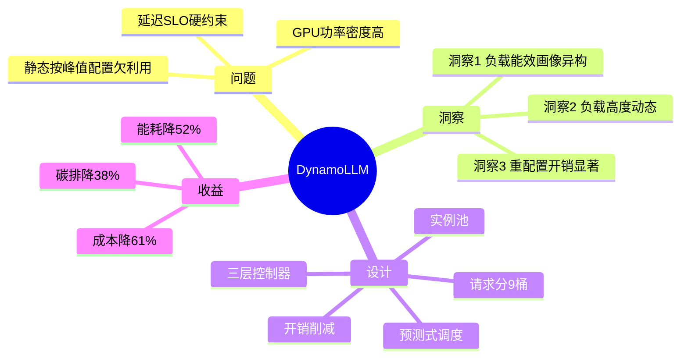

**关键洞察**：
- 论文的贡献顺序是「先证伪单一旋钮，再提出多旋钮协同」，这与多数系统论文「先给架构再给数据」的写法相反，读者要顺着 §III 的三条 Insight 才能理解 §IV 每个设计选择为什么必须存在。
- 「首个 LLM 推理能源管理框架」这一表述的边界是：它管理的是**集群组织形状**（实例数/并行度/频率），不含芯片级 DVFS 策略、不含电网侧需求响应、不含内含碳核算。

---

## 二、背景：两阶段计算决定了「什么样的请求怕什么旋钮」

要理解后面所有配置选择，必须先接受一个物理事实：LLM 推理的两个阶段对硬件的需求方向相反。

| 阶段 | 计算特征 | 随什么扩展 | 对什么敏感 | 典型耗时占比（长输出请求） |
|---|---|---|---|---|
| **Prefill（预填充）** | 输入 token **并行**过一遍前向，矩阵乘密集，算力受限 | 随**输入** token 数线性增长 | **GPU 频率**与算力并行度；降频直接拉长 TTFT | 短，通常在首 token前一次性完成 |
| **Decode（解码）** | 每步只生成 1 个 token，需反复读权重与 KV cache，**访存受限** | 随**输出** token 数线性增长 | **显存带宽与容量**；降频对 TBT 影响相对小，但 KV cache 增长会挤占显存 | 长，占总时延的绝大部分 |

这张表的工程含义非常直接：**输入长的请求（LS/LM/LL）是「算力饥饿」，降频会立刻违反 TTFT SLO；输出长的请求（SL/ML/LL）是「带宽饥饿」，在 SLO 余量内降频几乎是免费省电**。论文表 I 的热力图正是这张表的量化版本。

> *"Requests with a large number of input tokens are compute intensive and, thus, sensitive to GPU frequency. Conversely, requests with a few input tokens and many output tokens have low compute but high memory requirements; reducing their GPU frequency would save energy without significantly impacting performance."*
>
> 输入 token 多的请求计算密集，因此对 GPU 频率敏感。相反，输入 token 少而输出 token 多的请求计算量低但显存需求高；降低其 GPU 频率可在不显著影响性能的前提下省电。

并行度方面，论文只讨论张量并行（TP），理由很实际：多数开源模型能装进单机 8 卡，而 TP 在同机 NVLink 上代价最低；PP 更适合跨机，但本文的配置空间聚焦 TP2/TP4/TP8。

| 并行方式 | 切什么 | 通信模式 | 适用边界 | 本文用法 |
|---|---|---|---|---|
| **TP（张量并行）** | 每层权重切片到每卡 | 每层都要跨全部卡做 all-reduce，带宽敏感 | 同机、NVLink 互联（8 卡内） | 主配置维度，记 TP2/TP4/TP8 |
| **PP（流水并行）** | 按层切，层内张量不切 | 仅相邻 stage 间传激活 | 跨机、层数多的大模型 | 文中说明可扩展，未作为主实验维度 |

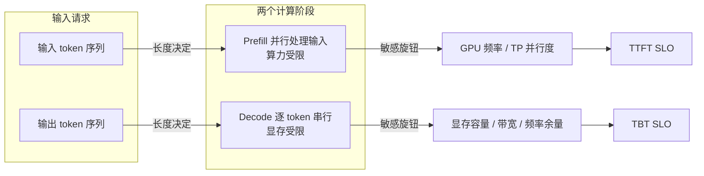

**关键洞察**：
- 「降频省电」这句话在 LLM 推理中**不是普适真理**：只对 decode 主导、且 SLO 有富余的请求成立。
- 反过来，「加卡提速」也不是普适解：当请求是 decode 主导时，加卡带来的边际收益被通信与显存带宽摊薄，反而增加空耗。
- 这两点合起来解释了为什么**必须做请求分类**，而不是全局调一个频率。

---

## 三、三条洞察：能效的机会在哪里

### 3.1 洞察一：能效画像在四个维度上异构

论文用 9 个桶（SS/SM/SL/MS/MM/ML/LS/LM/LL）把请求按输入输出长度切开，阈值取 Conversation trace 的第 33/66/100 百分位，SLO 取「无负载单请求延迟的 5 倍」。

| 维度 | 变化方式 | 观察到的差异 | 对配置的影响 |
|---|---|---|---|
| **请求长度（9 桶）** | 输入短/中/长 × 输出短/中/长 | SS 最优是 TP2@1.2GHz（0.79 Wh）；LL 只能用 TP8，最优 TP8@1.6GHz（13.21 Wh），能耗差 **16.7 倍** | 不同桶的最优并行度与频率完全不同，混跑被迫按 LL 配置 |
| **请求负载** | 650 / 2000 / 4000 TPS | 低负载最省 TP4@1.2GHz；高负载 TP2 不可行，最省 TP4@2GHz | 同一请求类型，负载变了最优配置也变 |
| **模型规模** | Llama2-13B → Falcon-180B | 13B/8x7B 可 TP2@1.2GHz（≈0.99 Wh）；8x22B/180B 只能 TP8 | 参数量大 → 对频率与并行度更敏感，被迫跑高频 |
| **SLO 松紧** | 5× vs 10× 无负载延迟 | SL 型请求 5× 下最优 TP4@1.2GHz；放宽到 10× 可用 TP2@1.6GHz | SLO 松紧直接改变可行配置集合 |

这张表的量化依据是论文表 I–III，最值得记住的两个数字是 **0.79 Wh（SS 最优）与 13.21 Wh（LL 最优）**：同一模型、同一负载档，仅因请求形状不同，能效差接近 17 倍。这也解释了为什么「把请求混在一个池里」天然不划算——系统必须按最受限的那类请求配置全部资源。

> *"Note that the lowest power configuration that meets SLOs (TP8 at 1.2 GHz), is not the energy-optimal one due to the increased execution time."*
>
> 注意，满足 SLO 的最低**功耗**配置（TP8@1.2GHz）并非**能耗**最优，因为执行时间被拉长。

这句话是全文最重要的方法论提醒：**功耗（W）与能耗（Wh）不是同一个目标**。降频降低瞬时功率，却可能拉长执行时间，使总能耗上升。任何只盯功率的调度都会掉进这个陷阱。

### 3.2 洞察二：负载高度动态，最优配置会迅速过期

论文用两类生产 trace 说明动态性的三个来源：

| 动态性来源 | 证据 | 幅度 | 后果 |
|---|---|---|---|
| **请求类型分布变化** | Conversation 输出长输入短，Coding 正相反；两者内部各类型占比都显著，热度随时间变 | 一周内类型占比此消彼长 | 固定分池会「池选对了、大小错了」 |
| **负载昼夜波动** | Conversation 峰值 = 均值 1.7×、谷值 3.3×；Coding 峰值 = 均值 2.8×、谷值 34.6× | Coding 谷值深达峰值 1/34.6 | 峰值静态配置 → 谷时大量空转 |
| **SLO 与模型多样性** | 同一实例可被多服务分时复用；同一服务可并发用多个模型 | 配置需求随「当前是谁在用」变化 | 单一全局配置无法同时满足 |

这里有个容易被忽略的推论：**池太少无法细调，池太多碎片化**。论文用 2/4/6/9/12/16 池做敏感性实验，平均需要 75.1/79.6/81.3/85.7/87.1/91.2 张 GPU——池数从 2 增到 16，GPU 需求上升 21%，但 TTFT 下降。最终选 9 池，是在「细调收益」与「碎片化成本」之间的折中。

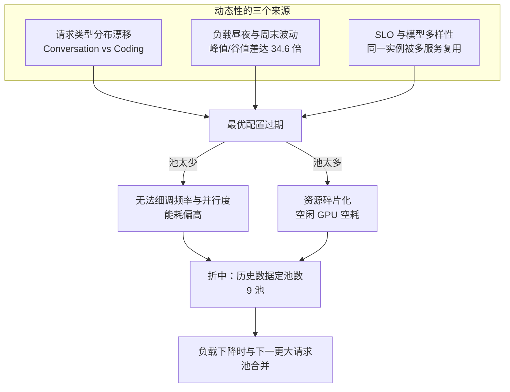

**关键洞察**：
- DynamoLLM 的分池不是「一类请求一个池」的机械映射，而是**带合并规则的弹性分池**：某类负载下降时，池会并入「服务更长请求的下一个池」，用「让邻居多吃一点」换取「不要留一个半空的池」。
- 换言之，碎片化治理不是事后整理资源，而是**把碎片预先推给唯一可能超配的那个池**（最大请求池），这是后面 §IV-B 的 floor 分配策略的来源。

### 3.3 洞察三：三类重配置都有「不可忽视」的开销

这是全文最「系统」的一节，也是它区别于纯调度论文的地方：它先量化切换成本，再设计切换方式。

| 变更对象 | 具体开销 | 量级 | 为什么不能放关键路径 | 论文的削减手段 |
|---|---|---|---|---|
| **实例数（建新实例）** | 建 VM、初始化分布式环境（Ray/MPI）、下载权重、配引擎、装载权重与 KV cache | 合计 **6–8 分钟**（VM 1–2min、分布式环境 2min、权重 3min、引擎 18s、装载 15s） | 请求到达时来不及；若同步做，尾延迟直接被拉爆 | 集群本地缓存权重 + 引擎全状态快照启 VM + 预测峰值后台预建 |
| **并行度（重切分）** | 重新切权重、搬到正确显存、引擎同步进程 | 现有系统停机卸载重载 **1–2 分钟** | 切换期实例不能服务 | 图匹配最大化权重原地不动 + NVLink 直连并发搬运 + 新旧实例并存 |
| **频率（调频）** | 调 OS、系统调用到驱动、与固件交互 | **50–80 ms**，而一次 decode 迭代仅 **20 ms** | 一次调频可让单步延迟翻倍 | nvidia-smi 常驻内存 + 控制器特权模式 |

这里最反直觉的数字是频率那一行：**调一次频率的耗时是一次 decode 迭代的 2.5–4 倍**。所以「每秒调一次频」在工程上是灾难——论文 fig4 用「每轮迭代后台重设频率」演示了吞吐显著下降。

值得注意的是论文明确否掉了 TDP 限功率路线，理由有两条：频率调节粒度更细；降 TDP 会触发更频繁的 power-capping，而 power-capping 是**反应式**的、会把频率直接压到最低，性能损失比主动调频更糟。

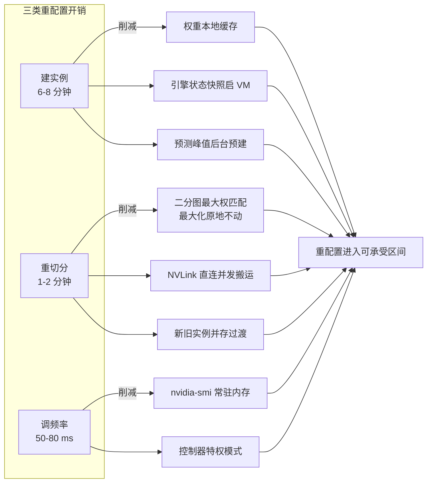

---

## 四、DynamoLLM 的设计：为什么必须分层控制

这是本文对清单问题「**实例数、并行度、频率为什么分层控制？**」的直接回答。

### 4.1 不分层会怎样：一个 MILP 就够了，但它太慢

论文把「选最优配置」写成一个 MILP：给定 GPU 数 N、总负载 L、SLO，求各并行度的实例数 N_TPi、频率 f_i、每实例负载 L_TPi，使总能耗最小。

$$\min \sum_{i}\Big(N_{TP_i}\times Energy_{TP_i,f_i}(L_{TP_i})\Big),\quad i\in\{2,4,8\}$$

约束三条：① 用掉的 GPU 数 $\sum i\times N_{TP_i}\le N$；② 分出去的负载 $\sum N_{TP_i}\times L_{TP_i}\ge L$；③ 每个实例的预测性能 $\le$ SLO。

这个模型的**解是全局最优**，但论文实测单次求解要约「数百毫秒」。这意味着：

- 若每 5 秒重算一次全局最优，控制面自身就会吃掉可观的算力与延迟预算；
- 若每 30 分钟才重算一次，则无法跟上 5 秒级的负载抖动与频率机会。

**所以分层不是为了「模块化好看」，而是因为三类旋钮的最优决策频率根本不同**：

| 层级 | 管的旋钮 | 节律 | 为什么是这个节律 | 单次决策的搜索空间 |
|---|---|---|---|---|
| **Cluster Manager** | 池数、每池实例数（扩缩容） | **30 分钟** 一个 epoch | 建实例 6–8 分钟，只能做「粗粒度、低频」决策；再快也没有物理意义 | 各请求类型的池规模分配（含碎片化取舍） |
| **Pool Manager** | 池内实例数 × 张量并行度（重切分） | **5 分钟** | 重切分 50–100 ms～1–2 s 级，可承受中等频率 | 固定 GPU 数下的 TP 组合 |
| **Instance Manager** | GPU 频率 | **5 秒** | 调频 50–80 ms，相对便宜，可跟负载抖动 | 单实例在若干频率点上的可行性筛选 |

这条推理链是：**开销决定节律，节律决定抽象层级，抽象层级决定搜索空间大小**。三者一一对应，谁也替代不了谁。论文还额外说明，因为各层通信稀疏（30 分钟 / 5 分钟 / 5 秒），这套层级**不会引入控制面开销**。

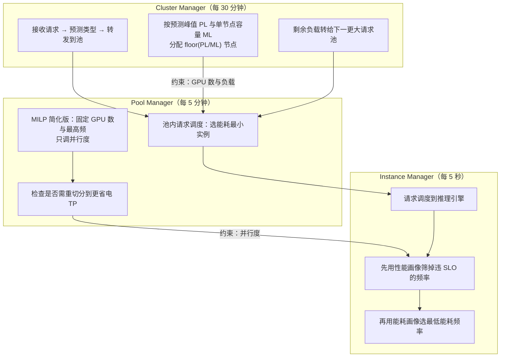

### 4.2 每层各自「只看自己的旋钮」，代价是什么

分层必然带来次优：上层在算实例数时假设「下层跑最高性能配置」（TP8@1980MHz），下层在算并行度时假设「频率固定最高」。这等于每层都预留了保守余量，因此整体不是全局最优。

论文的取舍是：**用「近似最优 + 可高频执行」换「全局最优 + 无法高频执行」**。这个取舍在评估里得到验证——DynamoLLM 相对 SinglePool 节能 35%，而单旋钮方案（ScaleFreq −19%、ScaleShard −6%、ScaleInst −2%）都明显更差；换言之，分层损失的「最优性」远小于单旋钮损失的「覆盖面」。

### 4.3 碎片化：floor 分配 + 往最大请求池推

扩缩容本身会产生碎片：若每池都按峰值 ceil 分配，各池都会多出一点空转容量。DynamoLLM 的做法是：

1. 每池按 `floor(PL/ML)` 少分一个实例；
2. 少的那部分负载，在下一个 epoch 转给「下一个更大请求类型」的池；
3. 于是只有最大请求类型的池可能超配，集群级碎片被压到最小。

这是一个很「工程」的设计：它不追求每池精确匹配，而是**把不确定性集中到一个愿意承担它的地方**。副作用是最大请求池的负载会略微偏紧，但因为它本来就要跑最重配置，多承担一点的边际成本最低。

### 4.4 预测错后怎么恢复：emergency 四步

这是清单问题「**预测错后怎样恢复？**」的答案，位于 §IV-D。DynamoLLM 的两类预测都会错：输出长度（下一步才知真值）与负载（突发不可预知）。

| 误判类型 | 直接后果 | 是否违反 SLO | 处理方式 |
|---|---|---|---|
| **高估输出长度** | 请求进入更高性能池 | 不违反，只是能耗次优 | 不干预，靠下一轮重配置自然收敛 |
| **低估输出长度** | 请求进入低性能池 | 可能违反 TBT/TTFT | 触发 emergency（四步） |
| **低估负载（突发）** | 池内资源不足以吸收 | 队列堆积 → 违约 | 触发 emergency（四步） |

emergency 的处置是**由轻到重、逐级升级**的四步：

1. **队列重排**：把即将超期的请求优先处理（不改配置，零开销）；
2. **拉满频率**：仍将违约时把该实例 GPU 频率提到最大（约 50–80ms 生效）；
3. **re-steer**：积压持续时，把尚未开始执行的请求经 Pool Manager 转到池内其他实例；
4. **squash**：以上都无效，把等待超过阈值的请求判失败，提示用户重试，由前端改投其他池或等负载平稳。

值得强调的是**第 4 步不是失败处理，而是系统的过载保护阀**：与其让所有请求一起烂掉（尾延迟全面爆表），不如牺牲少数请求保住整体 SLO。这与 SpotGPU 的「弹射链」、TAPAS 的「降级」思路同源，但 DynamoLLM 是把它放在**推理实例内部**而不是集群调度器里。

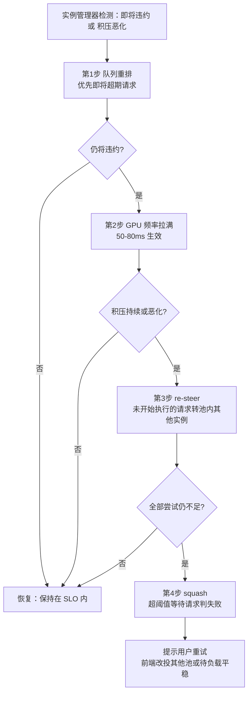

**关键洞察**：
- 这套恢复机制的关键不在「四步」，而在**触发时机**：靠「即将违约」的预测而非「已经违约」的事实，把干预提前到还能救回来的窗口。
- 高估与低估被**区别对待**，这是很务实的设计：高估只是浪费电，不值得为它付出停机代价；低估会掉 SLO，必须立刻救。这种「不对称处置」比统一回滚更省。

### 4.5 重切分：二分图最大权匹配 + NVLink 直连

重切分的核心问题是「尽量少搬权重」。论文把「当前 GPU 上的权重分布」与「目标 TP 配置」建成二分图，边权 = 需传输的数据量，然后做最大权匹配，使总传输量最小。

两个方向的开销差异很值得记：

| 方向 | 权重流向 | 老实例状态 | 耗时（Llama2-70B，300GB/s NVLink） |
|---|---|---|---|
| **小 TP → 大 TP（TP4→TP8）** | 前 4 卡各出一半给后 4 卡，4 路并发 | 只外发、内存不增，**几乎不中断** | 传 1/8 模型 ≈ **50 ms** |
| **大 TP → 小 TP（TP8→TP4）** | 两卡权重合并到一卡 | 接收方显存减少、吞吐下降 | 传 1/4 模型 ≈ **100 ms** |
| 表 VI 极值 | 视源/目标组合 | — | 最优组合 **0 开销**，最差 **4τ**（4×50ms） |

还有一层容易漏掉的成本：权重到位后，vLLM 这类引擎要同步新实例进程，耗时数百毫秒到数秒，**期间不能接负载**。DynamoLLM 的处理是让老实例在新实例同步期间继续服务，新实例上线后才下线老实例；前提是每卡上「老+新」显存之和不超过容量，否则只能先停老再建新，并把部分负载临时挪走。

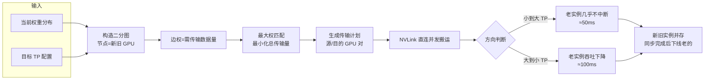

### 4.6 画像与预测：数据驱动，不要求模型结构知识

- **画像（profiling）**：按「请求长度 × TP2/TP4/TP8 × 800–1980MHz（步长 200MHz）」扫一遍，少量负载档位测到最大吞吐后插值；因为功耗对负载非线性，在相邻测点出现功耗陡升处**补采点**；平均预测准确率 >98%。
- **画像产物**：一个函数 `(负载, 请求长度, 并行度, 频率) → (能耗, TTFT, TBT)`，不需要任何模型结构先验。
- **复用**：每模型一份画像，存全局仓库，部署时缓存到集群本地，层级内共享。
- **输出长度预测**：BERT-base + 两层全连接 + softmax，取 CLS 隐状态做短/中/长三分类，用 SQuAD / WildChat-1M / OpenOrca / coding / LMSYS-Chat-1M 微调，准确率 **81%**。
- **负载预测**：基于历史周模式的模板法（轻量、可解释）。

| 预测对象 | 方法 | 准确率 | 错了会怎样 | 兜底 |
|---|---|---|---|---|
| 输出长度 | BERT 分类器（短/中/长） | 81% | 高估 → 进更强池（费电）；低估 → 进弱池（掉 SLO） | emergency 四步 |
| 请求负载 | 历史周模板 | 未单列 | 突发时池不够 | emergency 四步 + 下轮扩容 |
| 能耗/性能 | 实测画像 + interp1d | >98% | 配置评估偏差 | 保守余量（各层假设下层最高性能） |

**关键洞察**：
- 「81% 的分类准确率」在别的系统里是弱项，在这里被敏感性实验证明是可接受的：误分类率 40%（Dyn-60%）只让能耗 +25%、TTFT +12.3%。原因是系统能**快速检测并重配**，错误不会长期驻留。
- 这给读者的启示是：**在线系统的预测精度不必追求极致，只要「错得可检测、错得可纠正」**。这与离线建模追求高准确率是完全不同的工程标准。

---

## 五、评估：数字说明了什么，没说明什么

### 5.1 实验设置与对照组设计

| 系统 | 分池 | 动态实例数 | 动态并行度 | 动态频率 | 定位 |
|---|---|---|---|---|---|
| **SinglePool** | 否 | 否 | 否 | 否 | 实践基线（全跑 TP8@最高频） |
| **MultiPool** | 是（静态） | 否 | 否 | 否 | 证明「只分池」不够 |
| **ScaleInst** | 是 | 是 | 否 | 否 | 单旋钮消融（实例数） |
| **ScaleShard** | 是 | 否 | 是 | 否 | 单旋钮消融（并行度） |
| **ScaleFreq** | 是 | 否 | 否 | 是 | 单旋钮消融（频率） |
| **DynamoLLM** | 是 | 是 | 是 | 是 | 完整系统 |

这组对照的价值在于：它把「分池」与「三旋钮」拆开验证，使「为什么必须协同」有了可归因的证据，而不是只对比一个黑盒。

trace 使用三对：1 小时（开源，用于 §V-B）、1 天（自有集群生成，用于 §V-D）、1 周（用于 §V-E 仿真）。成本与碳用 1 周数据。

### 5.2 能耗与延迟：一个「方向相反」的结果

| 指标 | 相对 SinglePool | 解释 |
|---|---|---|
| 能耗（fig7） | **−35%** | 三旋钮协同；对比 ScaleFreq −19%、ScaleShard −6%、ScaleInst −2%、MultiPool **+20%** |
| P99 TTFT / TBT（fig8） | **−5.3% / −11.0%** | 分池消除队头阻塞 + 多资源池 |
| P50 TTFT / TBT | **+11.4% / +7.6%** | 在 SLO 余量内主动跑低性能模式，中位延迟变差 |
| 集群功耗 P50 / P99（fig9） | **−43% / −9%** | 平均功耗大幅下降，峰值只小幅下降 |

注意 MultiPool 能耗 **+20%**：分池本身不省电，反而因为「每池都按峰值配置、且恒跑最高性能」而更费电。这一条很重要，它说明「切分请求」只是获得调节能力的前提，**真正省电来自切分之后的差异化配置**。

延迟的方向相反（P99 改善、P50 变差）也是同一逻辑：系统把「SLO 余量」当成可支取的资源，用中位延迟换取能耗。这在工程上可接受的前提是——**用户感知的是尾延迟，而中位延迟的富余本来就存在**。

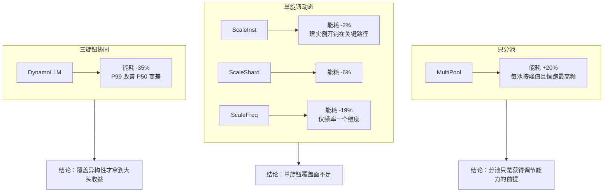

### 5.3 敏感性：三个「边界条件」

| 敏感性维度 | 实验设置 | 结果 | 边界含义 |
|---|---|---|---|
| **分类准确率**（fig12） | 人为注入误分类，Dyn-100% vs Dyn-60% | 能耗 **+25%**、TTFT **+12.3%** | 预测器不必很强；系统自愈能力是关键 |
| **负载水平**（fig13） | 泊松到达构造低/中/高负载 | 节能 **57% / 42% / 15%** | 高负载时余量耗尽，节能空间被压缩 |
| **池数量**（fig14） | 2/4/6/9/12/16 池 | 平均需 75.1/79.6/81.3/85.7/87.1/91.2 GPU | 池多则 TTFT 更好但碎片化更贵；选 9 池 |

「高负载只省 15%」是最该被记住的数字：它界定了方法的适用区间——**DynamoLLM 的收益与 SLO 余量正相关，负载越接近饱和，它越接近一个普通调度器**。任何把它宣传成「高负载也省一半」的说法都超出论文证据。

### 5.4 长时与大规模：真实硬件 1 天、仿真 1 周

| 实验 | 规模 | 结果 | 证据等级 |
|---|---|---|---|
| 1 天真实硬件（fig16） | SinglePool 11 台（88×H100），DynamoLLM 动态台数 | 全天能耗 **−42%**；峰时（动态功耗主导）与谷时（空闲功耗主导）都降 | 真实运行，可信度最高 |
| 1 周仿真（fig15） | SinglePool 40 台（320×H100），离散时间仿真器 | Conversation **−47%**、Coding **−56%** | 仿真，需注意模型假设 |
| 成本（§V-F） | 一周实验 | 服务器 40 → 24.6（**38.5%**），$1362.7/小时；电费再降最多 56% 但仅 $4.4/小时 | 按当前 GPU VM 定价 |
| 碳排（§V-F） | CAISO 一周碳强度 | 5t → 3.1t CO2，**−38%** | 只算运营碳，不含内含碳 |

两个细节值得注意：

- **Coding 的 −56% 高于 Conversation 的 −47%**，原因不是 Coding 更容易优化，而是它的谷值深（峰值 34.6× 谷值），低负载时段多，可利用的低频/低并行窗口更多。这反向印证了「收益与余量正相关」。
- **成本收益几乎全部来自「少用 GPU」，而不是「省电」**：$1362.7 vs $4.4，差三个数量级。这提醒读者，论文的「61% 成本下降」本质是**资源占用下降**，电价在当前价位对总成本的杠杆极小。

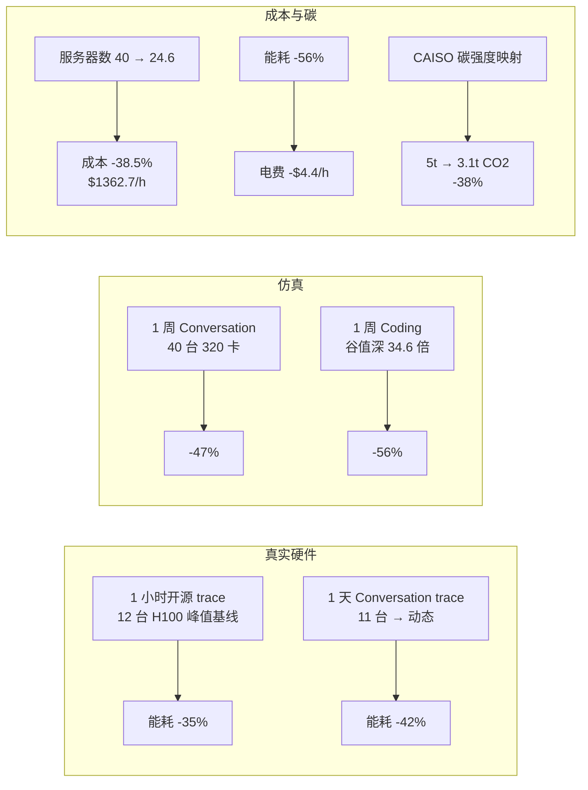

---

## 六、放进六篇清单里看：DynamoLLM 的位置

这篇与清单里其他五篇构成一条完整的「功率/能量约束 → 调度决策」链条，但落点各不相同。

| 论文 | 约束来源 | 被约束的对象 | 决策粒度 | 与 DynamoLLM 的关系 |
|---|---|---|---|---|
| **TAPAS**（ASPLOS'25） | 机架/集群供电上限 | 放置、路由、配置 | 请求级 + 副本伸缩 | 供给侧约束；DynamoLLM 是需求侧能效，两者可叠加：供电紧时 TAPAS 压容量，DynamoLLM 压每请求能耗 |
| **SpotGPU/ASI**（OSDI'26） | 生产资源紧张 + 抢占 | 作业优先级、容器生命周期 | 作业级 | 生产调度视角；DynamoLLM 的「squash」与它的「弹射链」同属过载保护 |
| **GREEN**（NSDI'25） | 碳强度时空差异 | 作业时间移位 + 资源扩缩 | 作业级（训练为主） | 用时间弹性换碳；DynamoLLM 用配置弹性换能耗，二者正交可组合 |
| **DynamoLLM**（HPCA'25） | 延迟 SLO + 能耗 | 实例数、并行度、频率 | 请求类型级 + 实例级 | 本文：把「形状」当旋钮 |
| **Nixie**（OSDI'26） | 交互响应 | GPU 切换与显存状态 | 请求/模型级 | 关注「切换成本」的另一面：显存状态迁移；与 DynamoLLM 的重切分开销同源问题 |
| **Kareus**（OSDI'26） | 降频后的通信/计算配比 | 通信与计算的排布 | 集合通信级 | 把「降频」推到通信层；DynamoLLM 只在实例粒度降频，未触及通信排布 |

三组对照最值得记：

1. **GREEN vs DynamoLLM**：都在「省」，但 GREEN 省的是一天中「什么时候跑」，DynamoLLM 省的是「怎么跑」。前者需要作业可延迟，后者需要 SLO 有余量。**两者叠加的收益不能简单相加**，因为 GREEN 把负载移到低碳时段后，正好可能移到高负载时段，压缩了 DynamoLLM 的余量。
2. **TAPAS vs DynamoLLM**：TAPAS 的约束是**外部供电上限**（硬容量），DynamoLLM 的约束是**内部 SLO**（软性能）。前者决定「最多能用多少卡」，后者决定「这些卡怎么用最省」。真实集群里两者同时存在，因此联合优化是开放问题。
3. **Nixie/Kareus vs DynamoLLM**：后两篇把「切换/降频」的代价推到更底层（显存状态、通信排布）。DynamoLLM 在实例级承认这些代价并试图削减，但没有进入 GPU 内部或通信层——这是它的边界，也是后续可做的工作。

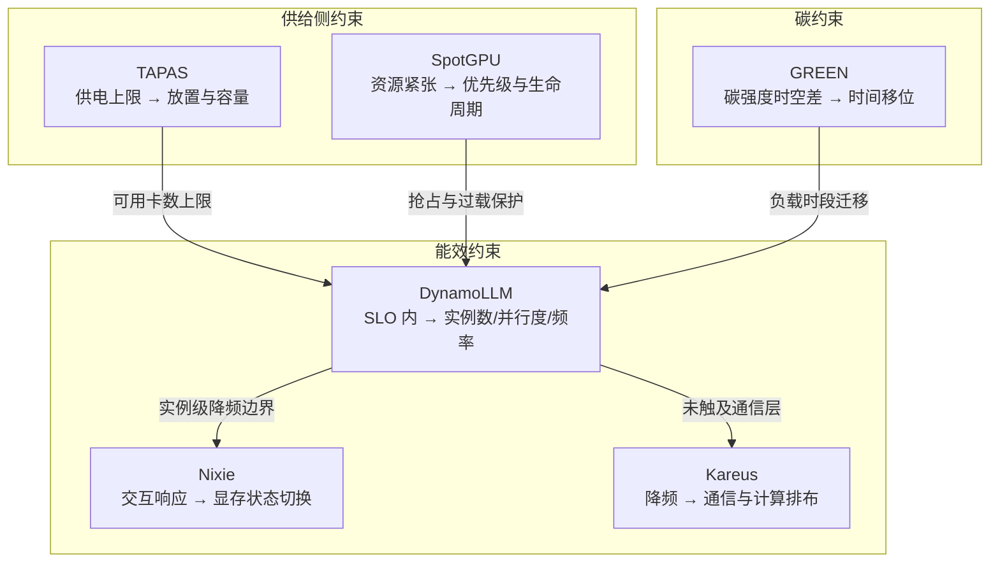

**关键洞察**：
- 六篇里只有 DynamoLLM 把「配置形状」当作一等公民，其余多把配置当作「约束下的结果」。这意味着**它的方法与具体硬件/供应商解耦，迁移成本最低**。
- 但它也最依赖「SLO 有余量」这一前提。在真正饱和的集群里，它的收益会退化到 15%，届时应由 TAPAS/SpotGPU 类方法接管。

---

## 七、工程启示：对两机六卡能做什么、不能做什么

本项目的硬边界是 2 台服务器 × 3 张 RTX 3090（共 6 卡）。直接复现 DynamoLLM 有三处不可能，但也有三处可迁移。

| 论文要素 | 原始条件 | 六卡条件 | 可迁移性 | 替代做法 |
|---|---|---|---|---|
| 单机 8×H100 + TP8 | 8 卡同机 NVLink | 3 卡/机，无 TP8 档 | **不可直接复现** | 退化为 TP1/TP2/TP3 三档，验证「异构画像」是否仍存在 |
| 600W 级 GPU 的频率调节 | H100 800–1980MHz | RTX 3090 频率范围不同，且消费级卡功耗墙行为差异大 | **部分可做** | 先量「锁频是否生效」「调频耗时是否仍是 50–80ms」 |
| 生产 trace（1h/1d/1w） | Azure 真实负载 | 可用开源 1h trace；更长的需自造 | **可用公开数据** | 用开源 1h trace + 合成负载做缩放验证 |
| 三层控制器 | 集群/池/实例 | 6 卡只能分 2–3 池 | **可做简化版** | 单机 3 卡做「池」、跨机做「集群」，验证节律是否仍成立 |
| 重切分的图匹配 | TP4→TP8 等组合 | 只有 TP1/TP2/TP3 | **可做小规模** | TP1↔TP2、TP2↔TP3 的搬权重开销可测，验证「少搬」原则 |
| 碳排映射 | CAISO 碳强度 | 国内电网碳强度公开度低 | **可用近似** | 用年度平均碳强度或公开区域数据，明确标注为近似 |

如果要在六卡上做一个**最小可信实验**，我会这样设计：

1. **先做「画像异构性」的存在性验证**（不需要功率计也能做一半）：同一模型、9 类请求长度、TP1/TP2/TP3 三档，测每类的延迟与 GPU 能耗（用 NVML 板卡功率积分）。要验证的命题是：**不同请求类型的最优配置确实不同，且差距显著**（对应论文的 0.79 vs 13.21 Wh）。
2. **再做「降频是否值得」的单变量实验**：固定 TP，锁 2–3 个频率点，测「功率下降幅度 vs 执行时间上升幅度」，算出 Wh 是否真的下降。这一步能直接复现论文「最低功耗配置 ≠ 最低能耗配置」的反直觉结论。
3. **最后做「分层节律」的验证**：用 5 秒/5 分钟/30 分钟三个节律各跑一次，测控制面自身开销占比。要验证的是：**调频开销（50–80ms 级）在多卡小集群里是否仍不可忽略**。
4. **明确不做**：不追求复现 52%/38% 的绝对值——那是 320 卡规模 + 生产 trace 的结果，六卡上的数字只能说明「方向是否成立」，不能说明「幅度是否成立」。

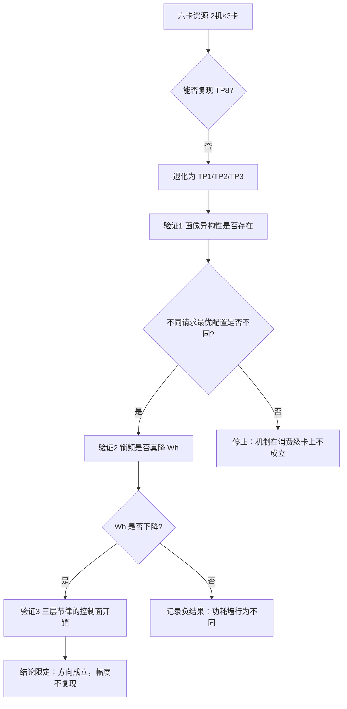

**关键洞察**：
- 论文里最「可搬」的不是框架，而是**那条判断链**：请求形状 → 阶段主导 → 敏感旋钮 → 最优配置。这条链在 3 卡上依然成立，只是档位更少。
- 最「不可搬」的是**幅度**。所有百分比都绑定在 8×H100 + 320 卡 + Azure trace 的组合上，跨硬件引用这些数字属于超出证据范围。

---

## 八、局限与审稿视角

从审稿人角度，这篇的软肋集中在四处：

| 局限 | 具体表现 | 影响 | 论文自身的处理 |
|---|---|---|---|
| **依赖 SLO 余量** | 高负载下节能降到 15% | 方法在饱和集群中退化 | 论文如实报告，但未讨论「无余量」场景 |
| **仿真与真实硬件的证据不对称** | 1 周结果来自仿真器；1 天结果才在真实硬件 | 大规模结论的置信度低于小规模 | 明确区分 §V-D（真实）与 §V-E（仿真） |
| **只算 GPU 能耗** | 不含服务器其他部件 | 系统级节能被低估或高估均有可能 | 引用「GPU 占整机 >60%」作为相关性依据 |
| **不含内含碳** | 只做运营碳 | 「可持续」叙述不完整 | 明确说明跑在既有数据中心，把内含碳列为未来工作 |
| **预测器精度中等** | 81% 分类准确率 | 依赖自愈机制兜底 | 用敏感性实验证明可接受 |
| **重切分开销为实测但组合有限** | 表 VI 只覆盖 8 卡内的 6 种组织 | 更大规模组合需外推 | 给出 τ 归一化，便于换算 |

还有两个「叙述层」的问题值得警惕：

- **「首个」的边界**：论文称首个 LLM 推理能源管理框架，这在「同时调实例数+并行度+频率」的意义上成立；但若把「LLM 服务能效」放宽到「单模型 DVFS」「请求路由」等，已有不少工作。读的时候要把「首个」限定在它的定义内。
- **「52% 平均」的统计口径**：平均是对多个场景/trace 的平均，不是单次实验的最好值。引用时应说「服务级平均」，而不是「最高可省 52%」。

---

## 九、如果要继续往下读，读哪里

| 目的 | 建议路径 | 理由 |
|---|---|---|
| 只想抓方法骨架 | §III 三条 Insight → §IV 开头四原则 → §IV-B 三层节律 | 这三段构成「为什么这么设计」的完整闭环 |
| 想做工程复现 | §IV-A 画像方法 → §IV-C 三类开销削减 → §V-A 实验设置 | 这三段给出可执行的参数与对照设计 |
| 想找后续研究缺口 | §V-C 敏感性（高负载仅 15%）→ §V-F 内含碳 → §VI 相关工作最后一段 | 三个明确的开放方向 |
| 想与本项目选题对齐 | §III-C 功耗比例性 → §IV-B 节律 → 本报告第七节 | 直接对应「六卡能验证什么」 |

最后留一个我认为最值得追问的问题：**DynamoLLM 假设「下层跑最高性能配置」来简化上层计算，这个保守假设在高负载时会让上层过度扩容吗？** 论文没有专门做这个消融，但它恰好是六卡小集群上最容易观察到的现象——资源越少，保守假设的代价越明显。

---

## 十、一页速记

- **一句话**：把 LLM 请求按形状分池，再用三层控制器按不同节律分别调「实例数 / 并行度 / 频率」，在 SLO 内把能耗压下来。
- **三个数字**：0.79 Wh（SS 最优） vs 13.21 Wh（LL 最优），差 16.7 倍；调一次频 50–80ms vs 一次 decode 20ms；建一个实例 6–8 分钟。
- **三个反直觉**：最低功耗 ≠ 最低能耗；分池本身不省电（MultiPool +20%）；P99 变好但 P50 变差。
- **两个边界**：收益与 SLO 余量正相关（高负载只剩 15%）；只算 GPU 能耗、只算运营碳。
- **一个可迁移的判断链**：请求形状 → 主导阶段 → 敏感旋钮 → 最优配置。这条链比框架本身更值得带走。
