# TAPAS：面向云平台 LLM 推理的热感知与功率感知调度 —— 中文学习报告

> 本报告基于论文 *TAPAS: Thermal- and Power-Aware Scheduling for LLM Inference in Cloud Platforms*（Stojkovic et al., ASPLOS '25）自下而上精读而成。报告不做"摘要式概括"，而是把基础设施刻画、负载侧机会刻画、系统三组件设计、双轨评估与故障应急逐层拆开，落到可指导工程实践的细度，并在最后结合本项目"两机六卡"的资源边界讨论可迁移性与候选问题。

## 报告元信息

| 项目 | 内容 |
|------|------|
| **论文标题** | TAPAS: Thermal- and Power-Aware Scheduling for LLM Inference in Cloud Platforms（面向云平台 LLM 推理的热感知与功率感知调度） |
| **作者团队** | Jovan Stojkovic、Chaojie Zhang、Íñigo Goiri、Esha Choukse、Haoran Qiu、Rodrigo Fonseca、Josep Torrellas、Ricardo Bianchini |
| **所属机构** | University of Illinois Urbana-Champaign（UIUC）；Microsoft Azure Research；Microsoft Azure。第一作者在 UIUC，工作期间任职于 Microsoft Azure Research |
| **发表会议** | 第 30 届 ACM 编程语言与操作系统体系结构支持国际会议（ASPLOS '25），2025 年 3 月 30 日–4 月 3 日，荷兰鹿特丹；DOI: 10.1145/3676641.3716025，ACM ISBN 979-8-4007-1079-7/25/03 |
| **文献类型** | 会议完整论文（16 页），CC BY 4.0 开放许可 |
| **研究范式** | 生产数据刻画（数万张 GPU、三区域、三个月）+ 单服务器配置扫描（DGX A100 + Llama2）+ 80 台服务器一小时真实回放 + 千台级离散时间仿真 |
| **一句话主旨** | 利用历史温度/功率/负载画像与 SaaS 负载的可调性，在"放置—路由—实例配置"三个层级协同做热与功率感知调度，在不破坏 SLO 与质量的前提下压低温度与功率峰值、支撑安全超配并应对设施故障 |
| **对应分析包** | AN-20261105-031-v01（LP05，partial）；证据定位 LP05-E01～E04 |
| **阅读重点（清单问题）** | 供电限制如何传到放置、路由和配置？重点看 §4、§5.4 |

## 核心指标速览

| 指标 | 数值 |
|------|------|
| **最高温度压降（整体方案，消融口径）** | **−17%**（仿真一周口径为 −15%） |
| **行峰值功率压降（整体方案，消融口径）** | **−23%**（仿真一周口径为 −24%） |
| **可追加容量（超配上限）** | **最多 +40%** 服务器，限频时间占比 < 0.7% |
| **限频事件降幅（大规模仿真，对比其他可行策略）** | 热限频 **−97%**、功率限频 **−99%** |
| **真实集群回放峰值利用率** | 相比基线 **−20%**；与仿真绝对误差 **4%** |
| **全 SaaS 负载下最大压降** | 温度 **−23%**、功率 **−28%**；全 IaaS 时仅放置环节有效 |
| **应急容量限额** | 冷却（AHU）故障降至 **90%**；供电（UPS）故障降至 **75%** |
| **基线应急动作** | 跨服务器统一限频，最高 **35%** 频率上限 |
| **TAPAS 应急质量代价** | 最高 **12%** 质量影响（导向小模型导致的准确率下降） |
| **硬件基准** | NVIDIA A100 TDP **6.5 kW**、H100 TDP **10.2 kW**；GPU 温度阈值 **85°C** |
| **刻画数据集** | 数万张 GPU（A100+H100）、三区域、2024-07-01 至 08-30、**10 分钟**粒度均值 |
| **温度回归精度** | 分段多项式 MAE **< 1°C** |
| **SLO 口径** | goodput = 满足 TTFT/TBT 的 token/s；TBT/TTFT SLO 定义为空载执行时间的 **5 倍** |

---

## 1. 研究背景与问题动机

### 1.1 LLM 推理集群为什么把热与功率推到台前

生成式大语言模型已进入医疗健康、开发者效率、教育等多个领域，直接拉动了对 LLM 推理集群的高需求。云端 LLM 通常运行在由最新 GPU（NVIDIA A100、H100）驱动的虚拟机上。这类 GPU 功耗巨大，而冷却与供电正是数据中心总拥有成本（TCO）的主要组成部分。

> *"The A100 and H100 GPUs have thermal design powers (TDP) of 6.5 kW and 10.2 kW, respectively, and require substantial cooling capabilities to maintain safe operating temperatures."*
>
> A100 与 H100 GPU 的热设计功耗（TDP）分别为 6.5 kW 和 10.2 kW，需要强大的冷却能力才能维持安全工作温度。

与通用服务器不同，GPU 服务器与机柜通常受限于**功率密度**而非空间约束。这意味着规划容量时，瓶颈不在"还能不能再塞一台机器"，而在"现有冷却风道与供电额度能不能再扛一份热与电"。

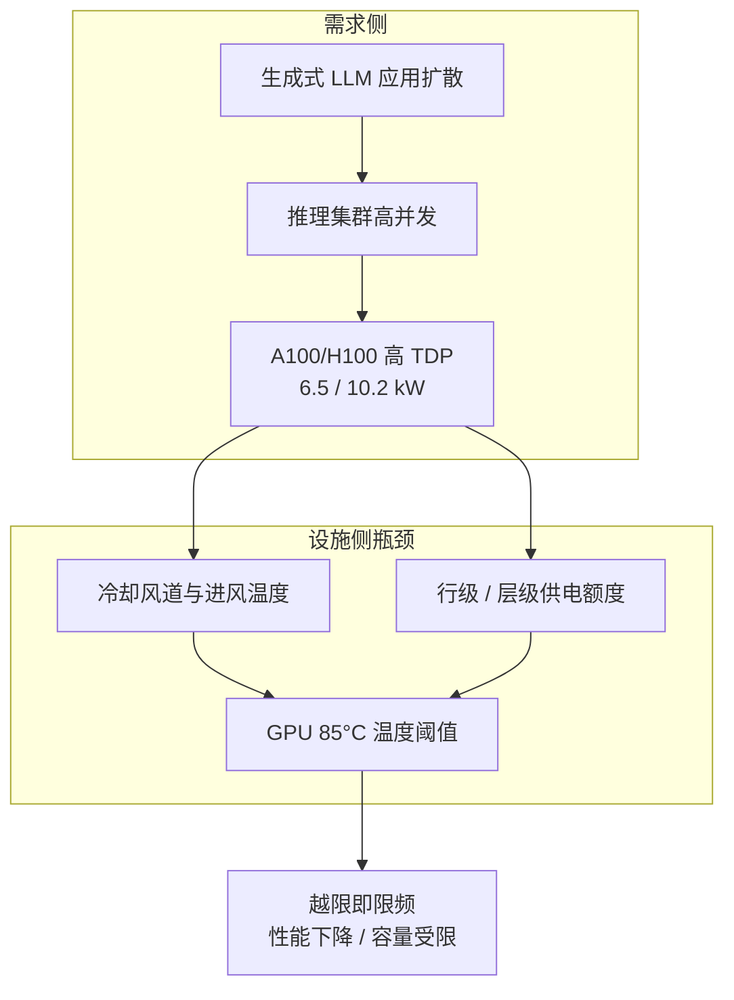

### 1.2 传统热/功率方法为什么在 LLM 推理上不再最优

论文指出，LLM 推理集群的性能进步主要由软件系统、硬件技术与模型架构推动，热与功率问题此前未得到同等关注。传统数据中心的热管理与功率管理已被广泛研究，但 LLM 推理负载有三个传统方法没有覆盖的独特性质：

- **毫秒级细粒度执行阶段**：推理由 prefill（并行处理整段提示词）与 decode（逐 token 顺序生成）两个阶段组成，每个阶段有不同的性能、温度与功率画像；传统方法多在服务器或作业的稳态尺度上做决策。
- **多配置参数的耦合权衡**：模型并行度、模型大小、量化精度、GPU 频率、批量大小等参数同时影响性能、温度、功率与输出质量，方向并不一致（详见 §4）。
- **SaaS / IaaS 共置的可见度不对称**：云平台同时托管对厂商透明、可调的 SaaS 负载，与不透明、不可改的 IaaS 负载，可动作的权限边界完全不同。

### 1.3 论文的问题定义与三条核心原则

本文关注同时托管 SaaS 与 IaaS GPU 负载的公有云。SaaS 是云厂商管理、对厂商透明的 GPU 虚拟机，允许调整配置；IaaS 是厂商不可见的不透明 GPU 虚拟机，不可改动。TAPAS 要回答的问题是：**在既有设施约束与两类负载权限不对称的前提下，怎样避免局部电力、风量与 GPU 温度越限，并在设施能力下降时尽量保留服务？**

论文通过三条核心原则组织方案：

1. **放置（Placement）**：利用温度、功耗、服务负载的历史数据，以热感知、功率感知的方式放置 GPU 虚拟机；
2. **路由（Routing）**：根据各虚拟机负载与底层设施可用的热/功率余量，在多个 LLM 实例之间路由请求；
3. **实例配置（Configuration）**：在冷却与功率层级内重配置 SaaS 实例，把温度与功率拉回安全限值。

### 1.4 贡献与评估口径

论文自述三项贡献：刻画生产规模下 GPU LLM 推理负载的热与功率特性；提出首个面向 LLM 推理系统的热/功率感知调度方案 TAPAS；基于大规模生产轨迹在 GPU 集群上做全面评估。需要特别注意评估口径被分成三类，不能互换：**常态一小时硬件回放**、**千台级轨迹仿真**、**应急代理评估**（§5.4 用频率限幅比例作性能代理、用模型替换估计质量损失）。

---

## 2. 冷却基础设施刻画（§2.1）

### 2.1 风冷气流组织与阈值机制

论文聚焦风冷——当今数据中心最常用的方式；其多数洞见也可迁移到液冷等其他技术路线。数据中心按两条行组成一条冷热通道布置：每行的空气处理单元（AHU）把来自数据中心级冷却设备（如蒸发冷却中的绝热冷却塔）的冷风送入冷通道；服务器风扇按负载调速，从前部吸入冷风、穿过服务器（含 GPU）、把热风排入热通道；冷却设备再回收热风重新降温。

为避免**热风回流**（hot air recirculation，热风返回冷通道），AHU 提供的风量必须大于冷通道内服务器消耗的风量之和。GPU 温度一旦超过阈值（85°C），硬件就会对计算限频，以防止故障与永久损坏。

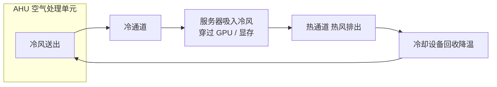

### 2.2 容量规划与故障冗余

**常态规划**：运营商通常按峰值负载规划冷却，需要同时保证 (1) 每条通道有足够风量（AHU）防止回流；(2) 数据中心有足够冷却能力把温度降到工作范围。两个条件都满足时，才可以往行内追加机柜。

**故障冗余**：数据中心通常搭建 N+1 等冗余。某台冷却设备故障时由其他设备补偿，但冷却容量随之下降，可能抬升所有冷通道温度；若某台 AHU 故障，由通道内其余 AHU 分担风量，风量不足即引发回流，抬升两条行内所有服务器温度。

### 2.3 刻画数据集与四个温度维度

为理解冷却基础设施的温度影响，作者研究了 Microsoft Azure 若干数据中心样本：数万张 GPU（A100 与 H100）、三个气候各异区域、2024 年 7 月 1 日至 8 月 30 日共三个月（覆盖冷却需求最高的暖季），另纳入一个较冷区域数据中心以覆盖凉爽气候。采集每台服务器进/出风温度、室外温度，以及各部件（GPU、显存）温度与功率，每 10 分钟上报一次均值；该间隔与所有传感器采样频率一致，并可由平均功率近似发热量。

| 温度维度 | 刻画发现 | 对调度的含义 |
|----------|----------|--------------|
| **室外温度驱动** | 进风温度跟随室外温度趋势。室外冷时，冷却把进风维持在约 18°C 以上以避免湿度升高、增加故障；室外超过 15°C 后进风随室外线性上升；室外炎热（25°C）时冷却主动降温；温度本就较高的位置对室外更不敏感。 | 进风温度不是常数，而是随气候时段变化的可预测量；放置与路由需要把"室外温度时段"纳入预测。 |
| **空间布局异构** | 同一通道内 Server 1 始终比另外两台热约 2°C；部分行比其他行最高高 1°C，行内机柜之间差异最高 2°C；机柜内高度位置影响较小。气流模式难以事先估计，需实测或昂贵仿真。 | 存在固定的"热行/热柜"位置，放置时应把更热的负载导向偏冷位置；空间异构可由历史进风温度画像吸收。 |
| **数据中心负载** | 服务器发热量增加时进风温度随之升高；炎热区域一台服务器上，室外 35°C 时高/低负载进风相差 2°C。进风与负载的相关性远低于与室外温度的相关性。 | 负载是进风温度的次要变量，主变量仍是室外温度与布局；建模时不应把负载系数估计得过大。 |
| **GPU 个体异构** | 同一台 DGX A100、相同负载、相同进风下，8 张 GPU 温度差异最高达 10°C；大规模样本中同一数据中心 GPU 温度跨度超过 20°C。偶数编号 GPU（靠近进风口）温度更低。差异来自布局遮挡与工艺偏差。 | 单机内最热 GPU 决定限频风险；规划 AHU 风量时必须为个体异构预留余量，不能按平均温度规划。 |

### 2.4 三个温度/风量模型（式 1–3）

**进风温度模型（式 1）**：对每台服务器 s，用回归把进风温度建模为室外温度与数据中心负载的函数。

$$T_{inlet,s} = f_{inlet,s}(T_{outside},\, Load_{DC}), \quad \forall s \in S$$

**GPU 温度模型（式 2）**：对服务器 s 中每张 GPU g，把温度建模为该服务器进风温度与 GPU 负载的函数；该回归平均绝对误差小于 1°C，并捕捉漏电导致的进风温度上升。

$$T^{GPU}_{s,g} = f^{GPU}_{s,g}(T_{inlet,s},\, Load_{GPU,g}), \quad \forall s \in S,\, g \in G$$

**风量约束（式 3）**：必须保证 AHU 规划风量大于通道内各服务器风量需求之和。服务器风扇风量是 GPU 负载的线性函数 $f_{air}(Load_{GPU,s})$；实测与厂商规格一致——A100、H100 的 PWM 风扇在 80% 转速下风量分别为 840 与 1105 CFM。

$$\sum_{s \in S_{Aisle}} f_{air}(Load_{GPU,s}) \le Prov_{AHU}^{Aisle}, \quad \forall Aisle \in DC$$

**洞见 #1**：要实现有效的热管理，云运营商必须同时考虑由室外温度与负载变化带来的**时间异构**、由数据中心与服务器布局带来的**空间异构**，以及风量需求。

---

## 3. 功率基础设施刻画（§2.2）

### 3.1 三级配电层级

数据中心通常采用三级配电层级把市电逐级送达单台服务器：最上层自动转换开关（ATS）把电网电力分配到多台不间断电源（UPS）；每台 UPS 分担总负载的一部分，并连接一组配电单元（PDU）对；PDU 对进一步降压，支撑多条机柜行。

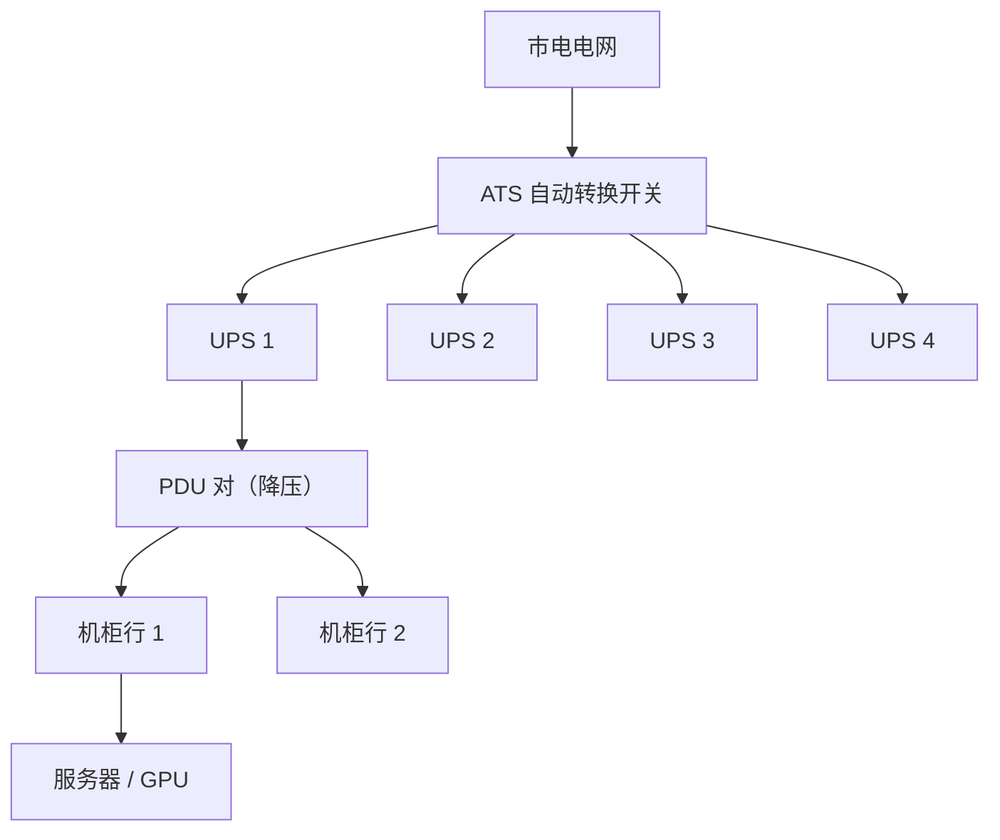

### 3.2 峰值规划、均匀分配与超配空间

为防止断路器跳闸，运营商在层级每一级都按峰值功率规划以覆盖最坏情形。当总功耗超过供电额度时，该层级内服务器被功率限频。为简化设计、降低实现成本，功率限额被均匀地向下分配到各层级，最终限制了预算内可规划的机柜数量。只要仍在行级功率包络之内，运营商就可以通过往行内追加机柜来**超配（oversubscribe）**功率容量。

### 3.3 冗余故障后的容量收缩

为保障高可用，云在功率层级每一级都实现冗余。论文引用的配置为 UPS 级 4N/3、PDU 级 2N。某台 UPS 故障时，其负载被重新分配到其余三台；重负载下这可能把其余三台推到容量上限，迫使每台快速降载以维持限额，实际把数据中心容量降到 **75%**。论文聚焦这一设计，因为它在常态与故障切换之间取得平衡；结论也适用于其他冗余模型。

### 3.4 服务器功率模型与行间功率不均衡

服务器功率与 GPU 负载强相关；即使空闲，服务器也像传统 CPU 服务器一样消耗可观功率。除 GPU 外，风扇、存储、内存、CPU 及其他部件也消耗相当一部分功率。对每台服务器 s，论文用多项式回归生成功率函数 $f_{power}(Load_{GPU,g,s})$，计入风扇及其他同样依赖负载的部件。

行级功率是各服务器功率的聚合与复用结果。论文在部分数据中心 100 行上统计 P50/P99 功耗 CDF，呈**重尾分布**：50%、75%、90% 的行，其 P99 功耗分别比最耗电的行低 28%、18%、10%。高功率行在数据中心内形成热点，需要充足功率规划来满足；分配给低需求行的功率被浪费，严重制约安全超配能力。

**行功率约束（式 4）**：

$$\sum_{s \in S_{Row}} Power_s(Load_{GPU,s}) \le Prov_{Row}^{Power}, \quad \forall Row \in DC$$

**洞见 #2**：GPU 集群的功率需求为功率超配提供了很大空间；但要安全超配，基础设施必须有效管控那些产生热点的**尾部行**。

---

## 4. 负载侧机会刻画（§3）

本章回答"负载本身有哪些可被调度利用的特性"，分放置、路由、实例配置三条线。

### 4.1 GPU 负载放置：随机放置的温度/功率离散度

为分析负载对冷却与供电的影响，作者在某数据中心两条行内部署 80 个虚拟机，并在这两条行上生成 **10 万个随机放置方案**。结果：最差放置使最高温度超过 85°C，典型放置平均约 72°C；最差放置比最优放置峰值功率高出 **27%**。若把更密集负载放到更热服务器上，或把同步峰值负载共置在同一行，厂商就必须按这些极端情形规划足够冷却与功率。

关键发现：**最高温度与峰值功率之间没有相关性**。这意味着放置虚拟机时必须同时考虑温度与功率两类因素，只优化其中一类会留下另一类热点。

| 放置观察 | 数据 | 调度含义 |
|----------|------|----------|
| **温度离散** | 最差 >85°C，典型约 72°C | 放置选择本身就能显著改变热点强度，不必依赖事后限频。 |
| **功率离散** | 最差比最优峰值功率 +27% | 行级峰值功率受放置影响大，存在通过放置削峰的空间。 |
| **温/功率解耦** | 最高温度与峰值功率无相关 | 温度热点行与功率热点行不是同一批；约束过滤必须分两条线做。 |

### 4.2 长生命周期与可预测负载

**长生命周期**：多数 GPU 虚拟机生命周期较长，超过 60% 运行两周以上；这类虚拟机通常独占整台服务器，因此某台服务器可能长期专用于某一负载。75% 的服务器在一个月内只承载一个虚拟机。

**周期性与可预测性**：示例虚拟机呈明显昼夜周期规律；聚合到行级后，功耗同样呈周期规律。论文采用模板化方法预测行级与虚拟机级功率：用四周历史数据生成模板，以 5 分钟粒度刻画一天各时刻平均功率。行功率预测在大多数行·小时上误差小于 10%，采用 P99 的保守预测在不到 4% 的行·小时上低估；虚拟机功率预测可利用客户信息，超过 75% 的 VM·小时误差低于 10%，P90/P99 模板低估比例在 2%–7%。

**洞见 #3**：云运营商可利用负载的异构性与可预测性进行智能放置，以缓解热点、平抑温度/功率尖峰。

### 4.3 IaaS 与 SaaS：可见度与可调性的不对称

| 维度 | IaaS 负载 | SaaS 负载 |
|------|-----------|-----------|
| **可见度** | 不透明虚拟机，厂商对其特征可见度有限 | 由云厂商完全管理，对厂商透明 |
| **可运行负载** | 任意模型、任意任务（推理/训练/微调、LLM/扩散/图像识别） | 面向不同应用的多种 LLM 推理服务 |
| **可调性** | 虚拟机不可改动 | 允许调整配置参数 |
| **可预测性** | 波动大、难预测 | 长生命周期、功耗周期且可预测 |
| **调度动作权限** | 只能在放置时选更冷服务器；末级才是硬件限频 | 可放置、可路由、可重配置实例 |

SaaS 服务面向多个 LLM 推理端点，每个端点运行一组专用虚拟机，可承载多个推理实例并在实例间路由请求。50% 的虚拟机属于跨多行、超过 100 个虚拟机的大型端点。

**负载均衡现状的问题**：传统云平台采用基于分配规则、对功率与温度不敏感的放置算法；在此之上，SaaS 实现跨虚拟机调度请求以改善延迟与吞吐。但若负载均衡器不了解温度状况，可能把等量负载分配给已接近热限频的服务器；不顾及功率状况，则可能把额外负载送入邻接 IaaS 服务器、本就高功率需求行内的虚拟机，加剧功率紧张。

**洞见 #4**：云运营商可利用 SaaS LLM 推理负载的灵活性，进行热感知与功率感知的请求路由，以最大化超配机会。

### 4.4 实例配置：五个旋钮的权衡方向

为评估配置选项，论文在一台 NVIDIA DGX A100 服务器上运行 Llama2 推理。LLM 推理由 prefill 与 decode 两个阶段组成。图 16 分别量化了五个参数对温度、功率的影响（红线为 TDP 上限，蓝线为空闲状态）。

| 配置旋钮 | 性能 | 温度 | 功率 | 质量 | 阶段敏感性与副作用 |
|----------|------|------|------|------|--------------------|
| **GPU 频率**（2GHz→1GHz） | ↓ | ↓ | ↓ | − | 提示词阶段对频率更敏感；降频对温/功率影响弱于其他旋钮，但不影响质量、可瞬时生效、开销低。 |
| **模型大小**（70B→7B） | ↑ | ↓ | ↓ | ↓↓ | 模型越小计算强度越低、温/功率越低；7B 相比 70B 质量下降 30%–40%，质量代价最大。 |
| **量化**（FP16→FP8） | ↑ | ↓ | ↓ | ↓ | 更低精度带来温/功率下降，准确率降低 2%–20%。 |
| **张量并行度**（TP8→TP2） | ↓ | ↑ | ↓ | − | TP2 用更少 GPU，服务器总功率下降；但工作量集中到更少 GPU，单卡功率上升，最热 GPU 温度升高。降并行度对提示词阶段功率影响更显著，对 decode 阶段温度影响更显著。 |
| **批量大小**（64→16→1） | ↓ | ↓ | ↓ | − | 批量越小计算强度越低、温/功率下降；但 decode 阶段需更频繁经内存控制器取数，显存温度反而升高。 |

两个容易被忽略的反向作用：其一，**降低并行度会降总功率但抬升最热 GPU 温度**；其二，**减小 decode 批量可能升高显存温度**。因此选哪个旋钮，取决于瓶颈是温度还是功率、负载处于提示词还是 decode 阶段。

### 4.5 goodput 与 Pareto 前沿

论文以 **goodput** 量化推理服务器性能：在满足 TTFT 与 TBT SLO（定义为空载系统执行时间的 5 倍）前提下每秒处理的 token 数。图 17 展示所有配置下温度/功率与 goodput 的权衡：goodput 以最小模型 Llama2-7B 最快配置归一化，温度与功率以精度最高的最快配置 Llama2-70B 归一化。每个模型都呈现一条 **Pareto 前沿**——在对性能影响最小的前提下使温度与功率最低的配置集合。模型大小同时影响质量，是权衡中权重最大的一维。

**洞见 #5**：云运营商可以通过配置 SaaS 实例，在对 LLM 推理性能与结果质量影响最小的前提下，有效地塑造温度与功率。

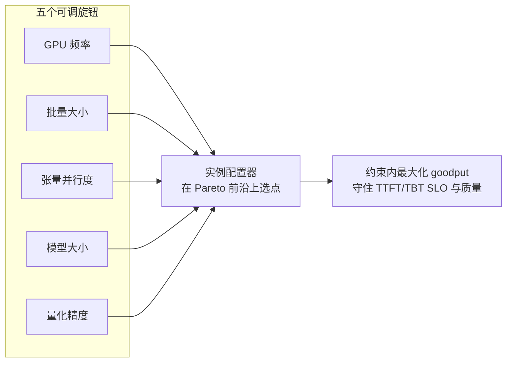

---

## 5. TAPAS 系统设计（§4）

### 5.1 总体架构

TAPAS 是面向云环境 GPU 集群的热与功率管理框架，专门针对 LLM 推理负载的独特性质。它提升冷却与功率超配能力，同时有效处理基础设施故障，在对负载性能与结果质量影响最小的前提下降低 TCO；系统利用 SaaS 负载的可调性，且不影响 IaaS 负载。

架构由三部分组成：(1) 扩展传统云端 LLM 推理集群的现有组件——集群级 VM 分配器、端点级负载均衡器；(2) 引入每个 SaaS 虚拟机一个的**实例配置器（Instance Configurator）**；(3) 维护多份**画像（Profiles）**。三个核心方面对应三条原则：虚拟机放置、请求路由、实例配置。

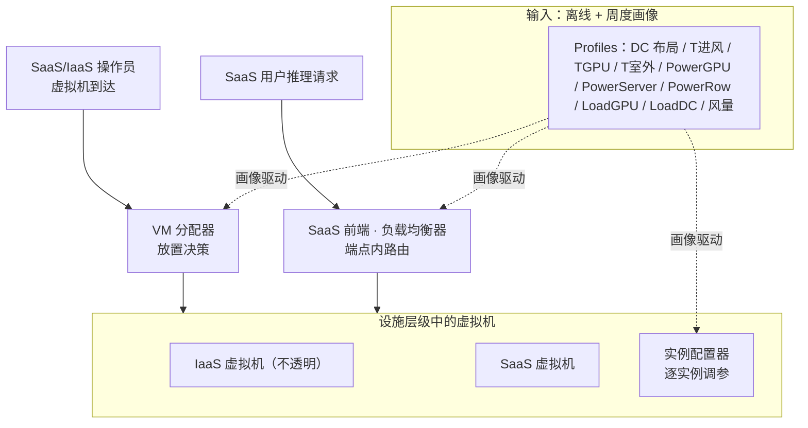

### 5.2 工作负载放置（§4.1）

虚拟机到达时，VM 分配器把每个新虚拟机（IaaS 或 SaaS）指派到某台服务器，在满足负载需求的同时尽量降低热或功率热点风险。放置分四步：

1. **通道与行过滤**：用历史服务器负载数据预测每条通道峰值风量需求与每行峰值功率需求；数据不足（少于一周）的服务器按峰值负载处理。新虚拟机负载参照同用户（IaaS）或同端点（SaaS）已有虚拟机估计；历史不足同样按峰值假设。估算放置后各通道新峰值风量与各行功率需求，过滤掉会突破式 (3)、式 (4) 限额的通道或行内服务器。
2. **IaaS 放冷服务器**：由于对 IaaS 虚拟机的细粒度控制有限，优先把它们放到更冷的服务器上，以尽量降低热限频风险。对每台服务器，把历史进风温度与预测虚拟机负载代入式 (2) 估计峰值 GPU 温度，选预测温度最低的服务器。
3. **SaaS 放较暖服务器**：倾向把 SaaS 虚拟机放到较暖服务器，因为应急事件中可调这类实例配置；同时根据该端点预测负载，确保不突破最高 GPU 温度约束。
4. **IaaS/SaaS 均衡**：要让 SaaS 负载能平衡风量与功率以压低峰值，每条通道与行内都需在两类负载间取得良好平衡；新虚拟机不放到导致任一类型过度集中的通道与行。

**迁移**：除初始放置外，可重算更优放置并迁移虚拟机以纠正预测偏差或负载行为变化。SaaS 可新建虚拟机、转移负载、再退役旧虚拟机；IaaS 迁移必须无缝、不中断。目前受 GPU 显存管理复杂性所限，尚不支持 GPU 虚拟机在线迁移，若能实现将进一步提升性能。

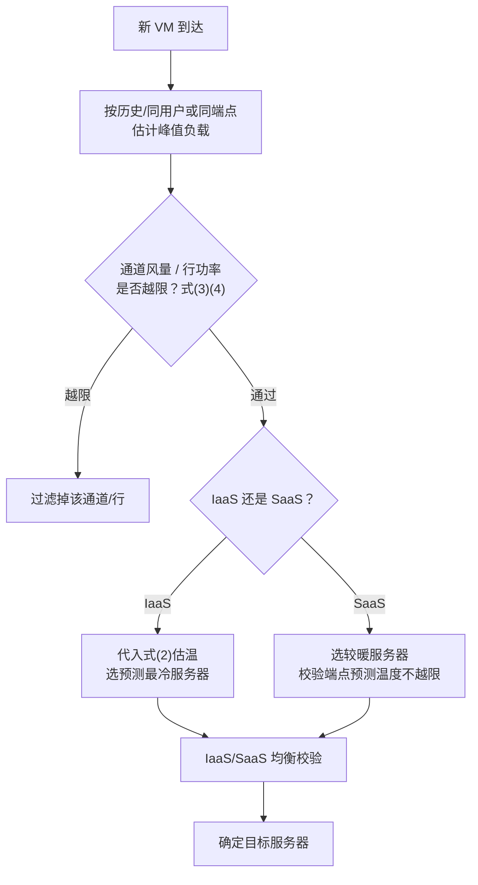

### 5.3 请求路由：三层约束（§4.2）

负载放置到服务器后，TAPAS 利用多实例 SaaS 端点，通过精细路由请求进一步平抑温度与功耗。约束分三个层级：

- **通道（Aisle）**：估计各服务器负载，计算通道内虚拟机总风量需求；信息缓存，每 5 分钟重算，发现偏差（如某服务器功耗高于估计）即更新；阻止把请求路由到可能触发风量越限的虚拟机。
- **行（Row）**：估计一行内所有服务器负载并聚合为总功率值，评估把请求路由到该行虚拟机是否有超过峰值功率限额的风险。
- **服务器（Server）**：跟踪当前负载，用式 (2) 估计每台服务器 GPU 温度是否超阈值；避免路由到有较高过热风险服务器上的虚拟机。

过滤之后，TAPAS 按以下顺序应用主流负载均衡策略：(1) 优先路由到此前处理过同一客户请求的实例，最大化 KV cache 复用；(2) 集中负载以降低能耗；(3) 在虚拟机间分散请求以优化性能。

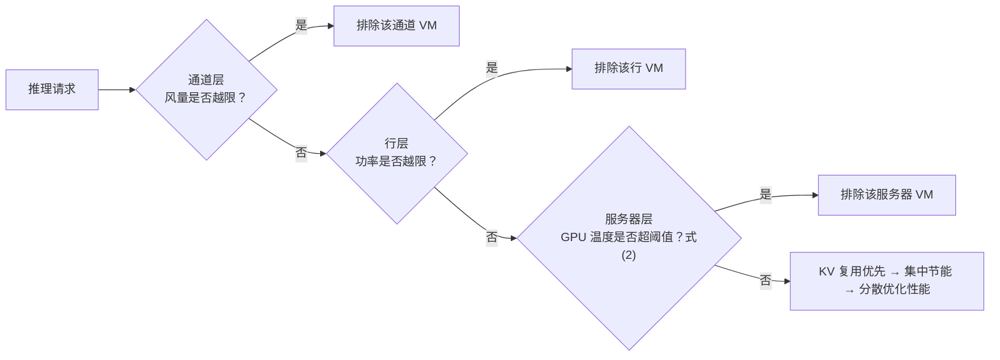

### 5.4 实例配置（§4.3）

为保证服务器在负载尖峰或应急期间仍处于冷却与功率限额内，TAPAS 为每个实例计算允许的最大风量、GPU 温度与服务器功率。实例配置器利用图 17 中该 LLM 的热/功率画像，确定在不影响质量前提下最大化 goodput 的最优频率、批量、并行度、量化与模型大小。它找出在当前负载下满足性能 SLO、且不超出功率/温度预算的配置，预测每个配置的 TTFT/TBT 延迟、功耗与温度，在预算内选精度最高、性能最好的配置。

**画像开销**：为 SaaS LLM 服务生成配置空间需 3–4 小时，且仅在新模型注册到 TAPAS 时执行一次；数据中心组织结构画像在部署时执行一次。相比单个 LLM 或数据中心生命周期，这两项开销可忽略。

**动作优先级与切换成本**：所有配置旋钮在推理引擎中都可获得，配置器与引擎通信、动态调参，取值保证 SLO 始终满足。在线决策时计入重设配置所需时间，并在切换过程中阻止把请求发给相关实例。改变模型并行度、大小或量化级别需要重载模型，耗时数秒。考虑这些开销与最大化质量的目标，**调整模型大小与量化通常是最后手段**：SaaS 实例仅在所在行功率/温度余量不足时才切到更低精度模型；配置器先调性能旋钮，再在不违反 SLO 的前提下选能塞进余量的最高精度模型。TAPAS 不会改动 IaaS 实例的精度。

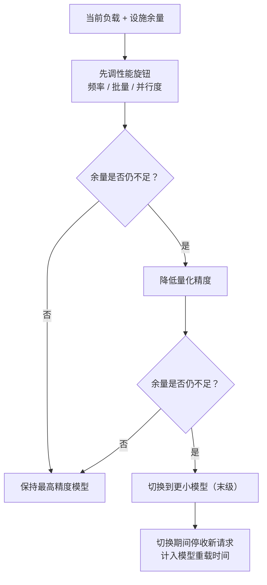

### 5.5 超配与故障管理（§4.4）

**超配**：使用 TAPAS 可降低运行同一负载所需的冷却与功率额度。云厂商最初按基准峰值需求规划；随需求增长，运营商可把更多机柜追加到现有行，利用 TAPAS 腾出的余量。TAPAS 仿真器还可配合估计负载评估冷却与功率需求，实现更精确规划。

**故障管理**：若发生冷却或供电故障，TAPAS 重新计算每条通道可用风量、每行功率以及每台服务器进风温度；请求路由把请求调离受约束服务器，实例配置器相应降载；若这些动作仍不足，TAPAS 对 IaaS 虚拟机施加常规功率限频。

### 5.6 实现要点（§4.5）

| 组件 | 实现方式 |
|------|----------|
| **画像（Profiles）** | 离线画像阶段在部署初期运行基准与验证测试，建模数据中心布局、服务器进风温度、GPU 温度、风扇风量、服务器功率-负载关系；接入新 LLM 时按 §3 流程画像各配置参数。常态运行期间每周细化模型，采集各服务器与行的功率/负载模式预测利用率，采用基于上一周数据的模板化方法；模型与画像通过定期数据更新提供给其余三个组件。 |
| **VM 分配器** | 受 Protean 启发的规则式分配器，三条规则：校验规则按峰值风量/功率过滤通道行；偏好规则把 IaaS 导向冷服务器、SaaS 导向较暖服务器（服务器等分冷/中/暖三组）；另一条偏好规则按 IaaS/SaaS 均衡引导放置（分 IaaS 偏重/SaaS 偏重/均衡三类）。规则使用当前集群数据与周度更新的模型画像。 |
| **负载均衡器** | SaaS 端点部署在提供 HTTP REST 接口的专用虚拟机上；对每个虚拟机结合当前状态与服务器热/功率画像，计算违反温度、功率、性能三类限额中任一项的概率，不路由到高违规风险虚拟机；过滤后按 KV 复用→集中节能→分散优化排序。 |
| **实例配置器** | 本地实例采用 vLLM（主流推理平台），也可经少量接口修改集成 TensorRT-LLM 等其他平台。本地控制器每周接收更新画像，在每次 LLM 迭代时估计最优运行设置；计算轻量并缓存；必要时更新各实例设置，若需改并行度/模型大小/量化则重启实例。 |

### 5.7 泛化条件（§4.6）

TAPAS 的设计原则可推广到其他类别负载。SaaS 虚拟机可运行任意负载，但组件可能需要调整：实例配置器需以不同方式训练，并使用面向特定负载定制的旋钮；IaaS 在 TAPAS 中已被视为不透明盒，可运行不同类型负载而无需改动系统。洞见也可应用于多样数据中心基础设施；预测模型需使用数据中心专属回归函数，随组织、服务器物理布局、冷却机制（液冷还是风冷）而变化。

---

## 6. 评估方法（§5.1）

### 6.1 基线与消融变体

**基线（Baseline）**：对温度与功率不敏感的系统，使用传统虚拟机放置与 LLM 请求路由，不做任何重配置。TAPAS 按 §4.5 实现，并评估六种额外变体以衡量各组件及组合对放置（Place）、路由（Route）、配置（Config）的影响。

### 6.2 负载与双轨评估

| 评估轨 | 规模与构成 | 做法 |
|--------|-----------|------|
| **真实集群回放** | 缩减版生产轨迹，模拟两条行共 80 台 A100 服务器，IaaS/SaaS 各半，持续一小时 | IaaS 直接使用历史功率读数，除跨行放置虚拟机外不改动负载；SaaS 采集各端点调用轨迹，用 Llama2 回放执行。 |
| **大规模仿真** | 一周生产轨迹，约一千台服务器、数千张 GPU，IaaS/SaaS 各半；SaaS 用 Llama2，请求来自 10 个端点子集，每端点 23–100 个虚拟机 | 离散时间仿真器按 §2 建模数据中心；复现 IaaS 负载与 SaaS 请求执行。冷却建模用式 (1)–(3)；功率用真实 IaaS 读数并按式 (4) 映射 SaaS 功耗；跟踪限频事件对冷却与供电的影响。 |

**回归模型选择**：论文评估了随机森林、多层感知机、线性、多项式、分段多项式等回归模型。分段多项式 MAE 小于 1°C，计算快、存储省，并能对未见取值有效泛化；随机森林容易过拟合，难以预测低于训练集的温度。

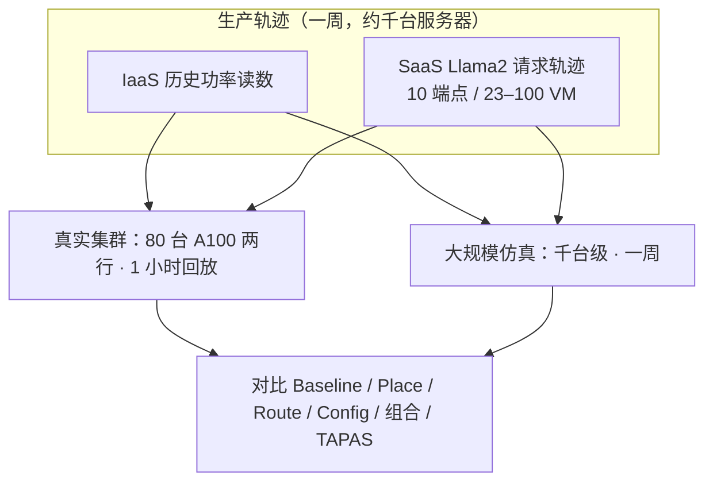

---

## 7. 评估结果（§5.2–5.4）

### 7.1 运行效果：真实集群与仿真

**真实集群（图 19）**：以 1 分钟为间隔对比基线与 TAPAS 的行峰值功率。常态运行下，TAPAS 在维持延迟 SLO 与结果质量的同时有效压低峰值功率，相比基线峰值利用率降低 **20%**。该实验与仿真相比仅有 **4%** 绝对误差，验证了仿真器准确性。

**大规模仿真（图 20）**：以 5 分钟为间隔展示一周内最高温度与行功率。相比基线，TAPAS 把最高温度降低 **15%**、峰值功率降低 **24%**，且不损害结果质量。

> 口径提醒：摘要给出的整体压降为温度 −17%、行峰值功率 −23%（消融整体方案口径）；§5.2 仿真一周口径为 −15% / −24%。两者来自不同实验切片，引用时需标注口径，不应混用为同一数字。

### 7.2 消融研究：三组件各自贡献与协同（图 21）

图 21 展示一周内基线与各变体的最高温度（上）与峰值功率（下），按规划最大值归一化。常态下所有策略都不影响质量、不造成 SLO 违规。在 IaaS/SaaS 各半（中间一组）时：

- 单个策略相比基线可把温度与功率各最多降低 **12%**，手段是平衡或降低本地负载；
- **Place 略优**，因为它在行之间同时平衡 IaaS 与 SaaS；Route 与 Config 只优化 SaaS 负载；
- 组合两个组件带来额外改善；TAPAS 通过集成放置、路由、配置的整体方案取得最大压降——温度 **17%**、功率 **23%**。

### 7.3 对 IaaS/SaaS 比例的敏感性

随 SaaS/IaaS 比例变化的结果符合预期：

- **全 IaaS**：TAPAS 的作用仅限于虚拟机放置——没有可调 SaaS 实例，路由与配置旋钮都无法发力；
- **全 SaaS**：凭借可调性，TAPAS 相比基线取得最大压降，温度 **23%**、功率 **28%**。

这一敏感性直接揭示了 TAPAS 的能力边界：**可调整 SaaS 占比决定了调度空间的大小**。

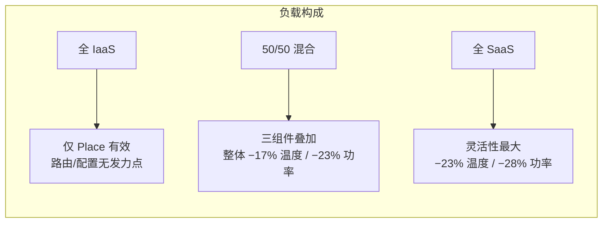

### 7.4 超配能力（图 22）

论文分析热与功率基础设施被超配场景下 TAPAS 的有效性。未超配（None）时，基线与 TAPAS 都不会因温度或功率约束出现限频。随服务器追加：基线很快出现限频事件，尤其超配超过 **20%** 之后；TAPAS 最多可多承载 **40%** 的服务器而不影响结果质量，并把热/功率限频时间占比维持在 **0.7%** 以下，实现安全的热与功率超配。

### 7.5 故障应急管理（§5.4，表 2）

发生温度（AHU）或功率（UPS）故障时，数据中心必须立即适配分别降至 **90%** 和 **75%** 的容量限额。表 2 对比基线与 TAPAS 在五分钟峰值负载期间的性能与质量影响。

| 指标 | 功率应急·基线 IaaS | 功率应急·基线 SaaS | 功率应急·TAPAS IaaS | 功率应急·TAPAS SaaS | 温度应急·基线 IaaS | 温度应急·基线 SaaS | 温度应急·TAPAS IaaS | 温度应急·TAPAS SaaS |
|------|------|------|------|------|------|------|------|------|
| **性能** | −35% | −28% | **0%** | **+16%** | −22% | −19% | **0%** | **+10%** |
| **质量** | 0% | 0% | 0% | −12% | 0% | 0% | 0% | −6% |

**口径与动作**：由于难以精确测量 IaaS 性能影响，论文把 IaaS 与 SaaS 效果都表示为相对最高频率被限频的频率百分比，并按受影响负载比例折算。基线为维持限额在各服务器施加最高达 **35%** 的统一限频，导致显著性能下降；TAPAS 在最多 **12%** 质量影响（导向小模型导致的准确率下降）下维持甚至提升性能，通过有选择的动作——仅在必要时把请求导向小模型——有效管理温度与功率。

> *"As precise IaaS performance impact is challenging to measure, we present the effects on both IaaS and SaaS workloads as the percentage of frequency capped relative to maximum frequency, adjusted by the fraction of workloads affected."*
>
> 由于难以精确测量 IaaS 性能影响，我们把 IaaS 与 SaaS 负载的效果都表示为相对最高频率被限频的频率百分比，并按受影响负载比例做了折算。

**重要边界**：表 2 的 Perf 是受影响负载加权的相对频率限制代理，Quality 是小模型路由带来的估计质量损失，并非全部用户请求的直接测量；不能由表 2 推导真实端到端延迟、逐请求质量或恢复期积压已获保证。

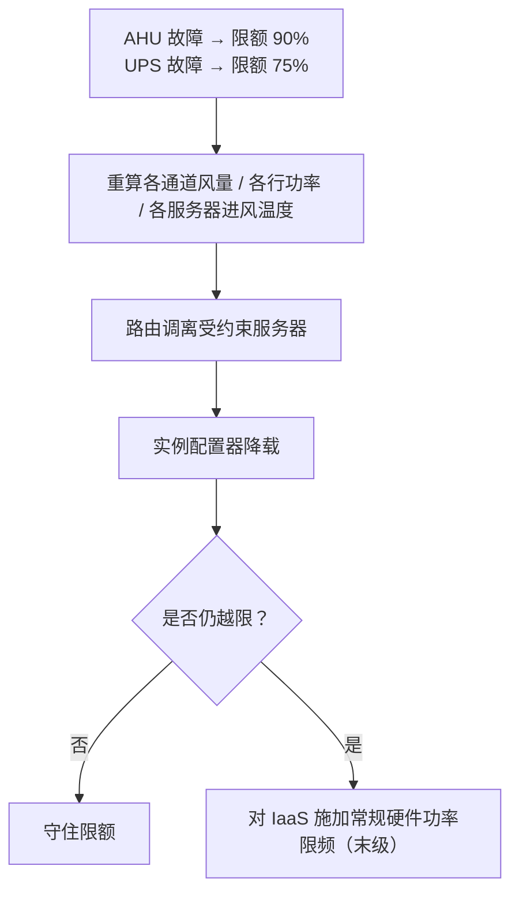

---

## 8. 与相关工作的定位对比

| 方向 | 代表工作 | 核心思路 | 与 TAPAS 的区别 |
|------|----------|----------|-----------------|
| **数据中心冷却管理** | CoolProvision、TESLA、CoolAir、CoolEdge、CoolDC 等 | 自适应冷却系统，借助温水、浸没冷却、自然冷却等优化热控制，缓解热点、提升效率；CoolProvision 在维持性能前提下优化低配冷却。 | TAPAS 不调节冷却设备本身，而是通过虚拟机放置、请求路由与实例配置减少 LLM 推理集群中的热点。 |
| **热感知调度** | RT-TAS、PTDS、Virtual Melting Temperature 等 | 优化作业/虚拟机放置以减少热问题：RT-TAS 做集成 GPU-CPU 的热均衡任务到核分配；PTDS 优化 VM 到主机调度以防热点、降冷却能耗。 | 传统热/功率感知调度在 LLM 服务的独特挑战下效果次优；TAPAS 针对推理阶段画像、配置旋钮与 SaaS/IaaS 不对称设计。 |
| **数据中心功率管理** | Flex、SmartOClock、SmoothOperator、Thunderbolt、Power routing、Dynamo | Flex 通过离线放置与在线切负载安全超配预留功率；SmartOClock 基于功率预测做负载感知超频；SmoothOperator 把同步功率模式服务均匀散布以削峰；Thunderbolt 做 QoS 感知大规模限频。 | TAPAS 聚焦 LLM 推理集群，把功率利用率提升与放置—路由—配置三层调度结合。 |
| **LLM 服务** | POLCA、μ-Serve、vLLM/PagedAttention、Orca、Splitwise、DistServe、Sarathi-Serve 等 | POLCA 提出 LLM 推理集群功率超配框架；μ-Serve 通过模型并行与预测式请求调度做功率感知服务；其余在 KV cache、连续批处理、调度、自动扩缩容、prefill-decode 分离、硬件异构、地理负载均衡等方向优化。 | 这些服务优化与 TAPAS 正交；TAPAS 在其之上叠加设施级热/功率感知。 |

**关键区分**：TAPAS 的新颖性不在某个推理引擎优化或单一冷却/限频算法，而在于把**设施侧历史画像**与**负载侧三层可动作空间**打通：放置选落点、路由避热点、配置调旋钮，且动作顺序与权限按 SaaS/IaaS 不对称分配。

---

## 9. 工程启示（结合本项目两机六卡边界）

> 本节是分析者判断，不是论文已验证结论；本项目资源边界为两台服务器、各三张 RTX 3090，所有迁移性判断都需在该规模上重新核验，不冒充原规模完整复现。

### 9.1 可直接借鉴的机制分层

| TAPAS 机制 | 可迁移要点 | 六卡小规模下的适配方向 |
|------------|-----------|------------------------|
| **设施/请求/动作权限三层分离** | 先分清设施约束（温度、功率、风量）、服务指标（TTFT/TBT/goodput）、可动作对象（谁可调、谁不可改）。 | 两机六卡虽无机柜行/通道，但可区分"整机功率上限""单卡温度""进程内可调参数"三层；先把可观测边界画清，再谈调度。 |
| **历史画像 + 保守假设** | 数据不足时按峰值负载假设；用周期模板预测行/VM 功率；保守分位（P99）低估比例可控。 | 小规模可先采短时段稳态曲线作为负载画像；冷启动/数据不足时按峰值保守取值，避免乐观预测导致越限。 |
| **配置旋钮的反向作用认知** | 降并行度降总功率但抬升最热卡温度；减 decode 批量可能抬升显存温度。 | 六卡实验调并行度/批量时，必须同时记录单卡温度、显存温度与总功率，不能只看平均功率或平均温度。 |
| **动作优先级** | 先调性能旋钮（频率/批量/并行度），量化与换小模型作为末级；切换期停收请求并计入重载时间。 | 小规模实验设计降载对照时，应把"切换等待/重载时间"纳入代价，不能只比较稳态功率。 |
| **温/功率解耦** | 最高温度与峰值功率不相关，约束过滤需分两条线。 | 评测时温度热点与功率热点分别报告，避免用功率达标代替温度达标。 |

### 9.2 规模差异下不能照搬的部分

- **行/通道级放置与超配**：TAPAS 的放置收益建立在数百机柜、跨多行的负载聚合与复用之上；两机六卡没有行级复用空间，放置策略退化为单机内进程/卡分配。
- **SaaS/IaaS 不对称**：本项目实验负载通常全部可控，不存在"不可改的 IaaS 邻居"；TAPAS 对 IaaS 的末级限频逻辑在小规模复现中缺乏对应对象。
- **超配 40%、限频 −97%/−99% 等数字**：来自千台级仿真与生产轨迹，是原规模结论；六卡上只能观察机制是否存在，不能据此宣称同等收益。
- **故障场景**：AHU/UPS 冗余与容量收缩（90%/75%）是设施级事件；两机环境只能用注入式功率/温度约束模拟，不能等同于真实设施故障。

### 9.3 对选题的线索提示

TAPAS 把"供电/冷却限制"沿**放置 → 路由 → 配置**三个动作层向下传导。对照本项目关心的"时变功率预算下不同紧急程度作业的调度与恢复"，可重点核验：TAPAS 的动作空间里**没有显式的作业优先级/紧急程度区分**，也没有跨多个下降—恢复事件的积压补齐模型；这两类是否构成可区分的机制缺口，需要在 Mode C 与最近邻对比中继续核验，不能仅凭关键词差异声称创新。

---

## 10. 论文局限、证据边界与未知项

### 10.1 作者自述限制

| 限制 | 出处 | 内容 |
|------|------|------|
| **IaaS 在线迁移不支持** | §4.1 | GPU IaaS 虚拟机不支持这里所需的在线迁移；可控 SaaS 可通过新建、转移、撤销迁移实现搬迁。 |
| **跨负载/跨机房需重训** | §4.6 | 更换工作负载需重训配置控制器；改变机房布局或散热系统需更新回归模型。 |
| **IaaS 性能用代理测量** | §5.4 | IaaS 真实性能难直接获取，采用频率限幅比例作代理，质量按模型替换估计。 |

### 10.2 分析者判断的边界

- **可调 SaaS 比例决定调度余地**：候选落点、模型替换权限与可控 SaaS 比例共同决定空间调度余量；不应把本机两节点场景等同于其机房。
- **三类评估口径需分列**：常态一小时回放、大规模仿真、应急代理评估不能互换；论文未提供跨多个下降/恢复事件、逐请求统计以直接支持真实恢复期服务保证。
- **代理指标与真实服务的偏离**：应急表格的性能代理与逐请求服务/质量之间，在哪些事件与服务组成下会明显偏离，是计量问题线索，尚无本项目失败证据。
- **重配置代价覆盖范围**：当可路由余量和可调 SaaS 比例降低时，重配置前后的等待损失是否改变动作排序，需先核对论文对切换成本的覆盖范围。

### 10.3 未核验项（unknown）

- 未审代码、原始轨迹、完整重配置状态机与置信区间；未独立复现。
- 估计质量与真实业务质量之间的对应关系尚未独立核验。
- 生产轨迹/请求的隐私协议未独立核验；本报告未复制用户请求或运行业务数据。

### 10.4 可复现性与迁移性评级

**复现评级：unknown**（未审完整工件/数据，未复现；未知不等于低）。可借鉴原则是把设施指标、请求指标及动作权限分层；原云规模不能因六卡无法原样复现而从阅读中排除，落地时另核对可测机制。跨领域迁移：不适用——本轮只形成来源阅读线索，未选择源方法 B。

---

## 11. 候选问题与 Mode C 待核验清单

| 编号 | 候选问题（AI 分析判断，非新颖性结论） | 支撑证据 | 状态 |
|------|----------------------------------------|----------|------|
| LP05-P1 | 应急表格的性能代理与逐请求服务/质量之间，在哪些事件与服务组成下会出现明显偏离？ | LP05-E01、E02、E03、E04 | 候选，待 Mode C 及最近邻核验 |
| LP05-P2 | 当可路由余量和可调 SaaS 比例降低时，重配置前后的等待损失是否改变动作排序？论文已考虑重配置成本，需先核对覆盖范围。 | LP05-E01、E02、E03、E04 | 候选，待 Mode C 及最近邻核验 |
| LP05-F1 | 功率与最热部件温度对同一并行度/批量动作可呈不同方向变化（降并行度降总功率但升最热卡温度；小 decode 批量升显存温度）。 | LP05-E01 | 论文设备与模型上的观察，未取得原始测量或复测 |
| LP05-F2 | 论文把应急期服务损失显式纳入讨论，但性能与质量主要是代理口径；不能由表 2 推导真实端到端延迟、逐请求质量或恢复期积压保证。 | LP05-E04 | 同上，口径边界已标注 |

### 11.1 与清单阅读问题的对照

清单要求回答：**"供电限制如何传到放置、路由和配置？"** 综合 §4 与 §5.4，传导链为：设施故障/预算收缩 → 重算通道风量、行功率、服务器进风温度三类余量 → 放置层过滤越限通道/行并把 IaaS 导向冷服务器 → 路由层在通道/行/服务器三层排除越限风险虚拟机 → 配置层按"性能旋钮优先、量化/换模末级"调整 SaaS 实例 → 仍不足时才对 IaaS 硬件限频。供电限制沿这条链逐层落地，且每一层的可用动作都受 SaaS 可调比例约束。

---

## 附录：关键术语对照表

| 英文 | 中文 | 说明 |
|------|------|------|
| SaaS (Software-as-a-Service) | 软件即服务 | 云厂商托管、对厂商透明、可调配置的 GPU 虚拟机 |
| IaaS (Infrastructure-as-a-Service) | 基础设施即服务 | 不透明、厂商不可见、不可改的 GPU 虚拟机 |
| goodput | 有效吞吐 | 满足 TTFT/TBT SLO 前提下每秒处理的 token 数 |
| TTFT | 首 token 延迟 | Time To First Token，prefill 完成到首个输出 token 的时间 |
| TBT | 每 token 间隔 | Time Between Tokens，decode 阶段相邻 token 间隔 |
| TP (Tensor Parallelism) | 张量并行 | 把单层权重切到多卡的模型并行方式，论文对比 TP8/TP4/TP2 |
| AHU | 空气处理单元 | 通道内送风、维持冷通道风量的设备 |
| UPS / PDU / ATS | 不间断电源 / 配电单元 / 自动转换开关 | 三级配电层级的组成部件 |
| oversubscription | 超配 | 在峰值不同时发生的假设下，按低于各负载峰值之和规划容量 |
| thermal/power capping | 热/功率限频 | 越限后硬件降低频率/功耗以守住温度或功率限额 |
| Pareto frontier | Pareto 前沿 | 在不牺牲某一目标前提下无法再改善另一目标的配置集合 |
| KV cache | 键值缓存 | 推理中缓存的注意力键值对；同客户请求复用可加速 |
| TDP | 热设计功耗 | GPU 出厂标定的最大散热设计功率 |
