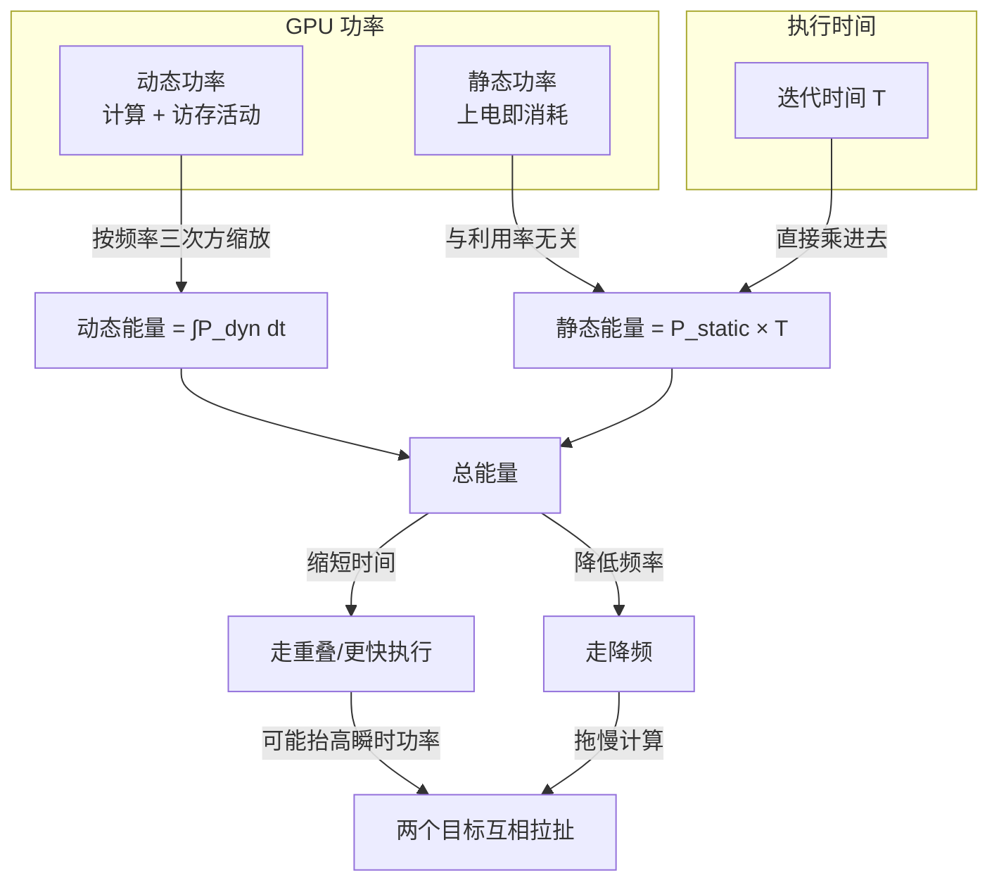
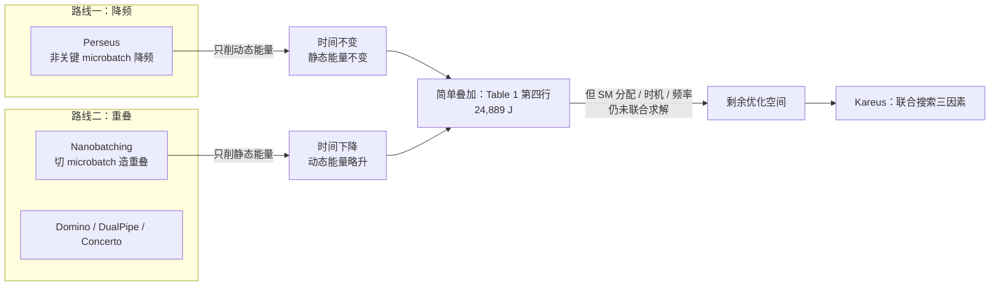
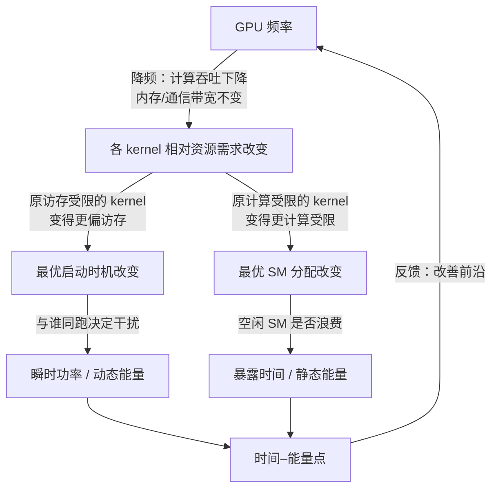
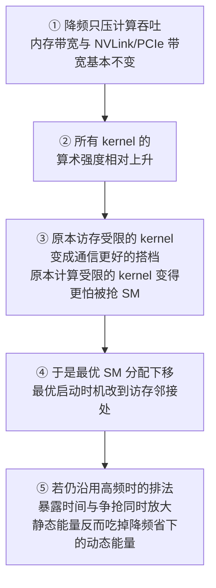
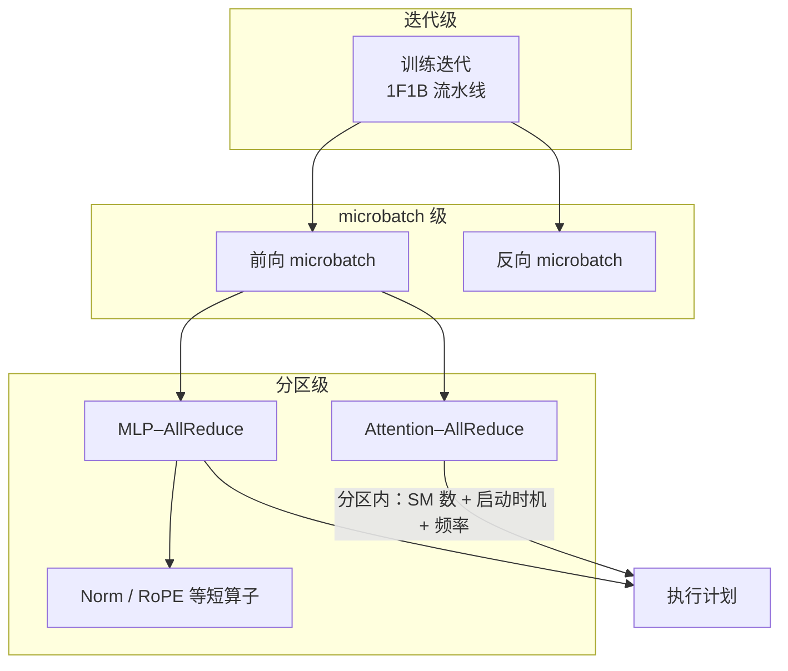
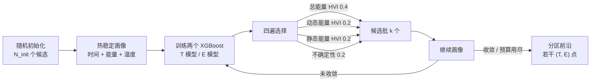
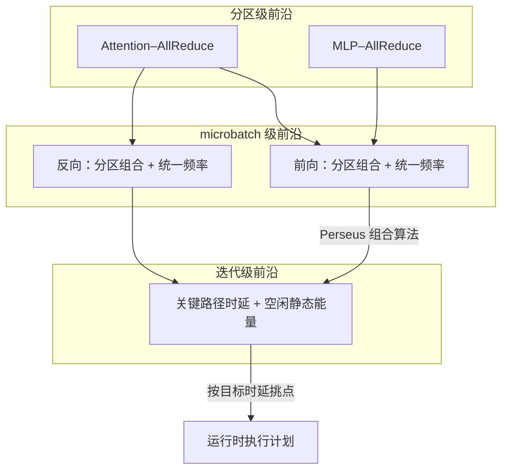
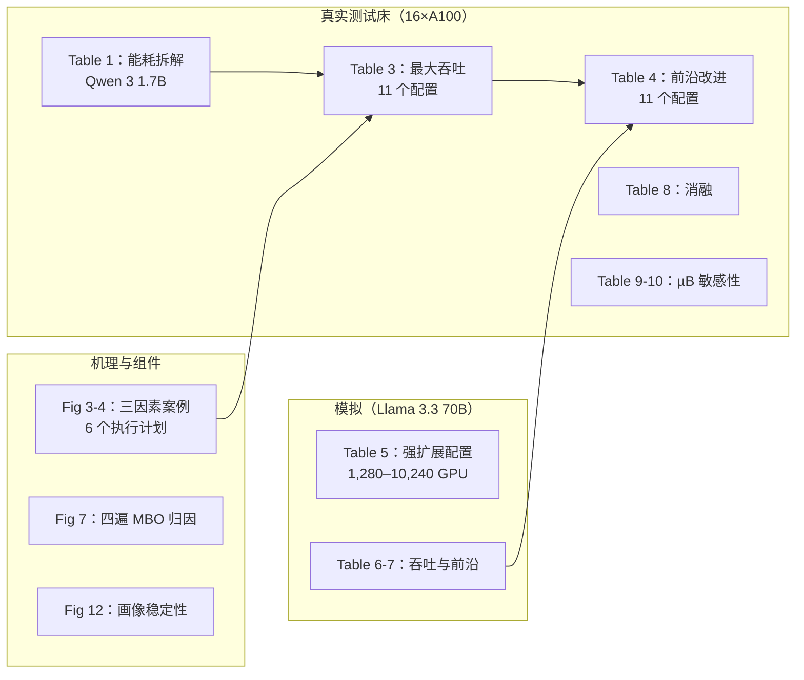
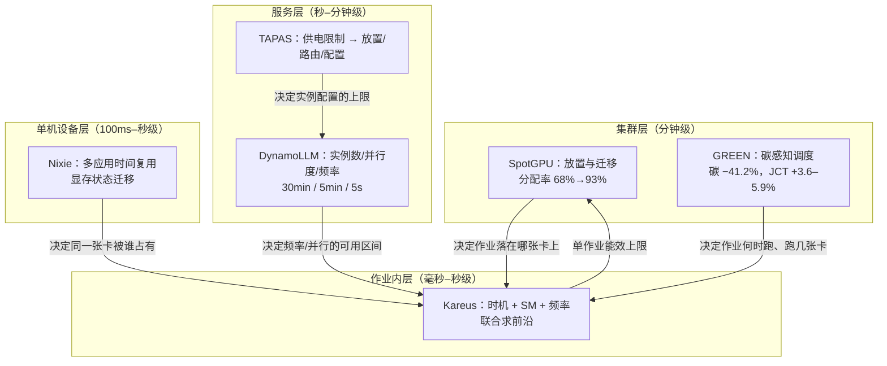
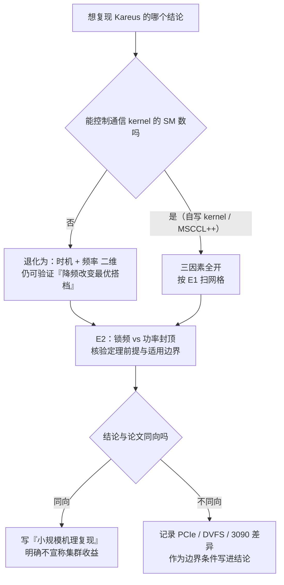

# Kareus 精读报告：降频之后，为什么"计算与通信怎么排"必须跟着改

> 一句话结论：**Kareus 把"省电"从两个互不相干的动作——给非关键路径降频（Perseus 路线）与把通信塞进计算空隙（nanobatching 路线）——合并成一个联合搜索问题**，并用"分区"把爆炸的搜索空间切成可以独立优化的小块。§3.2 的案例使用 Llama 3.2 3B、TP4 和**四张全互联 A100**，比较相同工作量下不同通信 SM 分配、启动时机和频率；§3.3 报告所观察配置的时间与能量差距最高可达 **3.29×**。在图 3 的案例中，**改变频率后，优选的 SM 分配与启动时机也改变**；这是指定设置内的证据。

## 报告元信息

| 项目 | 内容 |
|---|---|
| 论文 | Kareus: Joint Reduction of Dynamic and Static Energy in Large Model Training |
| 作者 | Ruofan Wu, Jae-Won Chung, Mosharaf Chowdhury（University of Michigan，SymbioticLab） |
| 发表 | USENIX OSDI 2026，正文 pp.1185–1198（含封面共 21 页） |
| 类型 | 系统论文（measurement + 机理分析 + 算法设计 + 真实测试床评估 + 大规模模拟） |
| 对象 | 大模型**训练**（不是推理服务）的 GPU 能量：单迭代时间 × 功率的联合优化 |
| 关键机制 | 分区重叠执行模型（partitioned overlap）+ 多目标贝叶斯优化（MBO）+ 热稳定画像器（thermally stable profiler） |
| 集成对象 | Perseus（频率控制）+ Megatron-LM（训练框架）+ MSCCL++（通信 kernel）+ Zeus/NVML（测量） |
| 开源 | https://github.com/ml-energy/kareus |
| 主要数字 | 同等时间能耗 −28.3%；同等能量时间 −27.5%；最大吞吐下时间 −14.9%、能耗 −22.1%；执行计划差距 3.29× |
| 实验规模 | 真实：16×A100 40GB（两台 AWS p4d.24xlarge）；模拟：Llama 3.3 70B 强扩展到 10,240 GPU |
| 与本项目关系 | 直接对应"发电/供电约束下 GPU 调度"里的**训练侧功率-时间耦合**一支；提供了"频率改变最优重叠安排"的机理证据链 |
| 读这篇要回答的问题 | **降频后，计算与通信的最佳安排为什么会改变？** |

> 2026-11-10 校正：按本地 PDF 第 4 页 §3.2 / Table 1 及第 19 页 Appendix A，核对四卡案例、nanobatching 的总能量与动态能量口径，并补齐恒频定理“相同平均频率对应相同完成时间”的第三前提。同步将未核验的拓扑、控制接口、计量刷新率和模型上限改为待测，并收紧“可发表”与“变化后必重跑 MBO”的判断。第 9 节属于待验证线索，尚无可执行 Idea/计划；本次未运行实验。

## 核心指标速览

| 指标 | 数值 |
|---|---|
| 不同执行计划的时间/能耗差距 | 3.29× |
| 单 Attention 层能量最优计划 vs Megatron-LM | 能耗 −24.3%、时间 −12.3% |
| 同上 vs Nanobatching | 能耗 −7.1%、时间 −5.4% |
| 端到端最大吞吐：时间降幅 / 能耗降幅 | 14.9% / 22.1% |
| 等时能耗降幅（前沿改进） | 28.3% |
| 等能量时间降幅（前沿改进） | 27.5% |
| 70B 模拟最大吞吐降幅 | 时间 9.1–9.3%、能耗 19.7–20.2% |
| 消融：去掉频率缩放 / 去掉 kernel 调度 | 能耗 +12.9% / +10.8% |
| 全局解空间规模 | 85,050 个候选（A100，单迭代） |
| 穷举画像代价 vs MBO 代价 | 4,912 GPU·h vs 2 h（32 GPU·h） |
| 画像单候选耗时构成 | 5 s 测量 + 5 s 冷却 + 初始化/预热 ≈ 13 s |

---

## 1 先把两个"能量账本"分开

### 1.1 论文给出的账本定义

论文把 GPU 功率拆成两项，这一步决定了后面所有推理成立与否：

| 项 | 定义 | 由什么决定 | 想降它要做什么 | 代价 |
|---|---|---|---|---|
| **动态功耗/能量** | 芯片计算与内存活动所消耗的功率；与核心频率成正比、与电压平方成正比；能量是该功率对时间的积分 | **频率**（近似三次方关系）、活动量（晶体管翻转次数） | 降低频率；减少无效活动 | 降频直接拖慢计算，可能拉长迭代时间 |
| **静态功耗/能量** | 芯片所有部分在任何时刻都消耗的功率，与利用率无关；能量 = 静态功率 × 执行时间 | **只由执行时间决定**（在给定芯片与温度下 P_static 近似常数） | 缩短执行时间；减少"有人在耗电但没干活"的空转时段 | 缩短时间往往需要更多并行/更强重叠，可能抬高瞬时功率 |
| 总能量 | 静态能量 + 动态能量 | 二者之和 | 必须同时看两项 | 两项的调节手段互相干扰 |

论文对静态功耗取了一个非常具体的口径：**GPU 处于就绪态（P0）、不跑显著计算时的功耗**。这一点很关键，因为它把"空转浪费"这件事变成了可测量的量：一个 SM 闲着，它照样在分摊静态功耗，但它没有产出。

**关键洞察**：
- 训练能耗不是一个数，而是**两个乘法的和**：`静态功率×时间 + 动态功率×时间`。Perseus 只动第二项里的频率，nanobatching 只动第一项里的时间，两边都没法单独把和压到最小。
- 静态能量对时间是**线性**的，动态能量对频率近似**三次方**——这解释了一个反直觉现象：高频跑得更快，但功率涨得比时间降得更快，所以"跑满频率"通常不是能量最优。
- 附录 A 给出一个**有前提的定理**：动态功率满足 $k f^3$、静态功率恒定，且**相同平均频率对应相同完成时间**时，Jensen 不等式推出恒定频率的总能量不高于波动频率；第三个前提不能省略。

### 1.2 用一张图记住这套账本

### 1.3 论文用 Qwen 3 1.7B 演示这套账本

Table 1 是全文最关键的一张"体检表"：16 张 A100 上训练 Qwen 3 1.7B，Megatron-LM 达到 99.0 TFLOP/s/GPU。

| 配置 | 迭代时间 (s) | 静态能量 (J) | 动态能量 (J) | 总能量 (J) | 读法 |
|---|---|---|---|---|---|
| Megatron-LM | 5.60 | 5,372 | 21,374 | 26,745 | 基线：顺序执行 + 满频，动态能量占 80% |
| Megatron-LM + Perseus | 5.60 | 5,374 | 19,531 | 24,905 | 时间不变 → 静态能量几乎不变；只削动态项，总能量 −6.9% |
| Nanobatching | 5.31 | 5,096 | 21,445 | 26,541 | 时间 −5.2% → 静态能量随之下滑；但动态能量反而**略升**（更多访存 + 每个 nanobatch 额外梯度累加） |
| Nanobatching + Perseus | 5.37 | 5,160 | 19,729 | 24,889 | 两条路线简单叠加，拿到 24,889 J，是"既有最优" |

**第三行的动态能量为 21,445 J，比基线增加 71 J；总能量则从 26,745 J 降至 26,541 J，减少 204 J（约 0.76%）。** 原文把动态项增加归因于额外访存和梯度累加；缩短执行时间带来的静态项下降仍使这组配置的总能量略降。因此，该表支持“重叠的两类能量变化可能相反”，不能据此断言 nanobatching 不节能。第四行联合频率调整后，总能量进一步降至 24,889 J。

**关键洞察**：
- 既有 SOTA（第四行）已经是"两条路线的最优拼装"，但它仍然是**拼装**：Perseus 用的 SM 分配与启动时机是 nanobatching 的默认配置，频率则是另一套逻辑单独算出来的。
- 论文的核心质疑正是从这里开始：**这两件事真的可以分开算吗？** 第 3 节用一组 6 个执行计划的实验回答"不能"。

---

## 2 两条既有路线，以及它们各自看不见的东西

### 2.1 路线一：频率缩放（Perseus 一脉）

| 维度 | 内容 |
|---|---|
| 做法 | 按 **microbatch** 粒度给"不在关键路径上"的前向/反向计算降频；流水线迭代时间不变（图 1b） |
| 为什么有效 | 动态能量随频率下降（三次方），而迭代时间不变 → 静态能量不变，总能量下降 |
| 它的盲区 | 沿用**顺序 kernel 执行模型**（图 2a）：同一时刻只跑一个 kernel。它没有把通信塞进计算里，因此"暴露的通信时间"这段纯空转的静态浪费一直存在 |
| 它的隐含假设 | "哪些 microbatch 是非关键的"由流水线调度决定，而流水线调度没被优化；SM 分配也没被优化 |
| 论文对它的定位 | 打开了"频率"这一维，但没打开"重叠"这一维 |

### 2.2 路线二：细粒度 kernel 调度（nanobatching 一脉）

| 维度 | 内容 |
|---|---|
| 做法 | 把一个 pipeline microbatch 切成两个**等大、彼此无数据依赖**的 nanobatch，让一个 nanobatch 的通信与另一个的计算错开跑（图 2b） |
| 代表工作 | NanoFlow、TokenWeave、vLLM Dual Batch Overlap（推理侧）；DeepSpeed Domino、DeepSeek DualPipe、Concerto（训练侧） |
| 为什么有效 | 时间缩短 → 静态能量下降 |
| 它的盲区 | (1) 不做频率缩放，动态能量不动；(2) 通信 kernel 用 NCCL 这类"为顺序执行优化"的默认实现，**默认假设没有并发 kernel，因此可能占用过多 SM**；(3) 启动时机基本是"尽早"，不与"和谁一起跑"的资源类型匹配 |
| 它的隐含假设 | 通信越快越好、重叠越早越好。第 3 节证明这两条都会翻车 |

### 2.3 两条路线的关系图

**关键洞察**：
- 这两条路线不是"竞争关系"，而是**各管一个能量项**。真正的问题不是选哪条，而是"两条一起上时，参数该怎么配"。
- 论文抓的漏洞很精准：nanobatching 的默认通信 kernel 是**为没有并发 kernel 的世界设计的**；一旦你开始重叠，这个默认就变成错误的前提。这是"来自系统默认值的机会"——一个非常典型的系统论文选题切口。

---

## 3 三因素实验：把"最优"这件事拆成可测量的三根旋钮

### 3.1 论文对"执行计划"的定义

论文把执行计划（execution schedule）定义为三个因素的组合：

| 因素 | 具体含义 | 可调范围（论文实现） | 影响哪个账本 | 单独看时的典型误判 |
|---|---|---|---|---|
| **SM 分配** | 分配给通信 kernel 的 GPU 流多处理器数量 | A100 上有效范围约 1–30 个 SM（超过 30 经验上不再改善通信时延） | 主要影响时间（进而影响静态能量）；分太少会让通信暴露，分太多会抢计算 | "通信越快越好" → 给满 SM，结果拖慢计算 |
| **启动时机** | 通信 kernel 插在计算 kernel 序列的哪个位置 | 枚举分区内所有计算算子位置 | 影响时间与瞬时功率（争抢内存带宽/算力） | "越早越好" → 与访存受限 kernel 撞车，双方都变慢 |
| **GPU 频率** | 计算与通信跑在什么频率 | A100 210–1,410 MHz（15 MHz 步长）；搜索限 900–1,410（35 档） | 主要影响动态能量；同时**改变前两者的最优值** | "降频只省能量、不改调度" → 沿用旧 SM 分配，反而更费 |

### 3.2 六个执行计划，一张前沿图

论文的案例设置：Llama 3.2 3B，单个 Transformer Attention 层，张量并行 4，四张全互联 A100。这一段只观察"一个 nanobatch 的计算 + 上一个 nanobatch 的通信"，二者无数据依赖，正是训练里的常见片段。

| 计划 | 配置要点 | 时间 (ms) | 能量 (J) | 落在前沿？ | 失败原因（论文解释） |
|---|---|---|---|---|---|
| (a) | 通信 2 SM，与 Linear 1 同启 | 5.56 | 7.69 | 否 | 通信在计算结束前跑不完 → **暴露的通信时间**，期间 106 个 SM 闲着，静态功耗白烧 |
| (b) | 通信 4 SM，与 Linear 1 同启 | 4.33 | **6.88** | **是** | 通信刚好在计算结束前完成，静态浪费最小 → 1,410 MHz 下的能量最优 |
| (c) | 通信 20 SM，与 Linear 1 同启 | 4.62 | 7.23 | 否 | 通信变快，但抢走 Linear 1 的 SM；多给的 SM 自己又几乎闲置，双重浪费 |
| (d) | 通信 4 SM，改与 **Norm** 同启 | 4.62 | 7.22 | 否 | Norm/RoPE 是访存受限的，通信也要高内存带宽 → **带宽争抢**，双双被拖长 |
| (e) | 同 (d) 但频率降到 1,100 MHz | 5.51 | 5.16 | 否 | 动态能量确实降了，但通信抢 Linear 1 的 SM，而 Linear 1 在低频下**更**计算受限 → 时间暴涨 |
| (f) | 1,100 MHz，通信 8 SM，与 **RoPE** 同启 | 5.17 | **5.03** | **是** | 让计算受限的 Linear 无干扰地跑；通信与访存邻接，干扰更小 → 低频下的能量最优 |

请注意 (b) 与 (f)：**同样是"能量最优"，两者的 SM 分配与启动时机完全不同**。这就是全文的支点。

### 3.3 三因素互相咬合的形状

**关键洞察（表 2 的四条，按论文原意）**：
- **SM 分配存在中间甜点**：给少了，通信跑不完，出现"只有一个小 kernel 在跑"的空档；给多了，拖慢别的 kernel 而目标 kernel 并不显著变快。
- **"和谁一起跑"比"多早跑"更重要**：通信 kernel 在 SM 充足时也是高带宽需求者，与 Norm/RoPE 同跑就是带宽内耗。
- **频率改变的是"相对"资源需求**：低频让所有 kernel 都更偏计算受限，从而改变"哪些 kernel 值得重叠"，也放大了静态功耗的相对占比（暴露的通信更致命）。
- **三者不可解耦**：改一个，另两个的能量最优配置就移位。

---

## 4 机理：降频之后，最佳安排为什么会变（本报告要回答的核心问题）

这是清单里给这篇论文出的问题，也是它区别于"又一个调度器"的地方。论文的答案可以拆成**四步因果链**，每一步都有实验数字支撑。

### 4.1 因果链

### 4.2 逐条对上论文证据

**第一步：降频只影响计算吞吐。** 论文明确写"reducing frequency only affects computation throughput and not memory throughput"。这是硬件事实层面的前提：HBM 带宽、NVLink/PCIe 带宽由存储与互连时钟决定，不随 SM 核心频率线性下降。因此降频后，同一个 kernel 的"计算/访存"比值下降——它变慢了，但它要的字节数没变。

**第二步：相对资源需求整体偏移。** 在 1,410 MHz 下，`Norm` 与 `RoPE` 是访存受限的、`Linear`/`FlashAttention` 是计算受限的。降到 1,100 MHz 后，所有 kernel 都往"计算受限"方向挪一格：原先"还挺访存"的 kernel 现在更访存占比高，原先计算受限的 kernel 更怕算力被切走。

**第三步：于是"最佳搭档"换了人。** 高频（1,410 MHz）下，论文的最优解是"通信与 `Linear 1` 同启、占 4 SM"（图 3b）：因为此时通信只要 4 个 SM 就能在 `Linear 1` 结束前跑完，而把通信丢给 `Norm` 会撞带宽（图 3d）。低频（1,100 MHz）下，最优解变成"通信与 `RoPE` 同启、占 8 SM"（图 3f）：因为 `Linear` 在低频下更计算受限，从它身上抢 SM 的代价更大；而 `RoPE` 本来就在等带宽，通信与它共享带宽的边际损失更小。**这就是"降频后最佳安排改变"的直接机制。**

**第四步：沿用旧安排会亏两次。** 图 3e 就是"只降频、不改排法"的反例：能量从 7.22 J 降到 5.16 J（动态项省了），但时间从 4.62 ms 涨到 5.51 ms（+19%），静态能量随之上涨。而 3f 把排法改对之后，能量进一步降到 5.03 J，时间回到 5.17 ms。**同样是 1,100 MHz，改不改排法差 2.3% 能量、6.4% 时间**——数字不大，但它是"必须联合求解"的存在性证明。

### 4.3 为什么"暴露的通信"在低频下更致命

论文给了一个比例论证：动态功率随频率显著下降，**静态功率不降**。于是降频后，静态功耗在总功耗中的占比上升；此时若有 1 毫秒的"只有通信在跑、计算 SM 全闲"，浪费的相对代价比高频时更高。这解释了为什么低频最优解更倾向于"把通信塞进访存邻接处，并且给足 SM 让它早点跑完"，而不是"给少点 SM、慢慢跑"。

### 4.4 一个附带但很漂亮的反例：1,350 MHz 打败 1,410 MHz

论文在 Qwen 3 1.7B / TP8 / µB8 / 4K 上发现：两个基线都把关键路径跑在 **1,410 MHz（最高频）**，但 Kareus 找到一个 **1,350 MHz** 的重叠配置，**时延反而最快**，并且比 N+P 再省 10.7% 能量。原因是：1,410 MHz 下的 nanobatching 重叠把资源利用率拉高 → 瞬时功率顶到上限 → **触发 GPU 频率节流**。结果是：决定执行时间的"时间平均频率"接近 1,350 MHz，而决定动态能量的"时间平均动态功率"仍接近 1,410 MHz 的水平。

**关键洞察**：作者用这个 A100 案例说明硬件功率限制下的频率波动可能增加能量。附录 A 的解释仍依赖动态功率近似 $k f^3$、静态功率恒定，以及**相同平均频率下完成时间相同**。该案例不能直接证明所有 GPU、工作负载或机架级限额下恒频均更优；应先核对实际频率、执行时间和计量边界。

### 4.5 把这个问题答完：三条可迁移的判断

| 判断 | 依据 | 迁移到别的系统时的用法 |
|---|---|---|
| 降频会**重新排序**"谁适合与通信重叠" | 图 3 的 (b) vs (f)；1,410 → 1,100 MHz 最优搭档从 Linear 换到 RoPE | 任何"带宽不随频率变"的平台（HBM、NVLink、PCIe）都成立；带宽随频率联动的平台要先重测 |
| 降频会**放大**暴露时间的代价 | 静态功耗占比随频率下降而上升 | 低频运行的系统应更激进地消灭"单 kernel 空转"窗口 |
| 在附录 A 三项前提下，频率波动增加动态能量 | 附录 A 定理 + 1,350 MHz 案例 | 有功率封顶/节流的机器上，"锁频"可能同时改善时间与能量 |

---

## 5 算法：把一个大不可解的问题切成"分区"

### 5.1 问题形式化与"为什么不能穷举"

论文的目标不是找单点最优，而是找**整条时间–能量前沿**，理由很实际：用户可能有时间截止（deadline、掉队节点）或能量预算，需要在前沿上挑点；这也是 Perseus/Zeus 一脉的共同立场。

三个决策变量（SM 数、启动时机、频率）合起来的解空间，对一个典型 Transformer LLM + A100 是 **85,050 个候选**（附录 B 的算法：35 档频率 × 30 档 SM × 91 种重叠子问题 = 85,050）。每个候选要 **约 13 秒**画像（5 s 测量 + 5 s 冷却 + 初始化/预热），穷举要 **4,912 GPU·小时**——按分区并行算是 307 小时。这个量级直接宣告"暴力搜索"不可行。

### 5.2 分区重叠执行模型

| 设计要素 | 论文做法 | 为什么这么做 | 代价/边界 |
|---|---|---|---|
| **分区定义** | 一个通信 kernel（来自 nanobatch A）+ 另一个 nanobatch 的最长连续计算 kernel 序列 | 二者无数据依赖 → 通信可落在任意连续子序列上 | 需要能识别"重复模式"，否则分区退化为整图 |
| **为什么能切** | 训练图是重复的：Attention–AllReduce 与 MLP–AllReduce 两类分区在每个 Transformer 块里重复出现 | 局部最优可以复用，搜索空间按"分区类型"而非"分区实例"计 | 依赖模型结构的规律性 |
| **泛化 nanobatching** | nanobatching 是它的特例（通信尽早、用默认 NCCL、不调频） | 把"三因素"都变成分区级的自由变量 | 需要支持可调 SM 的通信 kernel（MSCCL++）与可调频的运行时（Perseus） |
| **前向/反向不对称** | 用自定义 `torch.autograd.Function` 包住整块，前向与反向可用不同分区与计划 | 反向的 kernel 顺序与依赖不同，硬套前向计划会浪费机会 | 实现复杂度上升 |
| **连续通信融合** | 多个连续通信（如上下文并行下多个 AllGather）融成一个、共享 SM 分配 | 减少启动开销，避免"通信打通信" | 融合后细粒度控制变粗 |
| **短访存算子合并** | `BiasDropoutAdd` + `Norm` 这类合并为一个逻辑操作 | 否则启动时机搜索空间膨胀而收益甚微 | 需要算子级知识 |
| **执行模型可切换** | 工作量太小（小模型/小 microbatch）时，切分反而降低算术强度 → 允许回退**顺序执行** | 避免"为了重叠而重叠" | 需要画像两种模型并比较 |

### 5.3 三层结构

### 5.4 多目标贝叶斯优化（MBO）

标准 BO 只对单目标，而这里要帕累托前沿。论文做了两处定制：

| 组件 | 论文设计 | 为什么这样设计 | 具体超参 |
|---|---|---|---|
| **代理模型** | 两个：$\\hat T(x)$ 预测时间、$\\hat E(x)$ 预测动态能量；总能量 = $\\hat T(x)\\cdot P_{static} + \\hat E(x)$ | 时间主要由 SM 分配与启动时机决定，动态能量主要由频率决定，两者**大致正交** | XGBoost；训练线性于样本数（高斯过程是立方），树结构天然吃离散/类别变量 |
| **采集函数（利用）** | 三个超体积改进 HVI：分别用**总能量 / 动态能量 / 静态能量**代入 | 三个方向互补：动态能量向下推、静态能量向左推、总能量朝原点推 | 配额 0.4 / 0.2 / 0.2 |
| **采集函数（探索）** | bootstrap 集成（5 个模型、0.8 采样），用**各目标标准差之和**打分 | 单一采集函数只瞄一个方向，会漏掉前沿的其他段 | 配额 0.2 |
| **停止条件** | 样本数足够 or 连续若干批前沿无改进 | 画像是最贵的环节（占 97%），必须设上限 | $N_{init}$ 36/48/96；$B_{max}$ 3/4/4；$k$ 16/16/32（小/中/大分区） |

HVI 的定义（论文式）是：

$$\\mathrm{HVI}(x) = \\mathrm{HV}(P \\cup \\{(\\hat T(x), \\mathrm{Energy}(x))\\}; r) - \\mathrm{HV}(P; r)$$

其中 $P$ 是当前前沿点集，$r$ 是略差于已观测最差点的参考点（论文取 $r=(1.1\\max T(x), 1.1\\max E(x))$），保证超体积有界。

**MBO 的执行循环**：

### 5.5 前沿的组合

| 层次 | 组合方式 | 关键约束 | 为什么必须约束 |
|---|---|---|---|
| 分区 → microbatch | 枚举各分区计划的组合，累加时间与能量，剪掉被支配的组合 | (1) **一个 microbatch 内频率统一**；(2) **同类型分区共用一套 SM/时机** | 频率切换要数毫秒，相对单分区时延不可忽略；若允许每分区自由配置，搜索空间随分区数指数爆炸而收益甚微 |
| microbatch → 迭代 | 采用 Perseus 的迭代算法：迭代时间是关键路径上 microbatch 时延之和，能量是所有 microbatch 能量 + 空闲期静态能量 | 需要流水线各阶段的 microbatch 排布 | 关键路径与"非关键 microbatch"的降频机会都由排布决定 |

**关键洞察**：
- "统一频率"这条约束是**工程现实压过理论优雅**的典型：它可以被证明会损失一点前沿质量，但它换来"频率切换开销不进入模型"。任何"细粒度调频"的论文都必须回答这个数毫秒的切换代价。
- "同类型分区共用配置"是**用结构规律性换搜索可行性**。这也是这类系统论文常见的取舍：先承认"逐实例最优"不可解，再用"同类同配"的假设把问题压到可搜索。

---

## 6 实现：把计划落地需要的四件事

### 6.1 系统组成

| 组件 | 实现 | 职责 | 依赖 |
|---|---|---|---|
| 优化器 | MBO + 分区识别 + 前沿组合 | 离线产出"迭代前沿表"（T₁…Tₙ 各对应一套 SM/时机/频率） | — |
| 热稳定画像器 | Zeus + NVML | 给每个候选测时间与能量，控制温度干扰 | NVML 约 100 ms 采样间隔 |
| 分区重叠执行引擎 | Megatron-LM + MSCCL++ + 独立 CUDA 流 + CUDA event | 按计划执行分区，控制 SM 数与启动时机 | 通信 kernel 必须支持 grid size 控制 |
| 频率控制器 | 改自 Perseus 开源实现 | 异步切换每张卡频率 | 需 GPU 允许锁频 |

### 6.2 画像为什么要"热稳定"

| 问题 | 现象（论文实测） | 论文对策 | 数字 |
|---|---|---|---|
| NVML 采样太粗 | 采样间隔约 100 ms，毫秒级测量误差大 | 每个分区在 **5 秒窗口**内反复执行 | 从 5 s 起能量读数稳定；<2 s 波动大且均值偏低（GPU 未热起来） |
| 温度污染 | 前一个候选把 GPU 烤热，后一个候选测出来偏高 | 候选之间**冷却 5 秒**（本环境可降到 <32°C） | 能耗均值与"测量开始时温度"强相关；5 s 起稳定 |
| 总耗时 | 初始化 + 预热 + 5 s 测量 + 5 s 冷却 | 接受 ≈13 s/候选 | 单分区典型：32 候选/轮 → 画像 6.9 min，代理训练 + 采集 11 s |

**关键洞察**：
- 这是全文最"脏活"也最容易被忽略的一段。**任何以能量为目标的系统，如果测量不稳，优化器就会去优化噪声。** 论文把 97% 的优化开销花在画像上，说明它把"测量可信"当成了第一性约束。
- "5 秒冷却"不是一个可随便套用的常数：论文自己写明所需时长取决于服务器散热能力。搬到风冷/液冷不同的机器上必须重标定。

---

## 7 实验证据：从单层到 70B 模拟

### 7.1 证据地图

### 7.2 最大吞吐：不如前沿那么亮眼，但方向正确

论文的"最大吞吐"比较是取每条前沿的**最左点**（时间最小），与 Megatron-LM 比：

| 场景 | 时间降幅 | 能耗降幅 | 备注 |
|---|---|---|---|
| 全部 11 个配置的峰值 | **14.9%** | **22.1%** | 14.9% 出现在 Qwen 1.7B / TP8 / µB8 / 8K；22.1% 出现在 Qwen 1.7B / TP8 / µB8 / 4K |
| 典型 Llama 3.2 3B / TP8 / µB8 / 4K | 12.3% | 19.6% | 已是"纯 TP"里通信开销较高的一档 |
| Llama 3.2 3B / CP2TP4 / µB8 / 4K | 5.2% | 14.4% | 加上下文并行后，时间收益变小、能量收益仍可观 |
| Qwen 1.7B / CP2TP4 / µB8 / 4K | −0.5% | 7.1% | 特例：Nanobatching 在该配置下时间 **−20.4%**（显著拖慢），Kareus 靠"回退顺序执行"避开 |

**关键洞察**：
- 时间降幅的规律很清楚：**通信开销越大的配置，时间收益越大**（TP > CP+TP；µB 大 > 序列长）。这符合"重叠省的是暴露时间"这一机理。
- 能量降幅**不总跟随时间降幅**。论文解释得干脆：重叠提高利用率 → 抬高功率 → 抵消时间收益。所以"更快"不等于"更省"；要省，必须同时把频率也调对。
- 那一行 −20.4% 特别值得记住：**nanobatching 不是万灵药**。负载小到算术强度撑不住切分时，它会显著拖慢。Kareus 的"执行模型可切换"就是为这种情况准备的，这也是它比"纯 nanobatching"更稳的原因。

### 7.3 前沿改进：这才是它的主场

| 指标 | 定义 | 最好值 | 出处 |
|---|---|---|---|
| 等时能耗降幅 | 以 M+P 的最小时延为截止，看能耗能降多少 | **28.3%**（Qwen 1.7B / TP8 / µB16 / 4K） | Table 4 |
| 等能量时间降幅 | 以 M+P 的最小能量为预算，看时间能省多少 | **27.5%**（Qwen 1.7B / TP8 / µB8 / 4K） | Table 4 |
| 有代表性的中间值 | Qwen 1.7B / CP2TP4 / µB16 / 4K | 等时 8.9%→20.1%、等能量 8.4%→19.7% | Table 4 + Fig 11 |

论文对这两个方向的解释很物理：**同时间预算下静态能量被钉住**，Kareus 利用率更高 → 可以用更低频率跑完 → 动态能量降；**同能量预算下**，Kareus 把静态浪费压到最小 → 有更多能量额度可以"花在频率上"换速度。这是一个把两个账本"互相腾挪"的解释，比单纯说"我的调度更好"更有说服力。

### 7.4 消融：联合优化不是修辞

| 变体 | 相对 Kareus 的时间增幅 | 相对 Kareus 的能耗增幅 | 说明 |
|---|---|---|---|
| Kareus 去掉频率缩放 | +1.0% | **+12.9%** | 只留调度：时间几乎不变（说明调度本身没让事情变慢），但动态能量还回去了 |
| Kareus 去掉 kernel 调度 | +8.2% | **+10.8%** | 只留调频：时间明显变长（暴露的通信回来了），静态能量上升 |
| Nanobatching（两者都去掉） | +7.8% | **+20.6%** | 与第一行/第二行对照可见：两项收益不是简单相加，联合起来才有 20.6% |

**关键洞察**：这是一个"1 + 1 > 2"的实证。**去掉任意一维都只损失一部分，但两维都去掉损失更大**——这恰好对应"两个能量项通过同一个调度决策耦合"的论点。

### 7.5 敏感性：µB 越大，收益越大（但能耗曲线不平滑）

| µB | 时间降幅 | 能耗降幅 | 等时能耗降幅 | 等能量时间降幅 | 读法 |
|---|---|---|---|---|---|
| 8 | 12.2% | **22.1%** | 26.8% | 27.5% | 能耗峰值来自"低频关键路径"这个发现（1,350 MHz 案例） |
| 12 | 14.7% | 17.6% | 28.6% | 27.3% | 流水线失衡变大 → 非关键 microbatch 有更多降频空间 |
| 16 | 14.8% | 17.3% | 28.3% | 26.7% | 与端到端主配置一致 |
| 20 | **18.1%** | 18.8% | **29.8%** | **28.8%** | 通信占比最高 → 重叠收益最大 |

论文对"能耗曲线不平滑"给了两个解释：一是 µB8 有那个 1,350 MHz 的额外发现；二是 µB 改变流水线**阶段失衡**，而"给非关键 microbatch 降频"的省电潜力正比于失衡程度。这是一个挺微妙的点：**失衡在纯时间视角下是坏东西，在能量视角下反而是资源**。

### 7.6 模拟：70B 上趋势一致

| 场景 | 时间降幅 | 能耗降幅 | 等时能耗降幅 | 等能量时间降幅 |
|---|---|---|---|---|
| 16 µB / 10,240 GPU | 9.3% | 20.2% | 11.6% | 19.1% |
| 32 µB / 5,120 GPU | 9.2% | 20.0% | 14.1% | 16.8% |
| 64 µB / 2,560 GPU | 9.1% | 19.8% | 15.3% | 16.4% |
| 128 µB / 1,280 GPU | 9.1% | 19.7% | 15.1% | 16.0% |

论文的解释：流水线阶段与 microbatch 更多 → 非关键路径上可降频的东西更多 → 能耗降幅普遍高于测试床；µB 越多，预热/收尾的流水线气泡占比越小（而这些气泡本来会被降到最低频），所以能耗降幅略降；等时能耗降幅反而随 µB 上升，因为绝对迭代时间变长、可省额度变大。

**关键洞察**：模拟的价值不在"数字更大"，而在**趋势可复现**。但必须标明：这是模拟器结果，不是 10,240 张卡的真实测量。论文自己也用了 Perseus 的模拟器，并只声称"趋势一致"。
## 8 把六篇放在同一张图上：Kareus 站在哪一层

### 8.1 六篇的分层与优化对象

这六篇论文表面上都在谈"能耗/供电"，实际作用在完全不同的层，优化对象、时间尺度、代价函数都不一样。把它们并排看，能看出这个方向的"层间分工"。

| 论文 | 作用层 | 优化对象 | 时间尺度 | 代价/约束 | 核心手段 | 与 Kareus 的关系 |
|---|---|---|---|---|---|---|
| **SpotGPU / ASI**（OSDI'26） | 集群 | 6 个月、155,410 张 GPU、37,707 节点、1,400 万作业的**放置与迁移** | 分钟级决策（<2 分钟），抢占代价以 GPU·小时计 | 分配率 68%→93%；抢占代价 $C_t = G_t(\\tau_{now}-\\tau_{ck})$ | 特征刻画 + 增量放置 + "先建后拆" + 弹射链 | 提供了"上层负载长什么样"的事实底座；Kareus 优化的是单作业内部的 kernel 排布 |
| **GREEN**（NSDI'25） | 集群/作业 | 碳感知的**批作业调度与扩缩容** | 作业级（JCT 以小时计） | 碳足迹 −41.2%（四地区均值 32.2%），JCT 代价 3.6–5.9% | 碳因子驱动的时移 + GPU 数量扩展 + 峰值功耗约束 | 同一"用电侧灵活性"母题，但它在**作业之间**腾挪，Kareus 在**作业内部**腾挪 |
| **TAPAS**（ASPLOS'25） | 服务集群 | 供电上限如何传导到**放置、路由、实例配置** | 秒–分钟 | 供电预算 + SLO | 功率感知的放置/路由/配置联动 | 推理侧对应物；与 Kareus 共享"功率上限重塑最优配置"这一逻辑 |
| **DynamoLLM**（HPCA'25） | 推理服务 | **实例数 / 并行度 / GPU 频率**三层控制 | 30 min / 5 min / 5 s 三级节律 | P99 TTFT/TBT、SLO；重配置 6–8 分钟 | 画像 + 预测 + 重配置 + emergency 四步 | 与 Kareus 最像：都做"并行/频率的联合控制"，但一个在服务、一个在训练；DynamoLLM 的分层节律正好解释 Kareus 为何要"一个 microbatch 内统一频率" |
| **Kareus**（OSDI'26） | 单作业 / kernel | 同一迭代内**通信启动时机 + SM 分配 + GPU 频率** | 毫秒（kernel）–秒（迭代） | 训练时间预算或能量预算 | 分区重叠 + MBO + 前沿组合 | 本报告主角；把"频率"与"重叠"从两个独立旋钮变成一个联合问题 |
| **Nixie**（OSDI'26） | 单机 / 消费级 GPU | 多应用**时间复用**与显存状态迁移 | 100 ms 空闲检测；秒级窗口 | 交互延迟 vs 后台吞吐（−23.5%/+90.6%/+39.5%） | VMM 保留虚拟地址 + chunk 级迁移 + MLFQ | 把"GPU 被谁占用"这一层打开了；对 Kareus 的意义是：多租户下的"频率/占用"竞争会更复杂 |

### 8.2 一张定位图

### 8.3 三条横向洞察

**洞察一：这六篇其实在回答同一个问题的五个不同粒度——"给定一个功率/时间预算，怎样重排工作"。** SpotGPU 重排作业、GREEN 重排时间窗与卡数、TAPAS 重排实例与路由、DynamoLLM 重排并行度与频率、Kareus 重排 kernel 与频率、Nixie 重排"哪个应用此刻拥有 GPU"。区别不在"要不要重排"，而在**重排一次要付多少代价**：SpotGPU 的代价是抢占的 GPU·小时，DynamoLLM 的代价是 6–8 分钟建实例，Kareus 的代价是毫秒级频率切换与离线画像，Nixie 的代价是显存迁移。

**洞察二："降频"这件事在不同层有不同含义，且都不能孤立做。** DynamoLLM 把频率当作第三层（5 秒节律）来调，因为它比"重切分"便宜得多（50–80 ms vs 1–2 分钟）；Kareus 把频率当作与 SM/时机同级的决策变量，因为一次选错就会把静态浪费放大。两者共同指向一个结论：**频率不是一个可以叠加在调度之上的补丁，它会改变调度的最优解**。

**洞察三：只有 Kareus 把"能量"当第一目标而不是"时间的副产品"。** 其他五篇的主指标基本是"利用率/时延/碳排/成本"，能量要么是约束、要么是副产品；Kareus 直接把 $T$–$E$ 平面画出来，并且明确区分静态项与动态项。这也是它能发现"nanobatching 省时间但赔能量"这种反例的原因——**如果你只看时间，你永远看不到这笔账**。

---

## 9 放到"两机六卡"上：能做什么，不能做什么

### 9.1 现实约束先摆清楚

| 约束 | 具体情况 | 对复现/借鉴的影响 |
|---|---|---|
| 硬件 | 2 台服务器 × 3 张 RTX 3090（共 6 张，24GB） | 原 16×A100 的规模结果不能作为本机预期；需先核验六卡是否保留目标机制 |
| 互连 | 机内拓扑、GPU 间链路、机间网卡和实际带宽均待核验 | 通信占比、争用及重叠余量均须测量，不能从卡型直接推定收益方向 |
| 频率控制 | 目标 3090 的驱动、可用频率/功率控制接口、允许范围与权限待核验 | 权限和实际行为核验后可对照锁频与功率限制，检查附录 A 三项前提的适用性 |
| 通信 kernel 可调 SM | 所选 NCCL/MSCCL++ 版本及通信 kernel 的资源控制能力、3090 兼容性待核验 | 先检查已有工件和接口是否能控制目标变量；若只能调整时机与频率，须重新限定问题与证据范围 |
| 能量测量 | 本机 NVML 字段、传感器有效刷新率与计量误差待核验；板卡功率与整机功率分开 | 依据本机传感器与稳定性选择积分窗口和冷却时间；论文的 5 s 设置仅作待测参考，明确板卡边界 |
| 规模 | 可运行的模型规模、精度、batch 和并行策略待实测，不预设六卡只能运行约 1B 模型 | 结论必须标注"缩小规模验证"，不能宣称集群级收益 |

### 9.2 三个待核验的六卡实验线索

| 实验 | 变量 | 主要指标 | 计量边界 | 停止/继续条件 |
|---|---|---|---|---|
| **E1：三因素微基准**（单层 Attention，TP 度数待模型与拓扑核验） | 本机可用频率档 × 可控通信资源配置 × 启动时机；具体候选经接口核验后写入独立计划 | 单层时间（ms）与板卡能量（J，长窗口积分） | 只测 GPU 板卡能量，排除整机与网络 | 若配置排序稳定改变，先区分资源竞争、实际频率与测量误差；若不变，只能记为该设置未观察到，不能直接归因于 PCIe 拓扑 |
| **E2：功率封顶 vs 锁频** | 功率限制与锁频两种运行设置；具体档位待实测校准，不能预设 250 W 与 1,100 MHz 的平均频率相同 | 时间、能量与实际频率采样序列；先核对传感器刷新和可观察的时间尺度 | 平均频率匹配和同等完成时间须分别核对；同时检查功率模型与静态项假设 | 同等工作、匹配平均频率和完成时间下的能量差，可支持或削弱模型在该设置的适用性；若时间不同，先记录第三前提未满足，不能仅归因于 GPU 代际，也不能称定理被证伪 |
| **E3：端到端小步训练** | 有无重叠 + 两档频率，固定步数、固定数据 | 每步时间、每步能量、loss 一致性 | 积分窗口按本机刷新与稳定性核验后确定；同种子同数据 | 若重叠在小 batch 下更慢，记录条件与不确定性；Kareus 已有顺序执行回退，研究差异和价值须经最近邻及独立验证判断 |

### 9.3 决策树

**关键洞察**：
- **E2 只是待评估的诊断建议**：在确认锁频、功率控制和计量能力后，可以检查附录 A 的假设是否适用于本机；它不等于验证一个对所有工作负载成立的恒频优势。实际运行仍需单独的 Idea 与计划。
- 真正卡住复现的是**通信 kernel 的 SM 可调性**。这不是算力问题，是工具链问题；如果这一条过不去，任何"SM 分配"的结论都只能引用不能自证。选题时必须先把这条打通或明确放弃。

---

## 10 局限与可证伪点

### 10.1 论文自己承认的边界

| 局限 | 论文表述/位置 | 影响 | 怎样检验 |
|---|---|---|---|
| 两分量功耗模型 | 把 GPU 功耗拆为"动态 + 恒定静态"，更细的漏电模型（对电压敏感）留作未来工作 | 若漏电占比高（高温、低电压），静态项不再是常数，前沿会偏 | 在高温/低压场景重测静态功耗随温度的漂移 |
| 仅 A100 | 所有真实实验在 A100 40GB | 频率档位、SM 数、DVFS 行为都是 A100 特有 | 换 H100/3090 复测"最优搭档是否随频率移动" |
| 只覆盖 Transformer + 1F1B | 分区识别依赖重复结构 | MoE、长上下文异构结构、非 1F1B 流水线可能需要重新定义分区 | 在 MoE 模型上试分区识别；看分区类型是否仍重复 |
| 一个 microbatch 内统一频率 | 频率切换需数毫秒 | 牺牲了一部分前沿质量 | 若切换能压到微秒级，统一频率的约束可以放开 |
| 同类型分区共用配置 | 否则搜索空间指数爆炸 | 牺牲逐实例最优 | 对比"逐分区自由"在小模型上的收益上限 |
| 离线画像 | 画像与负载/硬件条件相关；变化后可否复用或需要重跑 MBO，待工件实现与测量核验 | 原实验画像平均为 2 h / 32 GPU·h；本机成本及缓存复用范围未知 | 测"换模型/换卡后前沿漂移多少" |
| 大规模结果是模拟 | 70B 用 Perseus 模拟器 | 绝对数字不可当实测 | 需要真实千卡验证（本篇没有） |
| 未计入网络与存储能耗 | 只算 GPU 板卡 | GPU 板卡证据不能直接支持端到端机房收益；增减幅度需额外计量 | 加整机/交换机功率计 |
| 温度只用于画像冷却 | 未把温度作为调度变量 | 高温降频会打乱计划 | 高温环境跑同一计划看偏差 |

### 10.2 我会追问论文的四个点

| 追问 | 为什么值得问 | 论文的现有回答 | 缺口 |
|---|---|---|---|
| "静态功耗取 P0 空闲值"是否过于乐观？ | 真实空转时芯片未必在 P0；温度升高会抬高漏电 | 用两分量模型简化，并引 [29,45] 的更细模型 | 没有给出"静态功耗随温度/利用率变化"的敏感性 |
| 13 秒/候选的画像，在小模型上是否"画像比训练还贵"？ | 若单次训练只有几分钟，2 小时离线优化就不划算 | 用 Llama 3 训练 54 天作对比 | 没有给出"训练时长多短时不值得用 Kareus"的阈值 |
| 1,350 MHz 的发现是普遍现象还是个例？ | 它依赖"功率封顶 + 重叠抬高瞬时功率" | 作为 case study 呈现 | 没有系统统计"多少配置会触发节流" |
| 统一频率的损失有多大？ | 这是全文最明显的近似 | §4.4 还给出同类型分区采用相同配置的复杂度理由；逐分区自由与多次切频的独立代价需进一步核验 | 没有量化"若允许逐分区频率，前沿能再降多少" |

### 10.3 可证伪的断言清单

| 断言 | 可证伪方式 |
|---|---|
| 频率改变会移动最优 SM 分配与启动时机 | 固定频率、扫 SM 与时机，若最优点不随频率移动 → 断言失败 |
| 简单叠加 Perseus + nanobatching 是次优的 | 若"叠加配置"恰好落在联合搜索的前沿上 → 断言失败 |
| 附录 A 三项前提成立时，恒频总能量不高于波动频率 | 先核对动态功率模型、静态项、相同平均频率与同等完成时间；若观察与预测不同，检查测量误差和各项前提，不能仅凭能量相同或更差认定三次方功耗假设错误 |
| 重叠省时间但可能赔能量 | 若所有重叠配置的能耗都低于无重叠 → 反例消失 |
| 分区化不会显著损失前沿质量 | 若"逐分区自由"比"同类型同配"好很多 → 近似过强 |

---

## 11 方法论上值得学的三件事

### 11.1 先建"账本"，再谈优化

论文没有一上来就提算法，而是先用 Table 1 把"时间/静态/动态/总能量"四列摆出来。这一步的作用是**把争论变成算术**：谁说 nanobatching 省电，就看它那一行的动态能量是不是涨了。**任何"能效"主张，如果没有分项账本，都容易被平均数字掩盖。**

### 11.2 用"同工作量、不同排法"制造可控对照

3.29× 这个数字的说服力来自实验设计：**工作量完全相同**，只有排法不同。这是系统论文里最干净的对照方式——它排除了"你跑得更快是因为你少算了活"这类质疑。做自己的实验时，这也应该是默认设计。

### 11.3 把"约束"写成显式的设计决策

"一个 microbatch 内统一频率""同类型分区同配"这两条，论文没有藏起来，而是明确写出理由（切换毫秒级、搜索空间爆炸）。**把近似写在明面上，比让它藏在实现里更可信**，也给了后续工作明确的改进入口。

---

## 12 术语、复现清单与"本报告没做的事"

### 12.1 术语表

| 术语 | 英文 | 在本篇里的确切含义 |
|---|---|---|
| 动态能量 | dynamic energy | 计算与访存活动消耗的能量，随频率近似三次方变化 |
| 静态能量 | static energy | 静态功率 × 执行时间；静态功率取 P0 空闲值 |
| 执行计划 | execution schedule | 通信启动时机 + 通信 SM 数 + GPU 频率 的三元组 |
| 分区 | partition | 一个通信 kernel + 另一 nanobatch 的最长连续计算序列（无数据依赖） |
| 分区重叠 | partitioned overlap | 泛化 nanobatching、并对三因素做细粒度控制的执行模型 |
| 前沿 | frontier | 时间–能量平面上不被支配的点集 |
| 等时能耗降幅 | iso-time energy reduction | 时间预算固定为基线最小时延时，能耗能降多少 |
| 等能量时间降幅 | iso-energy time reduction | 能量预算固定为基线最小能量时，时间能降多少 |
| 超体积改进 | HVI | 新候选把前沿相对参考点扩展的面积 |
| 热稳定画像 | thermally stable profiling | 5 s 测量 + 5 s 冷却，避免温度污染测量 |
| 1F1B | one-forward-one-backward | Megatron-LM 的流水线调度：一次前向一次反向交替 |

### 12.2 复现清单（若要动手）

| 项 | 需要什么 | 论文给的线索 | 我方的现实差距 |
|---|---|---|---|
| 频率控制 | 可锁频的驱动与权限 | Perseus 开源实现 | 3090 可锁频，但需验证权限与档位 |
| 通信 kernel | 可设 SM 数（grid size）的 AllReduce | MSCCL++（A100 生态） | 3090 + 自建环境需自写或找替代 |
| 训练框架 | Megatron-LM + 自定义 autograd Function | 论文 §5.2 | 需先跑通小模型 TP |
| 能量测量 | NVML + 长窗口积分 + 冷却 | Zeus；5 s/5 s | NVML 采样 100 ms，必须长窗口 |
| 优化器 | 双 XGBoost + 四遍 HVI + bootstrap | 论文附录 C 给了全部超参 | 可直接照抄，成本低 |
| 分区识别 | 从执行图识别重复模式 | 论文 §4.2 | 需按自己的模型结构重写 |

### 12.3 本报告没做的事

- **没有做浏览器交互验收**：本报告与配套中英对照页均为静态构建 + 静态核验（句对数、图数、表数、MathJax、placeholder），未在浏览器里逐项点验悬停联动、批注、主题切换。
- **没有独立复核论文数字**：所有数字来自原文（Table 1/3/4/5/6/7/8/9/10、Fig 3 的时间与能量标注、§6.6 的归因比例），未重跑实验、未重算模拟。
- **没有验证开源代码**：仓库地址取自论文，未克隆、未审计其实现是否与描述一致。
- **没有做跨论文的定量合并**：第 8 章只做层级与代价的对照，没有把六篇的收益折算成同一口径（它们的基线、硬件、负载都不同，强行合并会失真）。

### 12.4 一句话收尾

这篇论文最值钱的地方不是 28.3%，而是它把一句很容易说空的话——"频率和调度要一起优化"——落成了**可测量的三因素、可复算的前沿、可反驳的定理**。对做供电约束下 GPU 调度的人来说，它提供了一个可以直接搬走的分析框架：**先问"这项工作的时间与能量分别被谁决定"，再问"改变其中一个，另一个的最优解会不会移动"。**
