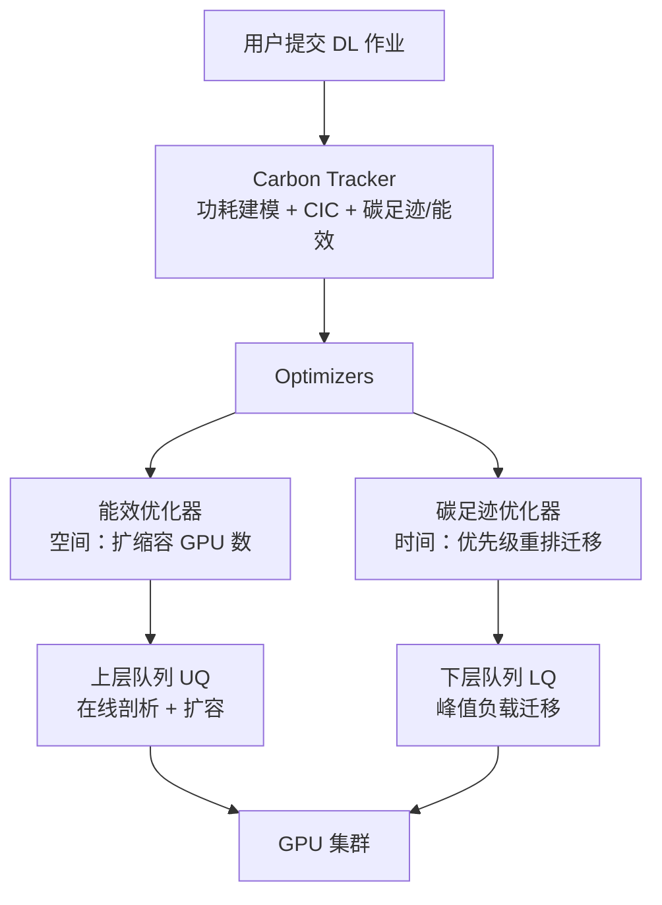
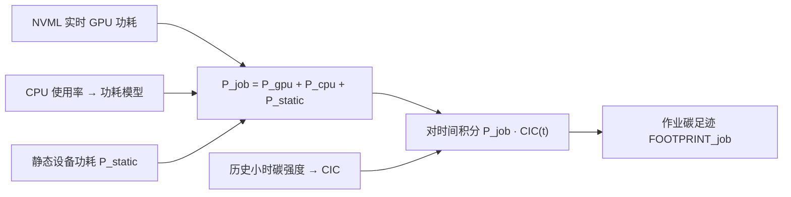
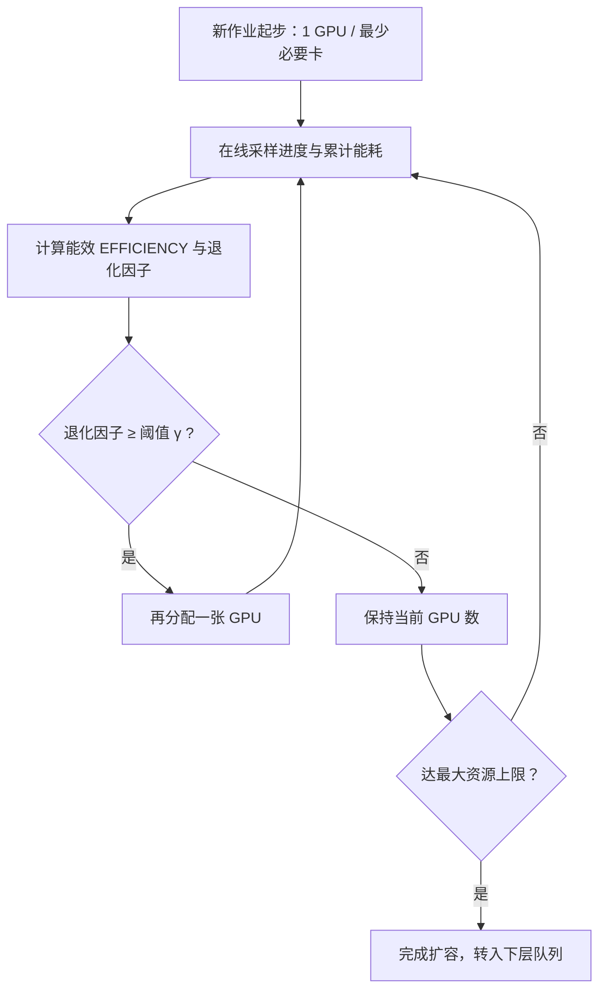
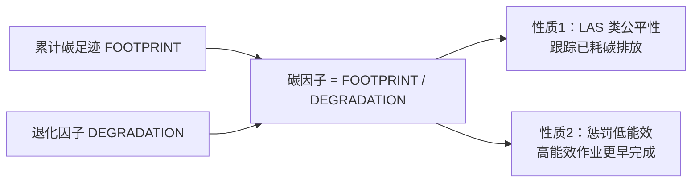
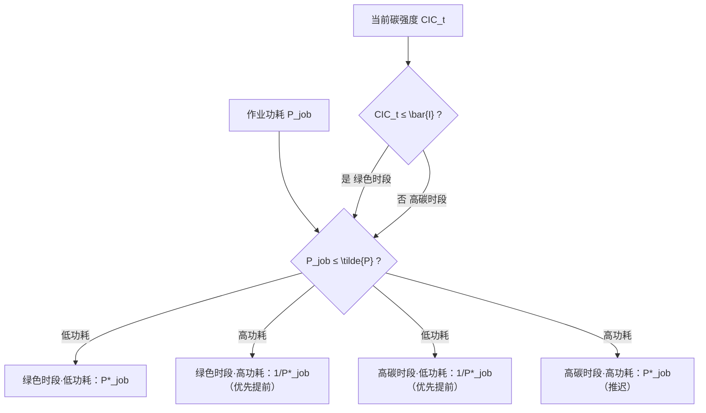
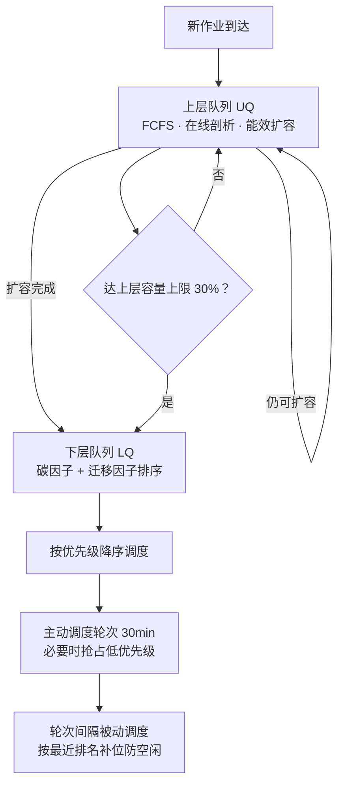
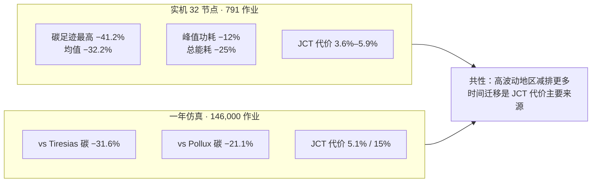
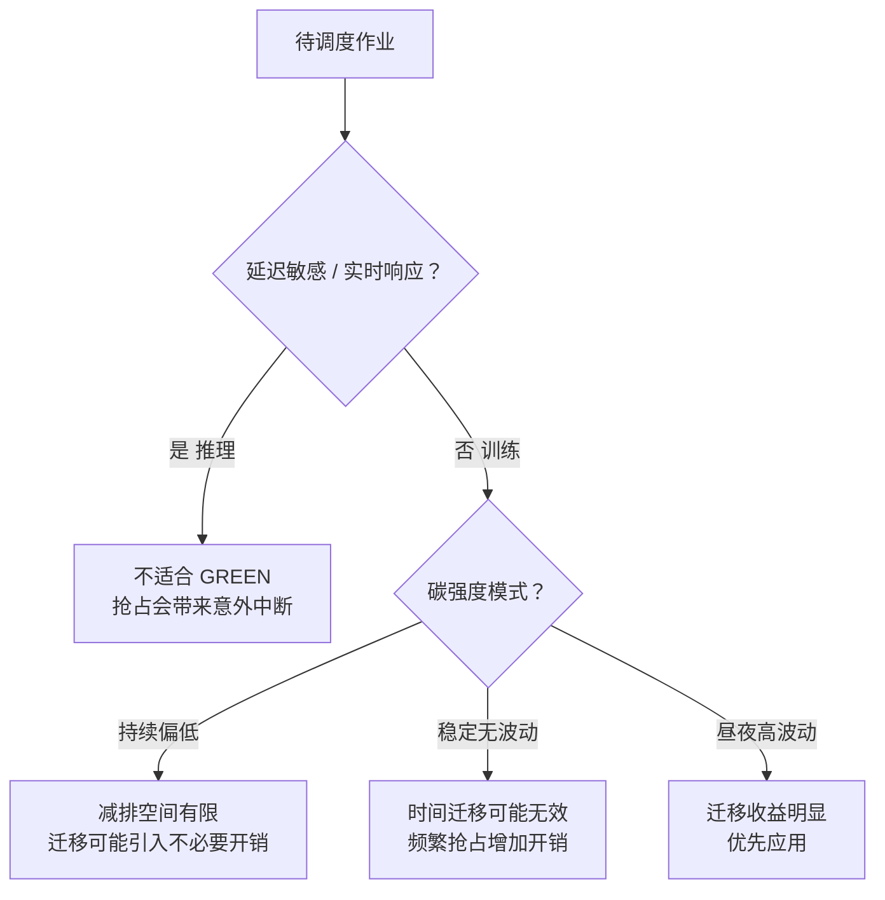

# GREEN：面向 ML 集群的碳高效资源调度 —— 中文学习报告

> 本报告基于论文 *GREEN: Carbon-efficient Resource Scheduling for Machine Learning Clusters*（Xu, Sun, Tian, Zhang, Chen, USENIX NSDI 2025, pp.999–1014）自下而上精读而成。报告不做概要式概括，而是把问题动机、碳跟踪建模、两个优化器、MLFQ 双层队列、实机与仿真评估、消融与局限逐层拆开，落到可指导工程实践的细度，并在最后结合本项目"两机六卡"资源边界讨论可迁移性与候选问题。

## 报告元信息

| 项目 | 内容 |
|------|------|
| **论文标题** | GREEN: Carbon-efficient Resource Scheduling for Machine Learning Clusters（面向机器学习集群的碳高效资源调度） |
| **作者团队** | Kaiqiang Xu、Decang Sun、Junxue Zhang、Kai Chen（HKUST iSING Lab）；Han Tian（USTC，中国科学技术大学） |
| **发表会议** | 第 22 届 USENIX 网络系统设计与实现研讨会（NSDI 2025），2025 年 4 月 28–30 日，美国费城；pp.999–1014；USENIX 开放获取 |
| **文献类型** | 系统设计 + 32 节点实机回放 + 一年 trace 驱动仿真；主要工作对象是**无硬截止期的训练作业**，并非硬功率上限控制器 |
| **官方链接** | https://www.usenix.org/conference/nsdi25/presentation/xu-kaiqiang ；PDF https://www.usenix.org/system/files/nsdi25-xu-kaiqiang.pdf |
| **开源计划** | 附录 B：将在 TACC 开源仓库发布 Slurm 调度插件、外部守护进程、剖析代理，以及作业提交脚本与 trace |
| **研究问题** | 固定容量的多租户 ML 集群，如何在控制作业完成时间损失的同时减少运行碳排放？ |
| **对应分析包** | AN-20261105-023-v01（LC02，partial）；证据定位 LC02-E1～E3 |
| **阅读重点（清单问题）** | 怎样利用训练时间弹性，同时计算完成时间代价？ |

## 核心指标速览

| 指标 | 数值 |
|------|------|
| **集群碳足迹下降（最高 / 四地区均值）** | **41.2% / 32.2%** |
| **关闭时间迁移（GREENns）平均碳减排** | 21% |
| **峰值功耗下降（UK CIC trace）** | **12%**（28 kW → 24.5 kW） |
| **总能耗下降（UK CIC trace）** | **25%**（966 kWh → 725 kWh） |
| **平均 JCT 代价（相对 Tiresias）** | **3.6%–5.9%**；GREENns 仅 1.7%–1.8% |
| **尾 JCT 代价（相对 Tiresias）** | **5.1%–7.1%** |
| **实机测试床** | 32 节点 × 2 RTX 3090 · 20 CPU 核 · 64GB · ConnectX5 |
| **实机负载** | 791 个真实用户作业，按原到达时间回放；时长 1 分钟–37 小时 |
| **一年仿真** | 1 分钟粒度 · 518,400 步 · 146,000 作业 · 五地区 |
| **仿真相对 Tiresias** | 碳足迹 −31.6%；平均 JCT +5.1%；尾 JCT +7.5% |
| **仿真相对 Pollux** | 碳足迹 −21.1%；平均/尾 JCT 均 +15% |
| **调度时间量子** | 30 分钟；上层队列容量上限默认 30% |
| **抢占宽限期** | SIGTERM 后 120 秒保存检查点；检查点与重启时间计入 JCT |

---

## 1. 研究背景与问题动机

### 1.1 ML 负载用电快速增长，传统调度只优化时间

ML 负载目前占全球数据中心 54 GW 用电需求的 8%，预计到 2028 年升至 15%–20%。当前生产集群处理大量 ML 作业，由基于 GPU 的快速并行计算基础设施支撑；这类被称为机器学习即服务（MLaaS）的集群通过多用户共享资源提升利用率、降低成本。在 AI 环境影响日益受关注、追求全球碳中和的背景下，迫切需要新的集群资源管理策略来缓解 ML 处理的环境足迹。

> *"Existing cluster resource schedulers for ML jobs primarily focus on optimizing metrics related to job completion time (JCT) for time efficiency. However, their optimization practices may result in inefficient energy usage."*
>
> 现有 ML 作业集群资源调度器主要聚焦优化与作业完成时间（JCT）相关的时间效率指标；然而这些优化做法可能导致能效低下。

现有调度器的不足可分三层：

| 调度器类别 | 代表 | 优化方向 | 主要不足 |
|------------|------|----------|----------|
| **JCT/吞吐导向** | Pollux、Optimus、Themis、Tiresias、Gandiva | 动态调整 GPU 分配与超参数优化吞吐 | 忽视作业在扩缩容与重配置期间的功耗变化；不可扩缩调度器要求用户固定 GPU 数，限制集群侧优化空间 |
| **单作业能耗导向** | Zeus | 在单作业上平衡能耗与时间效率 | 未考虑在具有不同能耗特征的多个作业之间做集群级资源分配 |
| **碳感知（云环境）** | CICS、CarbonScaler、GAIA、EcoVisor、Wait-AWhile、GreenFlow | 按碳强度节流/推迟/弹性扩缩 | 要么高碳强度时段节流作业使资源闲置，要么用不受限按需云资源弹性扩缩、无视资源限制；部分要求用户给截止期或碳预算，ML 负载执行特征不可预测，难以提供 |

### 1.2 关键区分：能耗 ≠ 碳足迹，碳强度随时间波动

更重要的是，能耗并非构成碳足迹的唯一因素。**碳强度**（每千瓦时电力对应的碳排放，kgCO₂/kWh）随时间显著变化，是电网特性，可从公开来源获取。碳足迹概念模型是设备功耗与碳强度之积对时间的积分——由于功耗与碳强度都随时间变化，这一积分是必要的。

$$FOOTPRINT_{job} = \int Power_{host} \times CarbonIntensity \, dTime$$

ML 训练作业常跨天数周，其间按优先级被间歇性暂停与恢复，因此具备一定**时间弹性**：只要在指定时间窗（如 24 小时）内保住总分配资源，作业执行时点就可以平移。调度器利用这一弹性，可使作业功耗与碳强度波动对齐，在电网碳强度更低时消耗能源，有效降低整体碳足迹。此前能耗感知优化忽视了碳强度与作业弹性二者对集群级环境影响的联合作用。

### 1.3 两个动机机会与两个必须守住的约束

**动机 1：可用资源未按优化能耗利用。** 此前调度器聚焦 JCT，要么不感知能耗，要么只强调单作业层；在作业能耗特征各异、资源分配影响集群级能耗的集群中无法有效优化。机会是：集群调度器应确定分配给作业的恰当资源量级，并同时考虑其在速度与能耗两方面的可扩展性。

**动机 2：负载时间弹性未被用于降碳。** ML 模型训练跨天数周，对过程中进度小幅波动不敏感；碳强度在一天内大幅波动。机会是：调度器应对弹性负载施加时间迁移，把它们提前或推迟到碳强度更低的绿色时段。

**关键挑战**在于做出碳感知调度决策而不引入显著性能下降。为此调度器必须：

1. **保持集群效率**：新调度与扩缩容机制必须维持整体集群效率，作业执行速度与最先进调度器相当；
2. **保证时间迁移中的资源公平**：在时间上平移弹性负载时，必须保住给定周期（如 24 小时）内的总资源分配，防止作业饥饿。

### 1.4 GREEN 的设计立场与非目标

GREEN 同时具备三个属性：**可扩缩（scale-adaptive）、模型无关（model-agnostic）、能耗感知（energy-aware）**，并在此之上加入碳感知。它在不改动模型超参数等作业级设置的前提下取得与此前工作相当的能耗与时间效率。

**非目标**：GREEN 避免像部分现有调度器那样改动作业级配置（模型超参数）。这一选择使 GREEN 对用户 ML 实现**非侵入**，并与 ML 框架在单作业层提供的优化技术（自适应超参数、学习率衰减等）**正交**——否则这些技术会与集群调度器的作业级优化冲突。

---

## 2. 系统总览（§3）

GREEN 是一个 GPU 集群调度器，目标是最小化 ML 作业执行的碳足迹，同时保持与现有 ML 调度器相当的时间效率。系统由三部分组成：

| 组件 | 职责 | 对应章节 |
|------|------|----------|
| **Carbon Tracker 碳跟踪器** | 剖析核心组件；监控作业执行全过程单作业能耗等因子，用碳强度模型估计碳足迹，为优化器与调度算法提供输入 | §4 |
| **Optimizers 优化器** | ① 能效优化器：考虑单卡"能耗—进度"效率，以最大化集群能效方式分配资源；② 碳效率优化器：动态调整作业优先级做峰值负载迁移，最小化集群级碳足迹 | §5 |
| **MLFQ Scheduler 调度器** | 类似多级反馈队列；上层队列侧重能效（为高能效作业扩容），下层队列保留扩容决策并把高功耗作业移到绿色时段 | §6 |

与 MLaaS 场景现有调度器类似，GREEN 优化集群级指标，**不为单个作业提供直接 SLO 或截止期保证**；作为模型无关调度器，它不对用户在特定框架下的实现做假设。

---

## 3. 碳跟踪器：功耗与碳足迹建模（§4）

### 3.1 功耗建模

作业在时刻 t 的功耗由三部分构成：

$$P_{job}(t) = P_{gpu}(t) + P_{cpu,model}(t) + P_{static}$$

| 分量 | 测量/估计方式 | 说明 |
|------|---------------|------|
| **GPU 功耗 P_gpu** | NVML（NVIDIA 管理库）实时读取 | 随利用率变化，是 ML 模型整体能耗的关键驱动；H100 低利用率约 150W、峰值超 700W |
| **CPU 功耗 P_cpu,model** | 由 CPU 使用率经功耗模型估计（kW） | 数据处理、取数采样等在 CPU 上运行 |
| **静态功耗 P_static** | 固定值 | DRAM、主板等受负载影响较小的其他设备 |

实际计算中，方程被离散为 **30 秒间隔**的阶跃函数，以尽量降低测量开销。需要注意：NVML 功耗读数未必始终准确，但本方法可适配任意测量来源，包括用于直接硬件功耗评估的外部功率计。

### 3.2 碳足迹与碳强度曲线 CIC

碳足迹指自作业启动以来累计产生的碳排放，以 kgCO₂ 为单位。GREEN 引入**碳强度曲线（CIC）**作为碳强度模型：

$$FOOTPRINT_{job}(T) = \int_{0}^{T} P_{job}(t) \cdot CIC(t) \, dt$$

计算 P_job·CIC 对时间 t 的积分，结果同时反映随时间变化的功耗与碳强度。许多地区的碳强度数据可在线公开获取；实现中使用历史碳强度数据，因为它在一段时间内通常呈现一致的昼夜模式。GREEN 碳足迹优化器可适配任意 CIC 模式；近期工作已提出基于软件的能源系统以实时获取能耗与碳强度。

**证据边界**：功耗来自 NVML 读数 + CPU 模型 + 静态值的估计，并非整机功率计实测；碳强度用历史信号回放，不能当作无未来信息的实时功率保证。

---

## 4. 两个优化器（§5）

### 4.1 能效优化器（Energy Efficiency Optimizer）

**目标**：确定分配给给定作业的恰当资源量级，最大化集群能效。动机是：以能效度量的作业可扩展性可能不同于性能可扩展性（训练吞吐），从而导致集群级能效次优。

**能效定义**：作业进度 Progress_job 对累计总能耗 W_job 的导数：

$$EFFICIENCY_{job}(t) = \frac{d\,Progress_{job}(t)}{d\,W_{job}(t)} \quad (1)$$

该表述使调度算法可利用两条信息：① 能效更高的作业能以相同功耗取得更多进度；② 给作业分配更多资源时，GREEN 可观察能效变化、了解其可扩展性——理想情况下扩容时能效不应下降。能效单位并不重要，只要可理解为每单位功耗完成的工作量；计算中单位会被约去，只看相对变化比例。

**两种进度度量**（取决于进度能否在运行时直接获取）：

| 情形 | 公式 | 进度来源 |
|------|------|----------|
| **进度可得** | $EFF = \frac{Progress(t)-Progress(t-\Delta t)}{W(t)-W(t-\Delta t)}$ (2) | 记录已完成 epoch 数与总 epoch 数之比；ML 训练按轮重复，每 epoch 耗时大致相同 |
| **进度不可得**（如 epoch 很长的大模型） | $EFF = \frac{\sum_{t'=t-\Delta t}^{t} Throughput_{job}(t')}{W(t)-W(t-\Delta t)}$ (3) | 用训练吞吐（一段时间内训练样本数）近似进度；获取吞吐是当今调度器常见做法，往往只需作业打印一条简单日志 |

Δt 是自最近一次扩缩容事件以来经过的时间。

**退化因子与扩容判据**：每个准备运行的作业从一张 GPU（或所需最少 GPU 数）起步。引入能效退化因子，表示单卡能效相对作业初始能效下降的比例：

$$DEGRADATION_{job}(t) = \frac{EFFICIENCY_{job}(t)}{EFFICIENCY_{job}(t_0)} \quad (4)$$

其中 EFFICIENCY_job(t0) 是作业以最少 GPU 运行时、在起始时刻 t0 剖析得到的能效。后续调度轮次中，若退化因子仍高于阈值 γ，作业再获得一张 GPU。例如 γ=0.9 意味着能效下降不超过 10% 才有资格扩容。γ 根据集群整体占用率与作业特征动态调整，避免超配或欠配；另有资源上限防止扩得好的作业占满全部 GPU。

> *"This scaling approach reduces the cluster’s carbon footprint by allocating more resources to jobs that efficiently utilize energy for progress."*
>
> 这种扩缩容方式通过把更多资源分配给能效高、能把能耗转化为进度的作业，降低集群碳足迹。

**与单作业优化的关系**：能效优化器用资源分配策略优化能效；Zeus 等更早工作把资源分配作为输入，研究作业层并行与配置来优化效率。二者正交，可组合使用共同提升整体能效。

### 4.2 碳足迹优化器（Carbon Footprint Optimizer）

**目标**：通过峰值负载迁移降低集群级碳足迹，做法是在调度中动态调整作业优先级。作业优先级由碳因子与迁移因子组合计算；**优先级数值越高，调度优先级越低**：

$$PRIORITY_{job} = \Big( \frac{FOOTPRINT_{job}}{DEGRADATION_{job}} \Big) \cdot SHIFTING_{job} \quad (5)$$

**碳因子（Carbon Factor）**：作业累计碳足迹除以能效退化因子。它具备两条关键性质：

1. **类似 LAS 的公平性**：跟踪作业执行期间产生的碳排放，类似最小已获服务（LAS）算法，同时计入环境影响，帮助在所有作业间实现公平资源分配；
2. **惩罚低能效**：用退化因子除碳足迹，使被能效优化器扩容的高能效作业更早完成，改善整体 JCT，也避免不必要地占用集群计算资源。

**迁移因子（Shifting Factor）**：遵循一条启发式——倾向于把高功耗作业推迟到低碳强度绿色时段，在高碳强度时段优先低功耗作业。核心思路是依据当前碳强度相对日内取值的高低、以及作业功耗相对所有未完成作业的高低，调整优先级。

两条边界值：

| 边界 | 定义 | 判定 |
|------|------|------|
| **平均碳强度 \bar{I}** | 由历史碳强度数据计算 | 碳强度低于 \bar{I} 的时段视为绿色时段 |
| **中位 GPU 功耗 \tilde{P}** | 所有已剖析/运行作业 GPU 功耗的中位数 | GPU 功耗高于 \tilde{P} 的作业视为高功耗作业 |

分段函数把作业功耗 P_job 重标定到 [1, µ]，记为 P*_job：

$$P^{*}_{job} = \frac{(P_{job}-P_{min})}{(P_{max}-P_{min})} \times (\mu-1) + 1 \quad (6)$$

参数 µ（≥1）控制 P*_job 尺度，从而控制时间迁移程度：取值越大迁移作业越多；µ=1 时迁移基本关闭（迁移因子恒为 1）。评估显示 **µ=2** 可有效平衡两个因子。优化器可适配任意碳强度变化模式，因为它基于给定 CIC 与作业功耗动态计算 \bar{I} 与 \tilde{P}。

**对 JCT 的影响**：推迟高功耗任务未必导致集群级 JCT 延迟——调度器在时间维度上互换分配给高/低功耗作业的日内计算资源，但保住每个作业的日内容量。§6.4 分析 GREEN 如何避免长短作业饥饿，§8.2.2 提供实证证据。

---

## 5. MLFQ 调度：两个优化器如何协同（§6）

GREEN 调度算法类似多级反馈队列（MLFQ），根据作业状态采用不同调度策略。上层队列决定**空间放置**（GPU 数），下层队列决定**时间维度**（何时运行），以实现不同优化目标。

### 5.1 上层队列：在线剖析与扩缩容

上层队列使用能效优化器确定分配给每个作业的计算资源量级，确保高能效作业获得更大能源份额。

- 新作业提交后放入上层队列末尾，剖析潜在可扩展性；
- 初始从一张 GPU（或所需最少 GPU 数）起步；
- 每个调度轮次按 **FCFS** 顺序遍历队列，评估能效退化因子判断是否具备进一步扩容资格；
- 队列中有多个作业时，额外计算资源单元按 FCFS 顺序分配，直到集群达到最大容量。

**队列转换**：只要作业仍具备扩容资格就不离开上层队列；能效优化器完成扩容过程后转入下层队列。队列间转换未必中断作业执行，它仍可能按下层队列分配的优先级具备运行资格。

### 5.2 下层队列：峰值负载迁移

下层队列使用碳足迹优化器做峰值负载迁移，把耗能密集作业迁到碳强度更低的绿色时段。它用 CF 优化器确定作业优先级，同时继承上层队列的资源扩缩容决策。在线剖析阶段的部分执行计入运行时间，该阶段完成的工作保留为作业进度的一部分。

下层队列按两个因子计算优先级：碳因子（考虑作业能耗并保证公平）+ 迁移因子（把高耗能作业移到低碳强度时段）；GREEN 按优先级排序，降序调度执行。

### 5.3 主动 / 被动调度工作流

| 调度类型 | 触发时机 | 行为 |
|----------|----------|------|
| **主动调度** | 按轮次运行，时间量子 **30 分钟** | 分配作业优先级并抢占低优先级作业；排序为：需立即执行的作业（触发抢占）→ FCFS 上层队列 → 按计算优先级排序的下层队列 |
| **被动调度** | 主动调度轮次之间的间隔 | 作业完成释放资源时，按其在最近一次主动调度中的排名启动下一个作业，不重算优先级、不触发抢占，避免空闲 |

设置 30 分钟量子是为限制过度抢占；§A.2 表明只要间隔不短到过度，其长度对整体结果影响不大。

**作业 SLO 与抢占假设**：与 MLaaS 现有调度器类似，GREEN 优先全局集群效率，不为单作业提供严格 SLO 或截止期保证。GREEN **假设所有作业都可抢占**，这可能不适用于要求严格执行保证的负载；真实部署中可覆盖调度策略，避免抢占有特定要求的作业。

### 5.4 避免饥饿

| 对象 | 机制 | 原理 |
|------|------|------|
| **短作业** | 上层队列隐式偏好低 GPU 消耗作业 | 随作业推进、临近完成，近似最短作业优先（SJF）策略，改善平均 JCT，避免短作业饥饿；上层扩缩容过程也省去独立剖析阶段 |
| **短作业** | 下层队列碳因子的 LAS 类行为 | 随时间降低长时运行作业优先级并抢占，为短作业腾出空间 |
| **长作业** | 上层队列容量上限旋钮（默认 **30%**） | 防止新作业提交高峰期长作业饥饿：新作业进入上层队列、优先于下层现有长作业时，上限限制上层队列可占用的集群总容量；达到上限后按退化因子排序作业，跳过上层剩余部分，转而考虑下层队列 |

---

## 6. 实现（§7）

GREEN 用 **Slurm** 实现。Slurm 是广泛用于管理计算集群的开源作业集群管理系统。

| 工件 | 实现方式 |
|------|----------|
| **调度器插件** | Slurm 调度器插件，支持自定义策略设置 Slurm 作业队列中的作业优先级 |
| **外部守护进程** | 与调度器插件通信；存储 CIC 数据，从各计算节点剖析代理收集作业能耗统计，把调度决策返回插件 |
| **剖析代理** | 运行在每个计算节点上，采集作业能耗统计 |

**能效作业终止**：采用通行的检查点—重启方法做作业扩缩容与抢占。该方法可能丢失自最近检查点以来的中间结果、浪费计算资源。GREEN 在终止时向 ML 作业发送带 **120 秒宽限期**的 SIGTERM 信号，允许作业完成当前迭代后保存检查点并优雅退出。**检查点与随后重启的时间计入作业执行时间**。

> *"The time for checkpointing and subsequent restart is recorded as part of the job’s execution time."*
>
> 检查点与随后重启的时间计入作业执行时间。

**关键证据边界（LC02-F1）**：作者实现已把检查点与重启计入 JCT；恢复成本不是该系统忽略的通用空白。但 checkpoint 后 GPU-time 只估计丢弃工作，不能等同于清理、状态写出、通信初始化与首个有效结果的总时间。

---

## 7. 评估设置（§8.1）

### 7.1 测试床与基线

**测试床**：32 个计算节点；每节点 2 张 NVIDIA RTX 3090 GPU、20 CPU 核、64GB 内存，Mellanox ConnectX5 网卡互联；节点由 Docker 管理，全部运行 64 位 Ubuntu 18.04 与 CUDA v11.1。

**五个基线调度器**（代表各自类别最先进水平）：

| 基线 | 类别 | 策略要点 |
|------|------|----------|
| **Tiresias** | 模型无关 · 不可扩缩 | LAS 调度；最佳 JCT 基线 |
| **GAIA Carbon-Time** | 云碳时间 | 把作业启动安排到碳排放最低时刻，允许参数 W 指定的最大延迟；按原论文 W=12 小时 |
| **EcoVisor** | 碳感知 | 碳强度高于阈值（所用 CIC 第 10 百分位）时作业按到达顺序排队；本评估扩展实现其策略 |
| **Pollux** | 可扩缩 · 非模型无关 | 联合优化作业超参数与集群资源分配；非能耗感知 |
| **Zeus + Tiresias** | 单作业能耗优化 | Zeus 为单作业调超参数与 GPU 功耗上限，Tiresias 在作业间分配资源 |

对不可扩缩调度器，把每个作业 GPU 分配预设到 GREEN 取得最佳能效的水平。

### 7.2 实机负载与分母口径

- 从一所大学管理的生产集群 24 小时内收集 **791 个**真实用户作业，含自包含作业包（代码、数据、配置），在测试床按原始提交时间线回放；规模约为此前工作（Pollux 160 个作业）的 5 倍；
- 作业训练时长 1 分钟–37 小时；任务含图像分类（ResNet-50、ShuffleNet）、语音识别（DeepSpeech2）、自然语言处理（BERT、GPT-2）；
- **JCT 口径**：从提交到完成的时间，含排队与抢占；每个作业运行时长由其用户程序决定；
- **分母口径提醒**：Pollux 与 Zeus 非模型无关、需要作业专属配置。由于用户提交作业可能存在不兼容实现，投入 100 个人工小时手动调整；791 个作业中超过 55% 存在无法解决的问题（不支持的学习率缩放器/梯度优化器），约 25% 因非标准模型实现被排除，最终调整出 **150 个**作业用于非模型无关评估。因此 §8.2.3 的对比只在这 150 个可适配子集上成立，不能与全量 791 作业的结果混用分母。

### 7.3 碳足迹估计与地区信号

能耗跟踪方法与现有碳感知系统一致。评估使用 Electricity Maps 的 **2023 年 8 月**历史小时碳强度数据，覆盖四地区：美国加州、英国、瑞典、波兰，代表碳强度与波动的不同组合。

- 实机：向 GREEN 提供 **48 小时 CIC**，代表典型碳强度模式；
- 一年仿真：每 24 小时用 2023 年连续历史数据提供新的 24 小时 CIC，评估对长期季节性变化的适应性。

---

## 8. 测试床实验结果（§8.2）

### 8.1 集群级碳足迹

GREEN 把集群级碳足迹最高降低 **41.2%**（四地区平均 **32.2%**）。关闭时间迁移的 GREENns 四地区平均碳减排为 **21%**——即能效扩容贡献约 21%，时间迁移在此之上再叠加约 11 个百分点的减排。

**跨地区差异**：碳强度波动大的地区，作业可在绿色时段迁移，碳足迹下降更显著（英国、瑞典）。由于 GREEN 依据碳强度剖面动态调整迁移阈值，平均碳强度对减排比例影响不大。但需注意：尽管减排比例可能很大（超 30%），在瑞典这类碳强度相对很低（相对其他地区不足 1%）的地区，**绝对碳足迹下降可能很小**，作业迁移反而引入不必要开销。

### 8.2 碳足迹与功耗

通过在扩缩容期间监控能效，GREEN 避免把额外资源分配给低能效作业。图 9a 中 GREEN 碳足迹曲线在高碳强度时段增速低于其他基线；图 9b 显示 GREEN 降低集群级功耗。在英国 CIC trace 下：

| 指标 | 基线 | GREEN | 下降 |
|------|------|-------|------|
| **峰值功耗** | 28 kW | 24.5 kW | **12%** |
| **总能耗** | 966 kWh | 725 kWh | **25%** |

另一层收益：物理集群通常按峰值需求设计与计费，更低峰值功耗可减少所需供电容量。

> *"Physical clusters are typically designed and billed based on peak demand, and lower peak power usage reduces the required power capacity."*
>
> 物理集群通常按峰值需求设计与计费，更低峰值功耗可减少所需供电容量。

**与碳感知基线对比**：GREEN 在四地区平均 JCT 上优于 GAIA 与 EcoVisor **25.2%**。GAIA 与 EcoVisor 把作业启动推迟到估计碳足迹更低时，常在高碳强度时段留下空闲资源；GREEN 动态计算迁移阈值，在高强度时段优先低功耗作业，在不闲置资源的前提下降低功耗。GAIA/EcoVisor 碳足迹更高，是因为多租户 ML 集群资源容量静态：作业推迟到绿色时段时，空闲资源仍消耗基线能耗。需强调 GAIA/EcoVisor 在其目标云环境（资源按需申请、空闲资源不产生额外成本或排放）中是有效的；本评估把其策略扩展到存在资源竞争与约束的多租户 ML 集群场景。

### 8.3 JCT 性能与个体影响

相对最佳基线 Tiresias，GREEN 平均 JCT 上升 **3.6%–5.9%**，尾 JCT 上升 **5.1%–7.1%**；关闭时间迁移（GREENns）后差距缩小到 **1.7%–1.8%**，同时仍实现 21% 碳减排。这说明 JCT 代价主要来自时间迁移，而非能效扩容。

**集群级时间线**：高低碳强度时段切换期间作业优先级互换——高强度时段低功耗作业优先以降低集群功耗。并非所有高功耗作业在高强度时段都被停掉：当低功耗作业未占满可用资源，或高功耗作业碳项更小、获得更高优先级时，它们仍会运行。

**个体 JCT 影响（相对 Tiresias，测试床）**：

| 作业规模（占比） | 平均 JCT 变化 | 尾 JCT 变化 |
|------------------|---------------|-------------|
| 超小作业（0–9 分钟，22%） | −0.5% | −0.4% |
| 小作业（10–59 分钟，30%） | 1.7% | 1.2% |
| 中作业（1–10 小时，30%） | 4.4% | 4.8% |
| 大作业（≥10 小时，18%） | **6.9%** | 5.8% |

GREEN 对大作业 JCT 上升最多 6.9%，对较小作业下降 0.5%，表明 MLFQ 有效优先短作业、同时避免长作业饥饿。

### 8.4 非模型无关基线（150 个可适配作业）

- **相对 Pollux**：四地区平均碳足迹降低 **23.9%**，平均 JCT 代价 **17.2%**，尾 JCT 代价 **13.4%**。鉴于 Pollux 比 Tiresias、Optimus 等模型无关调度器性能高出 50% 以上，这凸显 GREEN 在保持模型无关的同时平衡速度与碳效率的能力；
- **相对 Zeus + Tiresias 组合**：平均 JCT 相近，碳足迹降低 **12.7%**。

### 8.5 一年 trace 驱动仿真

**仿真器构造**：1 分钟粒度步进离散时间系统，全年 518,400 步。每步三项任务：① 依据 GPU 时间、进度因子（每分钟百分比）、当前 CIC 与功耗计算作业进度和碳足迹；② 检查 trace 新作业到达并入队；③ 调用仿真调度器按策略调整作业。

**负载构造**：从阿里巴巴集群负载 trace 的一个 24 小时窗口采样 400 个作业提交，重复 365 次，构造含 **146,000 个**作业的一年 trace。trace 提供提交时间与时长、缺少模型专属细节；沿用 Pollux/Zeus 仿真方法，按时长分类作业并映射到生产负载训练作业。为准确建模执行，在不同配置（GPU 数、batch 大小）下预运行作业，记录进度因子与功耗，使仿真器能据调度决策推断进度与能耗；并跟踪每类作业抢占时的检查点—恢复开销以保证保真度。

**仿真结果（五地区，含加拿大安大略）**：

| 对比基线 | 碳足迹 | 平均 JCT | 尾 JCT |
|----------|--------|----------|--------|
| **相对 Tiresias** | **−31.6%** | +5.1% | +7.5% |
| **相对 Pollux** | **−21.1%** | +15% | +15% |

仿真呈现与测试床相似的跨地区改善模式（高波动地点表现更好），表明 GREEN 能适应季节性碳强度变化。

**仿真个体 JCT 影响（相对 Tiresias）**：

| 作业规模（占比） | 平均 JCT 变化 | 尾 JCT 变化 |
|------------------|---------------|-------------|
| 超小作业（0–9 分钟，16%） | −0.1% | −0.3% |
| 小作业（10–59 分钟，38%） | 2.4% | 4.7% |
| 中作业（1–10 小时，36%） | 5.5% | 8.0% |
| 大作业（≥10 小时，8%） | 5.9% | 6.1% |

---

## 9. 消融与敏感性（附录 A）

### 9.1 优化器消融（表 4）

| 调度器 / 配置 | 平均 JCT | 尾 JCT | 碳足迹 |
|---------------|----------|--------|--------|
| **能效优化器 · GREEN（完整）** | 17.56h | 45.20h | **15.88kg** |
| 不扩容（1 GPU） | 19.91h | 48.89h | 18.38kg |
| 不扩容（2 GPU） | 18.53h | 46.57h | 16.71kg |
| **碳足迹优化器 · GREEN（完整）** | 17.56h | 45.20h | **15.88kg** |
| 碳因子 = GPU 小时（LAS） | 18.30h | 47.15h | 18.52kg |
| 关闭迁移（迁移因子=1） | 17.19h | 44.99h | 18.93kg |

**两条消融结论**：

- **能效扩容有效**：固定 GPU 数（1 或 2）时，碳足迹与 JCT 均更差，说明动态扩缩容决策同时影响能耗与执行速度；
- **碳因子与迁移都有效**：用 LAS 因子（GPU 小时数）替换碳项后，集群级碳足迹上升约 **16%**（高能效作业不再被优先扩容）；关闭时间迁移后 JCT 略有改善，但碳足迹上升 **20%**（不再把高功耗任务移到绿色时段）。

### 9.2 敏感性

| 参数 | 结论 | 原因 |
|------|------|------|
| **迁移强度 µ** | **µ=2** 最优平衡；µ 过高扭曲调度，因迁移项被放大而不公平地优先高功耗作业；µ=1 关闭迁移 | 迁移项放大效应 |
| **调度间隔** | 默认 30 分钟；10 分钟、60 分钟结果相近，确切长度影响很小 | 碳强度尽管绝对波动较大，但变化缓慢，允许更低抢占频率而不损害整体优化 |

---

## 10. 适用性与局限（§9）

### 10.1 碳跟踪与预测边界

| 未纳入因素 | 原因 |
|------------|------|
| **内含碳（embodied carbon）** | 硬件制造、运输、生命周期相关排放；近期工作表明碳感知调度不应计入内含碳，因为它是沉没成本 |
| **PUE** | 制冷、配电、辅助基础设施能耗开销；PUE 优化通常在数据中心设计层解决，基本独立于负载调度 |
| **碳强度预测误差** | GREEN 基于预测动态调整；预测不准可能导致次优决策；纳入更准确预测方法可提升有效性 |
| **实时碳强度接入** | 直接从数据中心接入实时碳强度数据仍是开放研究挑战 |

### 10.2 调度机制的适用边界

- **不适合推理负载**：推理实时响应用户请求、对延迟敏感；GREEN 基于抢占的调度机制可能给推理任务带来意外中断；
- **特殊碳强度模式**：碳强度持续偏低的地区（如瑞典）难以取得显著减排；碳强度保持稳定时时间迁移可能无效，还会因频繁抢占造成不必要开销；
- **长作业饥饿残留**：尽管含饥饿缓解机制，高度拥堵集群中的长时作业仍可能因基于 LAS 的调度而延迟；类似 Tiresias，可使用重置作业优先级的饥饿阈值防止饥饿；
- **与框架优化正交**：GREEN 非侵入式，可在不要求用户改代码情况下调度 ML 任务，与作业级优化正交，兼容现有与未来 ML 系统改进。

### 10.3 分析者补充的证据边界

- **固定集群 + 历史碳信号**：所有减排数字来自固定容量集群与历史碳强度回放，不是真实电网事件或实时碳市场信号；
- **功率为估计值**：GPU 用 NVML 读数、CPU 用模型估计、静态设备用固定值，存在测量误差；未接整机功率计；
- **部分基线移植与子集兼容**：Pollux/Zeus 对比基于 150 个手动适配作业，存在移植与子集兼容性影响；
- **无在线请求尾延迟合同**：GREEN 面向可抢占训练作业；不能把"降低峰值"等同于硬功率 cap 达标；
- **未独立核验**：本轮未运行 Slurm 插件、未审阅完整代码工件；本机功率接口、真实碳/预算信号与业务合同未知；未检验完整训练质量与每个配置的统计区间；
- **仿真保真度**：一年仿真的进度因子与功耗来自预运行配置映射，检查点—恢复开销按作业类别跟踪，不等同真实长时运行测量。

---

## 11. 工程启示（结合本项目两机六卡边界）

> 本节是分析者判断，不是论文已验证结论。本项目资源边界为两台服务器、各三张 RTX 3090，所有迁移性判断都需在该规模上重新核验，不冒充原规模完整复现。

### 11.1 可直接借鉴的概念分层

| GREEN 机制 | 可迁移要点 | 六卡小规模下的适配方向 |
|------------|------------|------------------------|
| **能效 = dProgress/dW** | 用"单位能耗换进度"而非纯吞吐判断作业可扩展性；退化因子低于阈值才扩容 | 六卡实验可记录每作业进度（epoch 比或吞吐）与能耗，比较扩容后能效是否下降；判断是否值得再加卡 |
| **双层队列分工** | 上层定空间（卡数/扩容），下层定时间（优先级/迁移），决策解耦 | 小规模可复用"先定每作业卡数、再按碳/功耗优先级排序"的两阶段思路 |
| **碳因子 LAS + 能效惩罚** | 跟踪已耗资源保证公平，同时惩罚低能效作业 | 无碳信号时可退化为"已耗 GPU 小时 + 能效"公平排序 |
| **日内容量守恒** | 时间迁移只换高低功耗作业的日内资源分配，保住每作业日总量，防饥饿 | 小规模实验若做延迟/提前，需在同一时间窗内记账总资源，避免某作业被无限推迟 |
| **检查点/重启计入 JCT** | 抢占代价必须含保存与重启时间，不能只算丢弃工作 | 六卡实验测抢占时应分段记录：检查点保存、重启拉起、通信初始化、首个有效结果 |
| **30 分钟调度量子** | 碳强度变化慢，抢占不必频繁 | 六卡实验可设较长重调度间隔，减少抢占抖动 |

### 11.2 规模差异下不能照搬的部分

- **减排百分比**：41.2%、31.6%、21% 等数字来自 32 节点实机与一年 146,000 作业仿真；六卡上只能观察机制是否存在，不能据此宣称同等减排；
- **碳强度信号**：GREEN 的时间迁移依赖日内可预测的碳强度昼夜曲线；本项目若无真实/模拟碳信号，迁移排序退化为纯功耗排序；
- **多作业容量竞争**：上层队列 30% 容量上限、LAS 公平性等机制针对大量并发作业；六卡并发作业少时影响有限；
- **非模型无关基线移植成本**：Pollux/Zeus 式超参数联合优化需要作业专属配置适配，六卡复现同样面临兼容性成本；
- **3090 贴近但网络/节点数差异显著**：测试床也是 RTX 3090，硬件代际接近，但 32 节点 ConnectX5 网络与两机六卡拓扑完全不同，通信相关结论不可外推。

### 11.3 对选题的线索提示

TAPAS 沿"放置—路由—配置"传导供电约束；SpotGPU 在混合紧急度上处理 HP/LP 抢占；GREEN 则在**时间弹性**轴上做文章：用日内资源互换把高功耗作业移到低碳/低功耗时段，并用 JCT 代价（平均 +3.6%–5.9%、尾 +5.1%–7.1%）量化这一弹性的成本。对照本项目关心的"时变功率预算下不同紧急度作业的调度与恢复"，可重点核验：GREEN 的时间迁移假设作业无硬截止期、可被抢占且能在日内容量内补齐进度；本项目若涉及在线/延迟敏感作业，这一假设是否成立需要单独验证。候选问题 LC02-P1（固定容量下推迟高功耗任务是否产生积压、如何与其他任务竞争）在高度拥挤的小规模集群中尤其值得先做回放核验，不能仅凭 GREEN 的公平机制声称无积压。

---

## 12. 候选问题与 Mode C 待核验清单

| 编号 | 候选问题（AI 分析判断，非新颖性结论） | 支撑证据 | 状态 |
|------|----------------------------------------|----------|------|
| LC02-P1 | 固定容量下，单纯把高功率任务推迟是否会产生积压？积压任务怎样与其他任务竞争资源？ | LC02-E1 | 候选，待 Mode C 核验 |
| LC02-F1 | 作者实现已把检查点与重启计入 JCT；恢复成本不是该系统忽略的通用空白。抢占代价应分段记账 | LC02-E2 | 来源条件内事实，可作为对照基线 |
| LC02-U1 | 碳强度预测误差对调度决策与最终 JCT/碳足迹的影响幅度是多少？ | LC02-E1 | 未决问题 |
| LC02-U2 | 六卡小规模、低并发下，上层容量上限与 LAS 公平机制是否仍有作用？ | — | 未决问题，需本项目实验核验 |

### 12.1 与清单阅读问题的对照

**清单问题**：怎样利用训练时间弹性，同时计算完成时间代价？

综合 §1、§5.2、§6、§8，GREEN 的回答分为"利用弹性"与"计算代价"两条线：

1. **识别弹性来源**：ML 训练跨天数周、对进度小幅波动不敏感，且按优先级间歇暂停/恢复；只要在指定时间窗（24 小时）内保住总分配资源，执行时点可平移；
2. **利用弹性的机制**：碳足迹优化器用迁移因子按"碳强度高低 × 功耗高低"四象限调整优先级，把高功耗作业推迟到绿色时段、低功耗作业提前到高碳时段；MLFQ 下层队列继承上层扩容决策，只改时间不改空间；
3. **计算完成时间代价**：JCT 口径为提交到完成的完整时间（含排队、抢占、检查点保存与重启）；代价以平均 JCT 与尾 JCT 相对最佳基线 Tiresias 的百分比报告（实机 +3.6%–5.9% / +5.1%–7.1%；仿真 +5.1% / +7.5%）；并按超小/小/中/大四类作业拆分，确认代价主要落在中大作业、短作业不受损甚至略改善；
4. **代价边界**：时间迁移是 JCT 代价主要来源（关闭迁移后代价降到 1.7%–1.8%）；公平性由日内容量守恒、LAS 类碳因子与上层容量上限共同保证；但 GREEN 不提供单作业 SLO/截止期保证，所有作业默认可抢占。

---

## 附录：关键术语对照表

| 英文 | 中文 | 说明 |
|------|------|------|
| **JCT** | 作业完成时间 | 从提交到完成的时间，含排队、抢占、检查点与重启 |
| **CIC** | 碳强度曲线 | 各小时平均碳强度构成的曲线，GREEN 的碳强度模型 |
| **Carbon Intensity** | 碳强度 | 每千瓦时电力对应的碳排放（kgCO₂/kWh），电网特性 |
| **Carbon Footprint** | 碳足迹 | 自作业启动累计碳排放，功耗 × 碳强度对时间积分 |
| **Energy Efficiency** | 能效 | 进度对累计能耗的导数 dProgress/dW；单位为每单位功耗完成的工作量 |
| **Degradation Factor** | 退化因子 | 当前能效相对最少 GPU 起步能效的比值；低于阈值 γ 才扩容 |
| **γ** | 能效退化阈值 | 如 0.9，能效下降不超过 10% 才有资格扩容；按占用率与作业特征动态调整 |
| **Shifting Factor** | 迁移因子 | 按碳强度象限与归一化功耗 P*_job 计算，调节作业时间迁移程度 |
| **µ** | 迁移强度参数 | 控制 P*_job 标定区间 [1, µ]；µ=2 最优，µ=1 关闭迁移 |
| **MLFQ** | 多级反馈队列 | 上层能效扩容队列 + 下层碳迁移队列的两层反馈调度结构 |
| **FCFS** | 先来先服务 | 上层队列分配额外资源单元的顺序 |
| **LAS** | 最小已获服务 | 跟踪作业已消耗资源量的公平排序策略；碳因子借鉴其行为 |
| **SJF** | 最短作业优先 | 上层队列隐式偏好低 GPU 消耗作业，近似 SJF 改善平均 JCT |
| **Capex/Peak Power** | 峰值功耗 | 集群按峰值需求设计与计费；降峰值可减少所需供电容量 |
| **MLaaS** | 机器学习即服务 | 多用户共享集群、无截止期约束的 ML 服务场景 |
| **Checkpoint-Restart** | 检查点—重启 | 抢占/扩缩容时保存中间进度、重启后恢复；120 秒 SIGTERM 宽限 |
| **PUE** | 电能使用效率 | 制冷、配电、辅助基础设施能耗开销占比；GREEN 不计入 |
| **Embodied Carbon** | 内含碳 | 硬件制造、运输、生命周期排放；被视为沉没成本，调度不计入 |
| **GREENns** | 关闭迁移的 GREEN | no shifting 变体，用于消融时间迁移贡献 |
