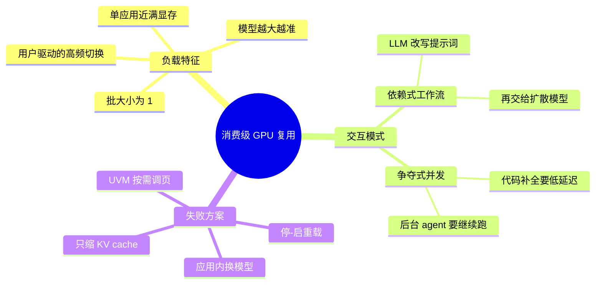
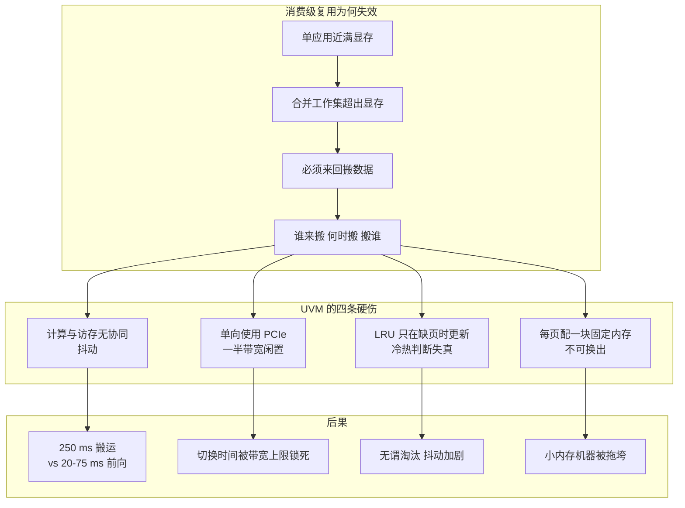
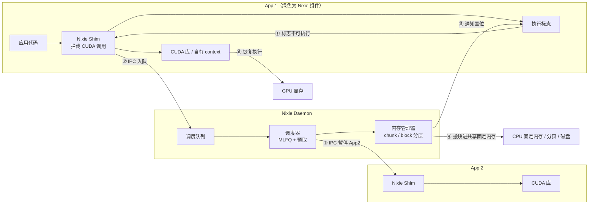
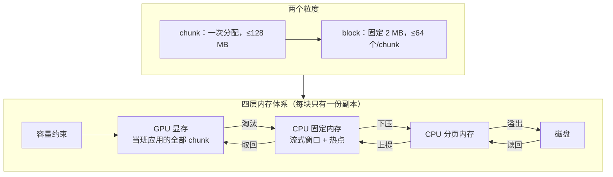
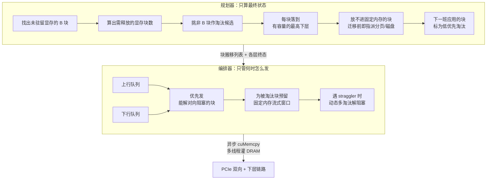
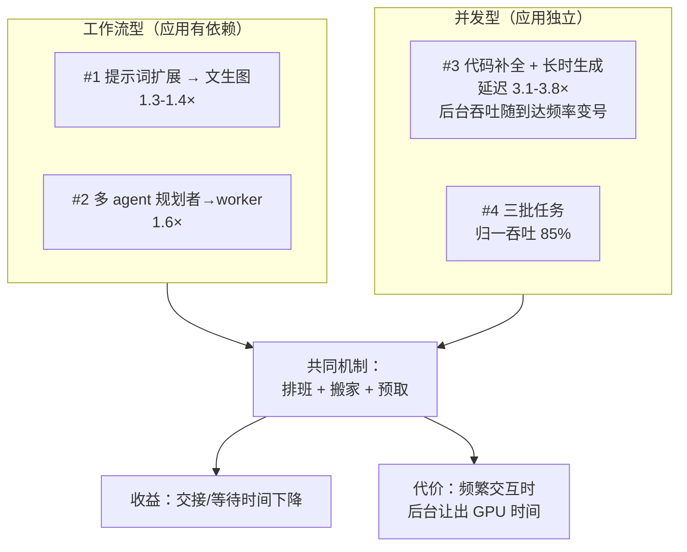
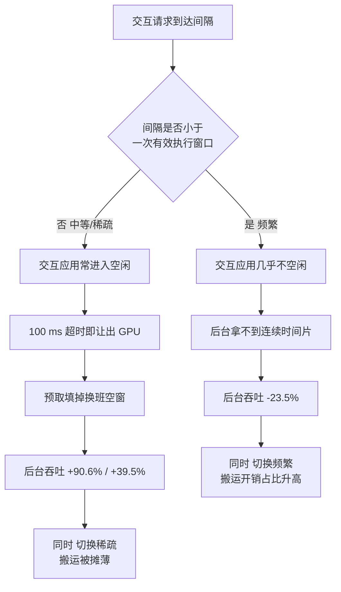
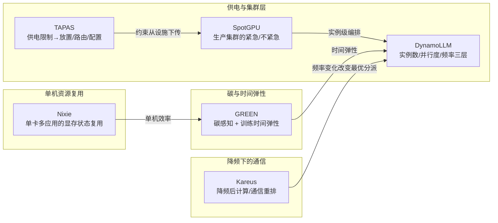

# Nixie 精读报告：为什么"切 GPU"这件事绕不开显存状态

> 一句话：Nixie 把"多个应用抢一块消费级显卡"这件事，从**被动缺页**改成**主动排班 + 搬家**——先决定谁能跑，再把它的显存搬齐，然后才让它跑；代价是后台吞吐在交互请求密集时被主动让出去。

| 项目 | 内容 |
|---|---|
| 论文 | Nixie: Efficient, Transparent Temporal Multiplexing for Consumer GPUs |
| 作者 | Yechen Xu、Yifei Wang、Nathanael Ren、Yiran Chen、Danyang Zhuo（Duke University） |
| 发表 | USENIX OSDI 2026，印刷页 pp.2085–2102（PDF 共 18 页，含 USENIX 封面） |
| 原文 | https://danyangz.github.io/papers/OSDI26-Nixie.pdf |
| 官方页 | https://www.usenix.org/conference/osdi26/presentation/xu-yechen |
| 源码 | https://github.com/XOR-op/Nixie |
| 标识 | ISBN 978-1-939133-55-7；无 DOI |
| 类型 | 系统原型 + 受控应用评估（单用户消费级 GPU 的时分复用），非集群调度、非多租户隔离、非供电控制 |
| 本地材料 | `research/papers/xu_2026_nixie/paper.pdf`、`analysis_broad_v01.md`（AN-20261105-035-v01，evidence_status: partial） |
| 本报告依据 | PDF 全文（extract 后 79,884 字符）+ 分析卡；未审计源码与驱动实现细节 |
| 读它要回答的问题 | ① GPU 切换为何离不开显存状态？② 交互响应改善有什么后台代价？ |

## 核心指标速览

| 指标 | 数值 |
|---|---|
| 上下文切换 TTFT 改善（相对 UVM / nvshare） | Ollama 场景 44.0%–82.3%；SGLang 场景 29.7%–36.3% |
| 交互式代码补全延迟改善 | 3.1×–3.8×（相对 nvshare W=4）；nvshare 默认 W=30 时延迟 >20 s |
| 同等 TTFT 下所需 CPU 固定内存 | 仅为 UVM 的 33.2%–40.2%（即最多省 66.8%） |
| 多应用依赖式工作流加速 | 提示词扩展 + 文生图 1.3×–1.4×；多 agent 编排 1.6×（数学 1.5×、编码 1.7×） |
| 主机↔显存双向拷贝吞吐 | 约为 UVM 的 2×，接近 nvbandwidth 测得的平台上限 |
| 三批任务并发归一吞吐 | 达"理想"的 85%；nvshare W=30 同档，nvshare W=4 仅 49.5% |
| 频繁交互（1 s 间隔）下后台吞吐 | 比 nvshare W=4 **低 23.5%** |
| 中等 / 稀疏交互（3 s / 6 s）下后台吞吐 | 比 nvshare W=4 **高 90.6% / 39.5%** |
| 与"两卡各跑一个"上界的差距 | 文生图流程达 65.9%（Qwen-Image）/ 60.4%（Z-Image）；多 agent 达 73%（A5000 平台） |
| 原型规模 | 约 10,000 行 Rust（Shim ≈1,900 + Daemon ≈7,400 + 共享 ≈700） |
| 关键超参 | 空闲判定 100 ms；最高优先级层配额 T=8 s、抢占阈值 S=4 s，逐层翻倍；chunk 上限 128 MB；block 2 MB |

---

## 一、问题定位：消费级显卡被当成"单应用设备"设计

### 1.1 负载形态变了，硬件假设没变

论文的判断是：**消费级 GPU 的结构性假设（一次只有一个活跃应用）与今天的实际用法已经脱节**。桌面机上同时或交替出现的是 LLM 推理、文生图扩散、交互式修图、视频处理，而这些负载和数据中心那套"长时运行、成批到达、多租户共享"的画像几乎正交：

- 批大小几乎恒为 1，交互式应用要求低延迟响应；
- 用户会为质量去跑"显存刚好装得下"的最大模型，于是**单个应用就接近占满显存**；
- 用户驱动的切换极频繁，且切换的模式有两种：**依赖式**（先用 LLM 改写提示词，再喂给扩散模型）与**争夺式**（代码补全要快，后台 agent/批生成要继续跑）。

这两类模式对系统的要求完全不同：依赖式要的是"跨应用交接的总时间最短"，争夺式要的是"低优先级不能把高优先级饿死，但自己也不能不动"。

### 1.2 为什么"多跑几个小模型"的老办法不适用

论文对既有工作的定位很清楚：数据中心侧的 GPU 复用（Nexus、Shepherd、Clockwork 这一脉）成立的前提是**多个模型能同时驻留显存**，所以它们的核心矛盾是"把算力塞满"；而消费级场景里每个应用的工作集就接近整卡容量，**空间复用根本摆不下**，只剩时间复用一条路。这个前提差异，是全文所有设计选择的起点。

**关键洞察**：
- 判断一篇 GPU 复用论文是否适用于你的场景，第一问不是"它优化了什么指标"，而是"它假设几个模型能同时驻留"。驻留假设一变，空间复用派的整套机制（批处理合并、模型放置、请求路由）全部失效。
- "单应用近满显存"不是偶发现象，而是用户主动追求质量的结果。这意味着它不是可以被"用户少跑点模型"消解的配置问题，而是结构性约束。

---

## 二、失败方案地图：四类做法与 UVM 的四条硬伤

### 2.1 四类既有方案

| 方案类别 | 代表 | 机制 | 在消费级场景的具体失败 |
|---|---|---|---|
| **停-启切换** | llama-swap | 终止当前应用、启动下一个，靠 mmap 重载权重 | 卸载+重载大模型带来**数秒级**延迟；对"LLM 生成描述→立刻拿去生成图"这种秒级交接完全不可用 |
| **应用内换模型** | Ollama | 应用自己卸载旧模型、加载新模型 | 机制与**单一应用内部执行**紧耦合，无法与其他应用协调；且它同时也是最差基线（mmap 策略） |
| **显存弹性化** | Prism（缩 KV cache）、Aegaeon（token 级自动扩缩） | 让推理框架主动缩小自己占用的显存 | **领域专属**：扩散、修图、视频流水线根本没有 KV cache；且需在每个应用/框架里显式集成，做不到系统级透明 |
| **统一虚拟内存** | NVIDIA UVM，及建在其上的 TGS、nvshare | 缺页中断驱动按需调页，LRU 淘汰 | 四条硬伤见下表；TGS/nvshare 只改了"谁先跑"，**底层迁移路径没变**，因此继承全部硬伤 |

### 2.2 UVM 的四条硬伤（逐条对应可量化后果）

| 硬伤 | 机理 | 论文给出的量化后果 |
|---|---|---|
| **计算与内存无协同控制 → 抖动** | UVM 不控制"谁在跑"和"谁的页在显存"这两件事，两者各自独立演化 | 32 GB 卡上两个 24 GB 模型轮转生成：每次前向至少搬 16 GB；PCIe 5.0×16（64 GB/s）下约 **250 ms**，而无迁移前向仅 **20–75 ms**，即**仅搬运就慢 4–12×** |
| **只用一个方向的带宽** | 一次缺页先淘汰（GPU→CPU）再取回（CPU→GPU），两段**永不重叠**；全双工链路一半闲置 | 直接导致切换时间无法压到链路理论上限；这是图 1 与图 4 上半部分的全部内容 |
| **LRU 元数据只在缺页时更新** | 只有"出错"时才采样访问信息，视图极不完整 | 即将被访问的页被误判为冷页 → 无谓淘汰 → 抖动自我放大 |
| **固定内存（pinned）开销刚性** | 为 DMA 性能，显存中每个驻留页必须在 CPU 侧有对应固定页；且**不可换出、不可压缩** | 即便数据永不被淘汰也照样占着；在小内存消费机上直接与其他应用抢资源，拖垮整机可用性 |

**关键洞察**：
- 四条硬伤里，只有第一条是"策略问题"（调度与放置不协同），后三条都是**数据通路的物理/结构问题**。这解释了为什么 TGS、nvshare 这类"给 UVM 加优先级"的做法收效有限——它们改的是谁先跑，没改**怎么搬**。
- 第四条（固定内存）最容易被忽略，但它是消费者场景的"隐形天花板"：数据中心机器内存充裕，固定内存翻倍只是浪费；消费机上它直接等于"整机卡死"。

---

## 三、整体架构：两个组件、三条目标、一次决策

### 3.1 三条设计目标

论文把设计目标写成三条，本质是把 UVM 的三处妥协逐一反过来：

1. **保留类 UVM 的透明抽象**（应用不改、驱动不改），但**同时**获得对计算与内存的协同控制权；
2. **重设虚拟内存管理**，把 GPU 显存 / CPU 固定内存 / CPU 分页内存 / 磁盘当成一个真正的四层体系，并让 CPU↔GPU 传输吃满**全双工**带宽；
3. **像操作系统调度器那样**优化交互延迟，但**不牺牲**后台批处理的吞吐。

第 3 条是全文最诚实也最容易被误读的一条：论文并没有声称"两者都赢"，而是声称"在多数到达模式下都赢，在最密到达模式下主动让出后台"（见第八章）。

### 3.2 两个组件怎么分工

- **Nixie Shim（≈1,900 行）**：以 `LD_PRELOAD` 注入的轻量应用库，负责**拦截** CUDA Runtime 调用（分配/释放、kernel 与 graph 启动、隐式分配、显存查询），并通过 UNIX 域套接字与 Daemon 通信。
- **Nixie Daemon（≈7,400 行）**：集中式系统服务，负责三件事——**谁可以启动 kernel、内存该驻留在哪一层、传输按什么顺序发**。

关键设计取舍：**所有 kernel 仍在应用自己的 CUDA context 里执行**。这不是实现细节，而是性能前提——如果每次 kernel 启动都要经过 Daemon，微基准里的 kernel 启动开销立刻爆掉。因此 Daemon 只在"换班"时介入，稳态运行时应用几乎只碰一个执行标志位。

**关键洞察**：
- 把"决策"集中、把"执行"分散，是这套架构能在 1 万行内跑起来的原因。集中的 Daemon 拿到全局视野（谁在等、谁在跑、下一班是谁），分散的 Shim 保证稳态零额外开销。这与很多"全代理"方案的思路相反。
- 执行标志位 + IPC 入队的两级路径，本质是把"快路径"（已经在跑）和"慢路径"（需要换班）彻底分开。任何系统只要每次操作都走后端，就必然在高频调用上失败。

---

## 四、透明性：不改应用、不改驱动，靠什么撑住

透明不是口号，要满足四个具体条件才不破坏应用语义。论文逐条给了机制：

| 语义风险 | 为什么会出现 | Nixie 的处理 |
|---|---|---|
| **虚拟地址失效** | `cudaMalloc/cudaFree` 不保证再次调用后地址不变；应用会缓存旧指针 | 用 CUDA VMM API **预留虚拟地址**，迁移前后把同一虚拟地址重映射到不同物理块；地址恒定，内容换位置 |
| **迁移中访存非法** | GPU kernel 执行是异步的，迁移开始时可能有未完成 kernel 正在读被搬走的页 | 迁移前**阻塞新 kernel 启动**并做一次 CUDA 同步，等所有在飞 kernel 结束；因此不是"随时可抢占"，而是"安全点可抢占" |
| **graph 捕获被打断** | 构造 CUDA graph 期间的意外 API 调用会破坏捕获 | 拦截 graph 捕获的开始/结束事件，捕获期间 Shim 不调用任何 CUDA API |
| **显存报告失真** | 有的应用（如 SGLang）按"整卡可用显存"决定 KV cache 分配 | 把可用显存报告为**本进程自身分配之和**，防止应用误以为还有富余地盘而把数据溢出到 CPU |

**关键洞察**：
- **"地址不变、内容搬家"是全部透明性的地基**。UVM 之所以能透明，是因为它天然保持了统一地址空间；Nixie 要自己做时分复用，就必须显式重建这个性质，否则任何缓存过指针的应用都会崩。这条约束反过来解释了第五章的设计：既然地址是虚拟的、内容只有一份，那么"搬到哪一层"就必须由一个全局视角统一决定，不能各应用自己拍脑袋。
- **"安全点抢占"而不是"任意时刻抢占"**，是 Nixie 与真正抢占式调度（XSched 一类）最重要的区别。代价是响应下界受制于"当前这批 kernel 还要跑多久"；收益是不需要驱动级/硬件级支持。

---

## 五、显存状态为什么绕不开（核心问题一）

### 5.1 先看清层级：四层、两份、零副本冗余

| 层级 | 内容 | 特点 |
|---|---|---|
| L1 GPU 显存 | 当前"当班"应用的 chunk | 唯一能直接算的地方；容量最紧 |
| L2 CPU 固定内存（pinned） | 中转 + 常驻热点 | 可被 DMA 直接访问，带宽高；**不可换出**，是稀缺资源 |
| L3 CPU 分页内存 | 次级backing | 可换出，带宽受 DRAM/页机制约束 |
| L4 磁盘 | 最冷的数据 | 慢，用于"确实放不下"的兜底 |

两个粒度：**chunk**（一次 `cudaMalloc` 的单元，上限 128 MB，超了切分，使同一大分配的不同段可分布在不同层）与 **block**（固定 2 MB，VMM API 的最小物理分配单元，一个 chunk 最多 64 个 block）。用统一 block 尺寸是为了避免"张量形状千奇百怪 → 内存碎片化"。

最关键的语义选择：**Nixie 不把 L1 当作 L2 的 cache**，而是"每个 chunk 在全体系里**只有一份**，按需在层间搬"。这一句话直接消掉了 UVM 的第四条硬伤——因为不需要为显存里的每个页在 CPU 侧保留一份固定内存副本。

### 5.2 为什么"切换"等于"搬家"，而不是"换上下文"

这是回答第一个问题的核心。在 GPU 上，一个应用的"状态"里，真正贵的东西不是寄存器、不是指令流，而是**它占着的那几十 GB 参数与 KV cache**：

1. **显存是排他的、容量有限**。两个工作集各 24 GB 的模型在 32 GB 卡上不可能同时驻留。要换班，就必须把 A 的 24 GB 搬出去，把 B 的搬进来。
2. **搬的是"状态"本身，不是"描述"**。GPU 没有像 CPU 那样把进程状态压到 PCB 的廉价手段；模型权重和 KV cache 就是运行时状态，搬不走就等于没切换。
3. **搬运量与"工作集"同阶**，所以切换时间 ≈ 工作集 / 有效带宽。这就是为什么 Nixie 的全部优化都落在"**有效带宽**"上：264 GB 的工作集不可能靠"更聪明的调度"变没，只能靠"更快地搬"和"少搬"。
4. **搬运必须保持地址不变**（第四章），因此"搬到哪一层"这件事必须由一个持有全局信息的组件统一决定；一旦让各应用或各层自己做局部决策，就会出现在层间来回倒腾、甚至死锁。

所以，"GPU 切换离不开显存状态"不是工程习惯，而是**由容量排他性 + 状态即数据 + 搬运量同阶**三条共同决定的：你想要时分复用，就必须接受"每次换班搬一遍工作集"，剩下的全部自由度只在"怎么搬得快、搬得少、什么时候搬"。

### 5.3 搬得快：把双向链路同时喂满

朴素做法（在相邻层之间发局部传输、靠反压腾空间）在多层层级里会退化成一条串行链：取 B 需要先淘汰 A 到固定内存 → 固定内存满了要把块下压到分页 → 分页满了要溢到磁盘。串行化的直接后果是**总有一条链路在空转**，更糟的是可能出现"要腾空间只能靠被阻塞的传输"的死锁。

Nixie 的解法是把**规划（planning）**与**编排（orchestration）**拆开：

- **规划器**：算最终状态。给定即将上场的 B，先找出所有不在显存的 B 块，算出必须释放多少显存块，再从"非 B 的显存块"里挑同样数量作为淘汰候选；每条被淘汰块放到"**有可用非预留容量的最高下层**"；确定放不进固定内存的块**在迁移开始前就指派**到分页/磁盘（而不是等层满了才往下压）；若调度器已暴露"下一班是谁"，就把它的块标为**低优先淘汰候选**，保护预取状态。
- **编排器**：执行计划。为上行（向 GPU）与下行（离开 GPU）各维护一条队列，**优先发能解除对向阻塞的搬移**；为 A 的被淘汰块预留一个小的**固定内存流式窗口**，保证"B 在经固定内存中转"时，A 的淘汰仍能同时进行。遇到传输落后者（straggler，来自 OS 资源管理或 CUDA 运行时），允许**动态改计划**：多淘汰几个块来解阻塞，避免与中转缓冲死锁。

实测结果：双向拷贝吞吐**接近 nvbandwidth 测出的平台上限**，约为 UVM 的 2×；差距主要来自内存分配开销。这个数字是全文最硬的一条证据——它说明"双向流水"不是理论上的漂亮话，而是把 UVM 浪费掉的那一半链路真的捡回来了。

### 5.4 搬得少：预取与"保护下一班"

调度器已经知道队列头部是谁，那就大概率是"当前应用被换下后要跑的那个"。于是 Nixie 在空闲期**主动把下一应用的块预取**到更上层。消融显示：即使在三批任务这种"切换本就不频繁"的场景，自动预取仍带来 **+5%** 吞吐。这说明预取的价值不只是缩短切换延迟，还能把"换班时的空窗"填掉。

**关键洞察**：
- 回答第一个问题的准确表述是：**GPU 时分复用的成本下限由"工作集搬运量 / 有效带宽"决定，而工作集是应用状态本身，无法被"更聪明的调度"消除**；因此任何声称"切换几乎免费"的方案，要么把工作集压小了（模型侧优化），要么根本没搬（空间复用），要么在骗人。
- Nixie 的三个动作分别对应这条式子的三个因子：**规划器**减少搬运量（只搬必要块、提前指派深层）、**双向编排**提高有效带宽、**预取 + 保护下一班**把搬运挪到不敏感的时间段。三者缺一，收益都不成立。
- "每块只有一份副本"是个被低估的设计：它同时解决了固定内存膨胀（第四条硬伤）和"层间谁是权威副本"的一致性问题。代价是任何一次搬错都要再搬回来，所以规划必须一次算对。

---

## 六、调度：在没有 yield 的世界里推断"谁该优先"

### 6.1 GPU 缺两个关键信号

CPU 调度器靠两个事件被唤醒：时间片到期、线程主动让出（`yield` 或阻塞系统调用）。GPU 上两者都没有：

- 长时服务型应用（SGLang、Ollama）**没有"任务完成"**这个概念，进程一直活着；
- GPU 没有 `yield` 等价物，应用"不干活"时不会告诉任何人。

于是若"跑到时间窗结束"，就会出现"某应用其实在等用户输入，却仍霸占 GPU 一整窗"的浪费。

### 6.2 空闲检测：不用 NVML，用 API 间隔

一个自然的想法是用 NVML 看利用率，但论文实测了两个问题：**NVML 报告"变空闲"要约 600 ms**（太慢，一个 4 s 窗口的 1/7 就这么过去了）；消费机上的后台渲染/解码会引入噪声，使信号不可靠。

替代方案是**超时机制**：CUDA API 分非阻塞（kernel 启动、异步调用）与阻塞（同步）；只有当"距最近一次 API 返回的时间超过阈值"才判空闲，阈值取 **100 ms**；对阻塞 API，在**执行前后都拦截**，避免应用在运行时内部阻塞时被误判为空闲。超时触发后 Shim 通知 Daemon，走与"时间窗到期"完全相同的调度循环。

### 6.3 优先级推断：为什么不能照抄 MLFQ

经典 MLFQ 会周期性"把所有优先级重置到最高"，这在 CPU 上没问题（窗口短、历史迅速过时）。但 GPU 的时间窗长得多，**盲目全重置会抹掉有用历史，还可能意外抢占正在服务的交互应用**。

Nixie 改造成"软恢复"：

- 每个应用记三个时间戳：变为空闲的时刻、上次优先级变更的时刻、最近一次调度请求的时刻；
- 只有在"上次优先级变更已经过了足够久"（防抖动）**且**"空闲时长扣掉等待时间后仍显著"时，才提升优先级；
- 等待时间不能全算：若应用还在队列里等着，立刻提升它会抢占当前运行者，并缩短同层所有应用的有效窗口。因此引入系数 **R** 乘在等待时间上，并要求 **R < 1/N**（N 为同层应用数）——这一条是防饿死的硬约束：若 R ≥ 1，只要高优先级作业持续不断，低优先级就会永远排不上。

### 6.4 队列参数与预取

K 级队列 Q1…Qk，优先级从高到低；同层轮转，从等待最久者开始；达到抢占阈值 S 时，若同层还有其他应用就抢占。最高层取 **T = 8 s（降级配额）、S = 4 s（抢占阈值）**，逐层翻倍——低优先级层窗口更大，是为了**降低切换频率、摊薄搬运开销**。这正好与第五章呼应：搬运很贵，所以对"不那么急"的应用，宁可让它一次跑久一点。

**关键洞察**：
- 这套调度器的聪明之处不在算法复杂度，而在**它只用了"kernel 启动的时间模式"这一种信号**。不读应用语义、不需要用户标注、不需要框架集成——这既是它能对 ComfyUI/llama.cpp 这类异构应用通用的原因，也是它无法区分"真交互"与"假装空闲"的原因（见第九章）。
- "逐层翻倍"不是随手设的常数，而是把**搬运成本**编码进调度参数：越不急的应用，越值得用更长的窗口去摊薄一次搬运。这是"内存系统成本 → 调度参数"的一次显式耦合。

---

## 七、评估：微基准与四个案例

### 7.1 平台与基线

| 项 | 内容 |
|---|---|
| 主平台 | Ryzen 9 9950X；96 GB 双通道 DDR5 @3600 MT/s；**2× RTX 5090 32 GB**，各 PCIe 5.0×8；Debian 12 / CUDA 12.9 / 驱动 580.95.05 |
| 软件栈 | Ollama 0.12.11、SGLang 0.5.4.post1、llama.cpp b7027、ComfyUI（commit eaf68c9） |
| 第二平台 | 2× EPYC 7352、1 TB 16 通道 DDR4、**8× RTX A5000 24 GB**、PCIe 4.0×16、Ubuntu 22.04 / CUDA 12.4 / 驱动 550.67 |
| 基线 | UVM（仅钩 `cudaMalloc`/`cudaFree`/`cudaMemGetInfo` 三 API）、nvshare（W=4 与默认 W=30）、Ollama、TGS |
| 特殊基线 | "2 GPUs"：把两个应用各放一张卡，**逼近零切换成本的上界**（硬件翻倍，不作为同资源收益归因） |
| TGS 限制 | 只支持恰好两个应用、需用户显式指定高低优先级 → 只进案例研究，不进微基准 |

### 7.2 微基准：切换、带宽、超订、固定内存、开销

| 测量 | 结果 | 说明 |
|---|---|---|
| 切换 TTFT（同一应用+同模型换班） | 相对 UVM/nvshare：Ollama 降 44.0%–82.3%，SGLang 降 29.7%–36.3% | Ollama 的 mmap 重载最差；**MoE 模型收益偏小**，因为 prefill 只激活部分专家，搬运的"有效工作集"更小 |
| 为什么 SGLang 收益小于 Ollama | SGLang 激进分配 KV cache 且大量闲置；Nixie 主动把**未使用的 KV 页**全部卸载，UVM 则是延迟搬 | 说明"知道哪些页不用了"比"猜哪些页要用了"更值钱 |
| 双向吞吐 | 约 UVM 的 **2×**，接近 nvbandwidth 上限 | 剩余差距来自分配开销；Ollama 的大块分配模式比 SGLang 的非均匀模式更容易达到高吞吐 |
| 超订量敏感性 | 超订越小，Nixie 切换越好；**UVM 因 LRU 几乎恒定** | UVM 的切换成本与超订程度"脱钩"，本身就是它失控的证据 |
| 固定内存 | 达到与 UVM 同等 TTFT，只需 UVM 的 **33.2%–40.2%** | 对应"最多降 66.8%"；限该模型/主存/PCIe 配置，不是普适比例 |
| 运行时开销 | 小 ResNet 推理延迟与"2 GPUs 原生执行"及"简单 UVM 拦截"**一致**；nvshare 有额外开销（CPU 线程与 GPU 同步） | 稳态零开销成立的关键：kernel 启动直连用户态驱动，不经过 Daemon |
| `cudaMalloc` 延迟 | <2 MB 与原生相当；2–128 MB 略高；**>128 MB 反而优于原生**（论文推测：多个连续 128 MB 物理区 vs 尝试单块最大连续区）；UVM/nvshare 因首次触碰分配更差 | 作者明确说 CUDA 运行时闭源，只能"假设"，属于未证实推断 |

### 7.3 四个案例

| 案例 | 结构 | 配置 | 结果 | 读法 |
|---|---|---|---|---|
| **#1 提示词扩展→文生图** | 依赖式（跨应用交接） | llama.cpp + ComfyUI；Qwen3-MoE 30B-Q6 扩写；Z-Image 6B-BF16 / Qwen-Image 20B-FP8；DreamBench++ 提示词 | 比 nvshare W=4 快 **1.4×（Qwen-Image）/1.3×（Z-Image）**；达两卡专用性能的 **65.9% / 60.4%**；TGS 15 分钟跑不完 Qwen-Image | 即便 ComfyUI 在生成期间**反复分配/释放显存**，Nixie 仍稳——说明它对数据路径上的动态分配鲁棒。TGS 崩掉的两个原因很典型：假设高优先级吞吐恒定（消费级不成立）、超订时强制低优先级 DMA 直读主机内存而不迁移（等于让计算停摆） |
| **#2 多 agent 编排** | 依赖式（规划者→worker） | KVCOMM；Qwen3 14B-Q8 路由、Qwen3-VL 32B-Q6 数学、Qwen3-Coder 30B-Q6 编码；GSM8K + HumanEval-FIM 混洗 | 总体 **1.6×** 快于两种 nvshare；数学 1.5×、编码 1.7×；A5000 平台 **3.4×**，达两卡的 **73%** | 收益在两种请求类型上一致，说明不是"路由碰巧变快"；A5000 上 UVM 明显变慢，作者归因于更老的驱动/更老的 UVM 实现，属推测 |
| **#3 代码补全 + 长时生成** | 争夺式（无依赖） | Qwen3-Coder 30B-Q6（FIM）+ Gemma3 27B-Q8（模拟 agent）；三档到达间隔 1 s / 3 s / 6 s；Nixie-RR 消融 | 补全响应 **1.8 s（频繁）/1.4 s（中等、稀疏）**；nvshare W=4 需 4.5–5.7 s，W=30 >20 s；相对 W=4 快 **3.1×–3.8×** | **后台吞吐分三档**：中等 +90.6%、稀疏 +39.5%、**频繁 −23.5%**；Nixie-RR（无优先级）在各档都慢，说明收益主要来自调度而非迁移；TGS 补全性能相近但长时模型几乎跑不动 |
| **#4 三批任务并发** | 争夺式（纯批） | Qwen3-MoE 30B-Q6、Qwen3-VL 32B-Q6（批 1）、Z-Image（批 8）；300 s；按各自独立运行归一 | 达"理想"的 **85%**（与 nvshare W=30 同档）；nvshare W=4 仅 **49.5%**；自动预取再 **+5%**；公平性在各配置下保持 | 这里"Nixie 用了自适应优先响应性策略"却仍拿到 85%，说明**在这类切换不频繁的场景**，优先级机制几乎不伤吞吐；反而是 W=4 的固定短窗口把吞吐砍半 |

**关键洞察**：
- 四个案例其实是**两组对照**：工作流型证明"搬运快"的价值（交接时间 = 两次搬运 + 两次计算），并发型证明"调度 + 搬运"的联合价值（等待与搬运要同时优化）。
- 最能说明设计取向的是 #4 与 #3 的对比：**同一套策略，在批任务场景几乎不损吞吐（85%），在密集交互场景明确损 23.5%**。差别不在策略，而在"交互请求占了多少时间"。
- TGS 在两个案例里都"崩"，根因是同一个：它假设高优先级作业吞吐恒定，且超订时不做迁移。这说明**任何依赖"应用性能可预测"的优先级机制，在消费级负载上都会失效**。

---

## 八、交互改善的后台代价（核心问题二）

### 8.1 代价的准确数值与形态

论文把代价写得非常直白（Case #3 / 图 13）：

| 交互到达间隔 | 代码补全平均响应 | 后台长时任务吞吐（相对 nvshare W=4） |
|---|---|---|
| 1 s（频繁） | 1.8 s | **−23.5%** |
| 3 s（中等） | 1.4 s | **+90.6%** |
| 6 s（稀疏） | 1.4 s | **+39.5%** |

同一套机制，在三种到达频率下，后台吞吐的**符号都变了**。这不是测量噪声，而是机制必然：Nixie 的调度器把"能在分配窗口内跑完的短促作业"判为交互式并提升优先级，于是**交互请求越密，后台被切走的 GPU 时间越多**。

### 8.2 为什么稀疏 / 中等时反而"双赢"

三个因素叠加：

1. **切换次数少 → 搬运开销占比低**。稀疏到达时，一次搬运摊到很长的时间预算里；而 nvshare W=4 是**固定 4 s 窗口强制切换**，即使没人需要 GPU 也要换班，于是为"不必要的切换"付出搬运代价。这解释了为什么 nvshare W=4 在批任务场景只有 49.5% 吞吐。
2. **空闲检测把"白等"的时间还给了后台**。交互应用在等用户输入时被 100 ms 超时判为空闲，后台立刻接管——nvshare 没有这个机制，只能等窗口到期。
3. **预取把换班的空窗填掉**。下一班是谁已知，提前搬，切换时几乎只剩"置位"。

而当到达极密（1 s）时，第 1、2 条同时失效：交互应用几乎不进入空闲，后台拿不到连续时间片；同时交互应用优先级高，窗口被压到很小，后台的有效吞吐就掉了。

### 8.3 代价的三种"隐性形态"（论文没写全，但可从机制推出）

- **延迟尾部而非均值**：论文报告的是平均端到端时间（沿用前作口径），没有给长时作业的尾延迟/饥饿尾部。而防饿死只由"R < 1/N"这一条软约束保证，**不构成严格的最大最小公平**。也就是说：平均值 −23.5% 可能对应尾部更差的停滞。
- **PCIe 与主机内存的连带占用**：迁移会消耗主机内存、PCIe 带宽和 CPU 线程。当交互频繁时，搬运本身也变频繁，这些资源被反复占用——论文给了固定内存的**容量**收益，但没有给"迁移期间的带宽/CPU 争用"对同机其他应用的干扰。
- **能效方向未测**：全文没有任何板卡或整机功率、能量指标。因此不能把"延迟改善"或"固定内存下降"读成"更省电"——迁移本身是要耗电的（PCIe 收发、DRAM 读写、CPU 参与）。

**关键洞察**：
- 回答第二个问题的准确表述是：**代价不是"后台变慢"这一句，而是"后台吞吐随交互到达频率改变符号"**。−23.5% 与 +90.6% 是同一条机制的两端，把它们分开引用都是误读。
- 这个"符号翻转"恰好给出了系统的**适用区间**：交互到达间隔远大于"一次有效执行窗口"（本例约 4 s 量级）时，Nixie 双赢；接近或小于时，它就是一台"交互优先机"，后台只剩残余吞吐。
- 更值得记住的是它的**对照组含义**：nvshare W=4 的失败不是因为"切得不够聪明"，而是因为"**不该切的时候也切**"。这说明在搬运昂贵的系统里，**减少无谓切换**比"切得更快"更值钱。

---

## 九、局限与边界

### 9.1 作者自述

| 局限 | 具体内容 |
|---|---|
| 平台 | 只在 Linux 上做了原型；Windows 与 AMD 是"未来方向"，作者认为 CUDA VMM API 在 Windows 上可用、AMD 有类似 VMM API，因此移植可行 |
| 语义盲区 | 不理解张量语义，无法识别"不可变数据（如权重）可以就地释放而不搬回"这类机会；作者明确说这是为保透明性而**主动放弃**的 |
| 策略保守 | 有意采用与应用无关的策略，不为峰值性能调参；改进方向包括从执行历史学习调度、对不同显存区域（权重/激活/KV）区别对待 |
| 小模型场景 | 目标负载是"每个应用占大部分显存"；若是一堆小模型，本可做空间复用，如何并入 Nixie 是未来方向 |
| 安全 | Daemon 与应用同 UID，共享固定内存区；同 UID 恶意进程不在威胁模型内——**明确是单用户假设，不是多租户隔离** |

### 9.2 分析层面的边界（读数字时须保留）

- **单卡复用**：A5000 那台机器有 8 张卡，但实验只测单卡复用；"多卡联合调度"未被验证。
- **无能耗证据**：没有板卡/整机功率、能量、供电越限指标；迁移会消耗主机内存、PCIe 与 CPU，因此"低延迟/低固定内存"不能推出"整机节能"。
- **"安全点抢占"的响应下界**：等待在飞 kernel 完成意味着响应时间依赖"当前这批 kernel 还要多久"，不能承诺瞬时让出 GPU，也不能承诺瞬时降功率。
- **统计细节**：图 6/11–13/15 给了标准差误差棒，但论文未报告重复次数、原始样本与置信区间；归一化"ideal"是论文定义的参照，**不是独立最优性上界**。
- **驱动依赖**：A5000 上 UVM 明显变慢被归因于"较老驱动/较老 UVM 实现"，属推测；这说明结论对驱动版本敏感。
- **工件**：源码已公开（github.com/XOR-op/Nixie），但本报告未运行、未审计其实现与拦截完整性。

**关键洞察**：
- 论文最值得借鉴的不是"3.8×"，而是**它对自己的边界写得很诚实**：单用户、单卡、无能耗、非抢占式。任何把这篇的结论外推到"多租户 GPU 池"或"机房功率管理"的用法，都超出了证据范围。
- "为保透明性放弃语义优化"是一个明确的取舍宣言。它意味着 Nixie 的性能上限被"看不见张量语义"锁住——这正是 Prism/Aegaeon 那一派在数据中心能拿到更高收益的原因，也是两派不可互换的根本。

---

## 十、工程启示：两机六卡上能复现什么

### 10.1 可直接借鉴的机制

| 机制 | 在 3×RTX3090 / 24 GB 级别上是否可试 | 注意点 |
|---|---|---|
| **地址恒定 + 内容搬家**（VMM 预留 + 重映射） | 是，前提是驱动支持 CUDA VMM（30 系一般支持，需实测） | 3090 是 24 GB、PCIe 4.0；双向带宽上限低于 5090，搬运效应会**更明显**，反而更适合验证"搬运是瓶颈"这一命题 |
| **chunk/block 两级粒度 + 128 MB / 2 MB** | 是，纯软件 | 2 MB 是 VMM 最小物理单位，跨架构基本一致；chunk 上限可调，需按模型分配模式实测 |
| **规划/编排分离 + 双向队列 + 流式窗口** | 是，这是最有复制价值的抽象 | 不需要驱动改动；但要小心 straggler 与死锁，需保留"动态改计划"的兜底 |
| **API 间隔判空闲（100 ms）替代 NVML** | 是，几乎零成本 | 100 ms 是论文取值，需按你的交互节奏调；NVML 延迟 ~600 ms 是实测，可复现 |
| **MLFQ + soft recovery + R < 1/N** | 是，纯用户态 | 这是**防饿死**的关键；直接抄"提升优先级"而漏掉 R 约束，就会出现低优先级永久饿死 |
| **预取下一班** | 是 | 依赖"队列头部可预测"，单机多应用场景成立 |

### 10.2 六卡边界上的三个"不能"

1. **不能复现"消费级单卡多应用"的完整收益链**：Nixie 的核心矛盾是"单卡装不下两个工作集"。你有 3 卡/机，天然可以用"一应用一卡"绕开矛盾——但那就退化成"2 GPUs 基线"，测不到时分复用的收益。所以要么刻意共置（两应用挤一张卡，第三张卡留作对照），要么这个命题在你的资源上**不成立**。
2. **不能把"低延迟"读成"低功率"**：Nixie 没有功率/能量证据。若你的选题落在"供电约束下的调度"，这篇只提供"时间维度的复用成本模型"，**不提供功率模型**。迁移本身耗能，这一点必须自己测。
3. **不能外推到多租户**：单用户、同 UID、共享固定内存，安全模型明确排除多租户。把它当"GPU 池隔离方案"会直接踩到未验证区。

### 10.3 一个可做的最小实验（若要把这条线接到自己的题上）

- **问题**：在两机六卡上，"时分复用的切换成本"是否仍是主导项，还是已被"每卡一应用"消解？
- **最小设计**：单卡（3090）上共置两个"各自接近占满 24 GB"的模型；对照 ① UVM ② 简单 stop-restart ③ 你的 chunk 迁移原型（先不做 MLFQ）；测 TTFT 与稳态吞吐。
- **判据**：若 ③ 的 TTFT 显著优于 ① 且稳态吞吐不劣，说明"双向搬运 + 地址恒定"在你的硬件上成立；若稳态吞吐已劣化，说明 PCIe 4.0 带宽把收益吃掉了，此时应转向"减少搬运量"（如权重不搬、只搬 KV）而不是"搬得更快"。
- **停止条件**：若 3090 驱动不支持所需 VMM 能力，则该机制在你的资源上不可实现，应停止而不是绕道改驱动。

**关键洞察**：
- 这套机制的价值密度最高处不是调度器，而是**"规划与编排分离"**这个抽象：它把"资源放置"当成一次全局规划问题，而不是一串局部反应。这个思路可以脱离 GPU 复用，直接迁到"多级存储 + 有限带宽"的任何场景。
- 六卡资源真正的约束不是算力，而是**"能否制造出容量排他性"**。如果每个应用都能独享一张卡，"挤一张卡"就是刻意自找麻烦；但如果你的研究命题本身就是"共享下的代价"，那这个约束反而是实验设计的核心。

---

## 十一、与其他五篇的位置关系

- **与 TAPAS**：TAPAS 关心"供电上限如何传到放置、路由与配置"，是**集群/设施级**；Nixie 关心"单卡上多个应用如何轮流占有"，是**单机级**。两者的共同点是都把"资源约束"显式建模成决策输入；差别是 TAPAS 的约束是外部给定的功率额度，Nixie 的约束是物理容量。
- **与 SpotGPU**：SpotGPU 讨论生产中"紧急/不紧急"如何定义与抢占代价；Nixie 在单机上重演了同一个问题——**如何在没有用户标注的情况下推断谁急**。SpotGPU 用业务语义（SLA、locked、弹射链），Nixie 用 kernel 启动时间模式。这是两种"紧急度推断"路线，可互为参照。
- **与 GREEN**：GREEN 用"训练时间弹性"换碳收益，Nixie 用"交互优先"换响应，两者都在**牺牲某一维换另一维**，且都需要明确代价核算。GREEN 明确报了 JCT 代价 3.6%–5.9%，Nixie 报了后台 −23.5%——后者更激进。
- **与 DynamoLLM**：DynamoLLM 做"实例数/并行度/频率"三层分层控制，是**集群内多实例**的频率-并行联合优化；Nixie 是**单卡内多应用**的时间复用。两者都采用"分层/分级"的思路（DynamoLLM 三层节律 30 min/5 min/5 s，Nixie 多级队列窗口逐层翻倍），可对照"分级的时间尺度"如何匹配"分级的动作代价"。
- **与 Kareus**：Kareus 讨论"降频后计算与通信的最优安排为何改变"。Nixie 里有一个同构现象：**搬运成本（带宽）与计算成本的相对比例一变，最优调度参数就得跟着变**（因此有"逐层翻倍"的窗口、有"减少无谓切换"的取向）。这是"资源比例改变 → 最优结构改变"的又一个实例。

**关键洞察**：
- 六篇合起来看，这条研究线的共同骨架是：**约束（功率/碳/容量）→ 推断（谁急/谁可延）→ 分层动作（放置/并行/频率/时间窗）→ 代价核算**。Nixie 在"推断"这一环提供了最"无信息"的版本（只看 API 时间模式），可作为"最少信息能推断到什么程度"的基准。
- 对做"供电约束 + GPU 调度"的人来说，Nixie 补的是**单机时间维度的成本模型**，而不是功率模型。这个缺口的准确表述是：**Nixie 告诉你"换班要多少钱（时间）"，没告诉你"换班要多少瓦"。**

---

## 十二、结论

1. **问题定位准确**："单应用近满显存 + 批大小 1 + 高频用户驱动切换"这个组合，使消费级 GPU 的空间复用失效，只剩时分复用——而时分复用的成本下限由"工作集搬运量 / 有效带宽"决定。
2. **第一条硬伤被彻底解决**：把"谁在跑"和"谁的页在显存"从两件独立演化的事，变成一件统一决策的事；配合"每块只有一份副本"，同时消掉了固定内存膨胀。
3. **四条 UVM 硬伤各有对应机制**：协同控制（调度+放置耦合）、双向流水（规划/编排分离 + 流式窗口）、冷热判断（chunk 粒度 + 预取 + 保护下一班）、固定内存（单副本 + 分层）。
4. **"切换离不开显存状态"的准确答案是**：显存是排他的、状态即数据、搬运量与工作集同阶；所以切换必然等于搬一遍工作集，优化空间只在"搬得快、搬得少、什么时候搬"。
5. **交互改善的代价不是"后台变慢"一句，而是随到达频率改变符号**：频繁 −23.5%、中等 +90.6%、稀疏 +39.5%。这说明系统的适用区间是"交互间隔显著大于一次有效执行窗口"。
6. **最值得带走的抽象不是 3.8×，而是"减少无谓切换"与"规划/编排分离"**：前者解释了为什么 nvshare W=4 在批任务上只有 49.5%，后者是可跨场景迁移的资源放置方法。

---

### 附：本报告未做的事

- 未运行 Nixie 源码，未审计其拦截覆盖面与驱动兼容性；
- 未复算论文的重复次数、置信区间与尾延迟；
- 未在本地 3090 上验证 CUDA VMM 能力与 PCIe 4.0 下的实际双向带宽；
- 未评估功率/能量——论文本身没有这类指标。

以上四项都属"分析卡 missing_evidence"中已登记的空缺，本报告未以推断填补。
