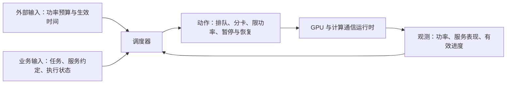

# 领域入门 01｜供电约束如何变成 GPU 调度问题

日期：2026-11-05，Asia/Shanghai。范围：研究对象、基础概念、已有证据与可探索问题。阶段：`analyze-paper → deep-read Mode C（partial）`。这是第一步领域理解，不是选题决定或实验方案。

## 1. 先明确我们研究什么

可以把研究对象称为“供电约束下的 AI 计算调度”：电力侧或数据中心运营方给出某一时间段允许使用的功率，计算侧决定如何安排 GPU 工作，在约束内尽量兑现业务承诺。

其中，任务需要的计算量不会因为电少了就消失。调度器只能在不同代价之间选择：让谁晚一点开始、让谁慢一点、把 GPU 分给谁，以及何时切换或恢复。

举一个**教学假设**：你们的六张卡原本共享 100 单位的 GPU 功率预算，接下来一段时间降到 70。这里的 100/70 是相对值，不是服务器测量。此时同时有交互推理和晚些时候交付的后台作业。可选动作包括：全部降速、保护交互任务并推迟后台任务、暂停部分后台作业，或重新分配卡数。问题是每个动作丢掉多少服务、何时生效，以及电恢复后要付出多少代价。

## 2. “发电量”和“可用算力”之间还隔着哪些条件

| 输入 | 它约束或改变什么 | 对计算侧的含义 |
|---|---|---|
| 功率上限 | 指定计量边界和时间尺度内最多能用多少 W/kW | 需要约束用电；不能只比较平均速度 |
| 需求响应事件 | 相对约定基线，何时降低多少功率、持续多久、如何回升 | 需要在事件前、期间与恢复后安排任务 |
| 分时电价 | 某时段每 kWh 的费用 | 可能值得推迟任务，但电价高不等于不能运行 |
| 碳强度 | 单位用电对应的排放 | 目标可能是降低排放，不能把它当功率上限 |
| 风光等发电出力 | 某时段的发电功率或一段时间的发电能量 | 还需明确并网、购电、储能等规则如何转成计算侧预算 |

因此，本轮先把外部输入写成 `B(t)`：时间 t 的可用功率预算。这样可以先分析计算问题，再逐步补清预算的行业来源。不能默认所有数据中心直接“风大就多算、没风就停”。

若研究 GPU 边界，理想约束可以写成 `Σ P_GPU,i(t) ≤ B_GPU(t)`。真正执行时还必须说明采样、平均窗口与允许越限。若输入是整机或机房预算，还要计入 CPU、内存、网络及其他负载；板卡读数不能替代设施电表。

**功率和能量也要分开。** 教学计算：300 W 运行 1 小时用 300 Wh；200 W 运行 2 小时用 400 Wh。如果两种方式完成同样工作，后一种降低了功率，却增加了能量。研究“应对供电上限”和研究“完成任务更省电”可以相互关联，但评价目标不同。

## 3. 任务的可调空间来自哪里

“训练/推理”描述工作类型，“紧急/可延迟”描述业务约定，不能直接画等号。在线推理可能要求快速回复；离线批量推理可能只要求今晚完成。训练也可能有严格交付时间。

完整服务约定至少包括：**指标、阈值、考核窗口**。

| 业务 | 可以关注什么 | 只看总吞吐会漏掉什么 |
|---|---|---|
| 交互生成 | 首个输出等待、连续输出间隔、达标请求数 | 用户等待很久，但最后仍输出很多 token |
| 离线批处理 | 截止时间、完成时间、排队时间 | 总完成量不错，部分作业已经超期 |
| 模型训练 | 同等质量下的时间与能量、截止期 | steps/s 增加，但到达目标质量更慢 |

Phoenix 现场试验给出了具体例子：256 张 A100 在指定峰值事件中实现了三小时的 25% GPU 功率降载；作业事先分为不同 Flex 档位，部分档位允许平均吞吐下降。因此，“满足服务约定”允许包含事先接受的降速。该试验的 GPU 计量与选定作业组合，不能直接代表整座机房和任意生产业务。[S02：原文 §§2、4](https://arxiv.org/html/2507.00909v1)

## 4. 调度器究竟能调什么

可以沿四个问题理解动作空间：

1. **什么时候运行？** 调整开始时间、排队和准入。代价可能是延期或拒绝。
2. **谁得到多少资源？** 调整卡数、功率份额或并发。多分资源能否更快，要看实际扩展性和相互干扰。
3. **在哪里运行？** 选择同机、跨机或迁移。代价涉及通信、模型/状态搬运和拓扑。
4. **以什么状态、速度运行？** 调整支持的功率/频率档位；驻留暂停；保存后释放资源。它们的恢复路径不同。

这里最需要先拆开的三个动作是：**减速继续运行、暂停但保留状态、保存状态后释放 GPU**。保留状态可能占显存；释放资源可能需要重新装载。谁更划算取决于可用窗口、资源争用与实际开销，目前不能替你们的机器填答案。

NVIDIA 提供功率与频率管理接口，但支持范围、可设区间和权限依设备与环境而变；官方文档中的设置功率上限要求 root。你们的 RTX 3090 能采用哪些动作，要在服务器上实际核验。[NVIDIA nvidia-smi 文档](https://docs.nvidia.com/deploy/nvidia-smi/)

## 5. 已有研究告诉了我们什么

本轮正式分析了三个种子来源，各自回答不同层面的问题。

| 来源 | 主要研究对象与证据 | 能用来理解什么 | 不能据此推出什么 |
|---|---|---|---|
| Acun 等，e-Energy 2026 | P100 任务测量支撑的千节点仿真 | 功率调节、任务队列和批处理服务指标如何共同建模 | 仿真收益等于六张 3090 的实测收益 |
| Phoenix 现场试验 | 商业云中 256 张 A100 的需求响应演示 | 真实事件要求与业务可降速合同如何落到软件动作 | 所有客户都愿意降速，或 checkpoint 开销始终可忽略 |
| PowerSlider，2026 预印本 | 硬件测量校准，主要集群结果来自仿真 | 推理阶段差异、服务分类、动态功率预算与切换已有研究 | “分紧急度 + 动态功率 + 恢复”这个组合本身是新颖性 |

原文：[Acun 等](https://www.bu.edu/peaclab/files/2026/03/FlexDC_Sim_ACM_E_Energy26.pdf)、[Phoenix](https://arxiv.org/html/2507.00909v1)、[PowerSlider](https://arxiv.org/html/2608.21719v1)。PowerSlider 部分服务定义和动态结果口径仍需澄清，本轮不使用这些存疑数字。

邻近领域也已有成熟入口：Zeus 研究训练配置下能量与完成时间的权衡；CASSINI 研究不同作业的通信阶段如何错开。这里只核对其官方摘要作为版图定位，尚未为它们补齐正式来源分析包。[Zeus，NSDI 2023](https://www.usenix.org/conference/nsdi23/presentation/you) · [CASSINI，NSDI 2024](https://www.usenix.org/conference/nsdi24/presentation/rajasekaran)

## 6. 我们可以在哪些层面探索

以下是**待研究问题**，不等于已确认的文献空白。小规模实机适合检验局部机制；大集群效果还需要独立的可验证扩展依据。

| 层面 | 可以追问的问题 | 六张卡可以观察什么 | 当前主要前提与边界 |
|---|---|---|---|
| GPU 性能与共享 | 不同任务/阶段在受限功率下损失多少？默认功率下的干扰估计是否仍可靠？ | 单任务曲线、少量任务共置后的延迟与有效进度 | 控制权限、测量条件；阶段感知和共享调度已有工作，单纯换成 3090 不够 |
| 混合业务与状态调度 | 预算短暂下降时，后台慢跑、驻留暂停、释放重载的选择如何变化？ | 状态占用、响应与恢复过程、在线达标及后台积压 | 真实事件时间尺度未知；“恢复开销重要”仍是假设，最近邻需继续对读 |
| 分布式计算与通信 | 一侧降速如何改变同步等待？计算变慢后，通信瓶颈和放置决策会不会变化？ | 同机两卡与跨机各一卡的计算/通信时间线 | 需核验网卡、PCIe/P2P、有效带宽、同步训练可用性；两节点不能代表大型网络 |
| 信息与预测的决策价值 | 提前知道下一次预算变化究竟能改善什么？预测错起止时刻是否比错幅度更严重？ | 在同一任务/预算回放下，比较当前观测、可用预告与全知参照的差异 | 必须区分发布时刻与事后实值；合成信号不能证明真实电力预测有效 |

从资源适配看，可以先学习前两层，再根据网络条件进入第三层。第四层先问“未来信息有没有价值”，有价值后再考虑需要何种预测方法。不能因能训练一个预测模型，就认定它能改善调度。

跨领域迁移也保留在后续链路中：先定位目标系统的失败现象和机制，再寻找外领域方法、核验其成立条件与已有迁移案例。本轮尚未选择源方法 B，因此迁移分支不适用。

## 7. 下一步只深入一个问题

建议下一步沿着**“任务到底能让出什么资源？”**继续：把服务约定、运行状态、可执行动作与恢复代价逐项对应，比较训练、离线推理和交互推理。这能帮助我们判断“紧急/不紧急”到底如何进入调度问题，再补读相关最近邻。

当前还没有本机失败现象、正式 Idea 或实验结果。下一次实测前，需要先形成有版本的诊断假设与最小方案。本轮矩阵中的恢复方向仅是补证据入口，候选题仍全部未定。

## 8. 证据与推进记录

- [AN-20261105-001-v01：Acun 来源分析](../../papers/acun_2026_dr/analysis_v01.md)
- [AN-20261105-002-v01：Phoenix 来源分析](../../papers/colangelo_2025_grid_interactive/analysis_v01.md)
- [AN-20261105-003-v01：PowerSlider 来源分析](../../papers/li_2026_powerslider/analysis_v01.md)
- [MC-20261105-001-v01：第一轮 P/F/M/E 交叉矩阵](../../matrices/power_constrained_gpu_scheduling/mode_c_v01.md)
- [推进台账 PR-20261105-004](../../../topics/progress.md)

三个来源包与矩阵均为 `partial`：已有可定位的文献证据；独立复现、本机适用性、完整最近邻对比与选题新颖性尚未建立。本轮不进入正式 Idea、迁移或执行阶段。
